# DeepInfer 架构与源码导读：从模型加载到并行调度

> 面向读者：刚开始学习大模型推理框架的开发者。  
> 分析日期：2026-10-22（北京时间）。  
> 主仓库版本：[`9bd9cf243fc53ef9afbf8f04d391d989117d6ab9`](https://github.com/deepseek-ai/DeepInfer/tree/9bd9cf243fc53ef9afbf8f04d391d989117d6ab9)，提交日期 2026-10-21。  
> 方法：阅读本仓库关键执行路径，拉取六个固定版本子模块及其递归依赖，再检查相关算子、编译、协议和存储仓库。本文是源码分析，未在支持的 GPU/NPU 集群上实际运行模型或测量性能。

## 阅读导航

1. [先明确：这个项目提供了什么](#1-先明确这个项目提供了什么)
2. [理解推理所需的基本概念](#2-理解推理所需的基本概念)
3. [整体架构与模块组织](#3-整体架构与模块组织)
4. [模型如何加载](#4-模型如何加载)
5. [一次请求如何执行](#5-一次请求如何执行)
6. [模型内部如何计算](#6-模型内部如何计算)
7. [缓存如何分配、共享、回收](#7-缓存如何分配共享回收)
8. [多卡如何分工与通信](#8-多卡如何分工与通信)
9. [调度与加速机制](#9-调度与加速机制)
10. [NVIDIA 与昇腾如何适配](#10-nvidia-与昇腾如何适配)
11. [外部仓库分别负责什么](#11-外部仓库分别负责什么)
12. [生产集群如何组织和管理](#12-生产集群如何组织和管理)
13. [调度原理：所有并行执行如何协作](#13-调度原理所有并行执行如何协作)
14. [源码阅读路线与常见误解](#14-源码阅读路线与常见误解)
15. [证据索引与分析边界](#15-证据索引与分析边界)
16. [名词解释：从基础概念到并行调度](#16-名词解释从基础概念到并行调度)

第一次阅读建议按 **1 → 2 → 3 → 4 → 5 → 7 → 8 → 13**。第 6、9、10、11 章适合第二遍深入；遇到生词可查第 16 章，词条中的依赖概念可点击继续查看。

## 1. 先明确：这个项目提供了什么

### 1.1 一句话定位

**DeepInfer 是围绕 DeepSeek 模型设计的高性能分布式推理引擎。本次开源可以运行离线批量推理，也保留了连接线上系统的接口。**

它把四件事连接起来：

1. 把输入文本、图片变成模型能处理的数据。
2. 决定当前一轮处理哪些请求、多少 token。
3. 调用多张加速卡完成模型计算。
4. 保存中间状态，采样输出 token，再进入下一轮。

“能在多张卡上推理”和“已经具备完整线上服务”是两个不同层次。README 明确列出尚未随本次发布提供的部分：完整 KV 缓存系统、视觉编码/预填充/解码的服务级分离，以及 Prefill、Decode 数据并行副本之间的请求负载均衡。[S01]

### 1.2 当前版本的支持范围

| 项目 | 本文分析版本的事实 | 对学习者的含义 |
| --- | --- | --- |
| 官方列出的模型 | DeepSeek-V4.1-Flash | 不能默认把任意 Hugging Face 模型放进来 |
| 默认检查点 | `deepseek-ai/DeepSeek-V4.1-Flash-1017` | 示例会解析这个模型 ID 或本地目录 |
| 模型注册项 | `DeepseekV41ForCausalLM` | 实际映射到 `DeepseekVLForCausalLM`，同时处理纯文本与图文 |
| 硬件 | NVIDIA SM100 GPU、Huawei Ascend 950 NPU | 通用 PyTorch 能运行的卡，未必能运行这套专用算子 |
| 操作系统 | Linux | 当前 Windows 工作区可用于阅读源码，官方构建链以 Linux 为前提 |
| 对外入口 | Python `LLM.generate()` 离线接口 | 本仓库没有现成的 OpenAI 兼容 HTTP 推理服务 |
| 并行能力 | Attention DP、balanced CP、MoE EP、EPLB，以及 Engram 分片 | 多种分工叠加在同一组设备上 |

模型注册表只有上述一个架构名；配置加载还会检查 `model_type=deepseek_v41`、视觉配置和指定量化格式。不能仅凭类名里有 `CausalLM` 就推断它是通用模型执行器。[S01][S03][S18][S15]

### 1.3 全文如何区分证据

- **【代码实现】**：能在本次分析版本的源码中找到具体实现。
- **【官方生产说明】**：来自仓库内的部署 Q&A，描述 DeepSeek 的生产系统；相应服务未必开源。
- **【设计推导】**：根据数据依赖与资源约束解释原理；不等同于已经测得的性能。

尤其注意：生产 Q&A 中的规模、吞吐、存储容量、容错和伸缩策略，不能当作本地离线脚本已经具备的功能，也不能直接当作你的部署指标。[S39]

## 2. 理解推理所需的基本概念

### 2.1 先把推理看成“准备材料，再逐步续写”

假设用户输入：“北京是中国的”。

1. **Tokenizer** 把字符串转成 token ID。token 可以是一段字、词或其他符号，不一定是一个汉字。
2. **Prefill，预填充**：处理输入的全部新 token，建立后续生成需要的历史状态，并产生第一个输出 token。
3. **Decode，解码**：利用历史状态继续预测下一批 token。
4. 遇到结束符、停止条件或长度上限，结束请求。

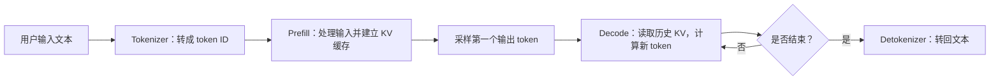

这是概念流程。开启投机解码后，一轮可能确认多个 token，而不是只输出一个。

### 2.2 最常见的术语

| 术语 | 简单解释 |
| --- | --- |
| 权重 / Checkpoint | 训练得到的模型参数；推理时主要读取，不进行训练更新 |
| Activation / Hidden states | 当前输入计算得到的中间向量，随着请求和步骤变化 |
| Q、K、V | 注意力计算中的查询、键和值；用 Q 找到应关注的历史信息 |
| KV cache | 保存历史 token 的注意力中间表示，避免每步重新计算过去全部内容 |
| HBM | GPU/NPU 的高带宽设备内存，下文也称显存 |
| Batch | 某一轮一起处理的请求或 token 集合 |
| Kernel / 算子 | 真正在设备上执行的一小段计算程序，例如矩阵乘、TopK、缓存写入 |
| Rank | 参与分布式执行的进程编号，通常一个 Worker 对应一张卡 |
| MoE | 多个专家网络中，每个 token 只选择其中一部分进行计算 |
| Logits | 模型为每个候选输出 token 给出的原始分数 |
| Sampling / 采样 | 根据分数与生成参数决定输出哪个 token |
| TTFT | 从请求到达至第一个输出 token 的时间 |
| TBT / TPOT | 相邻输出 token 的时间间隔；具体统计时还需注明口径 |

### 2.3 权重、KV 缓存、编译缓存是三种东西

可以把它们记成：

- **权重**：模型学会的知识，多个请求共同使用。
- **KV 缓存**：模型处理某段上下文得到的工作记录，和请求内容有关。
- **JIT 编译缓存**：把算子编译成设备程序后的结果，和硬件、源码、编译选项等有关。

删除 Hugging Face 下载缓存会影响模型文件；删除 JIT 缓存会造成算子重新编译；释放 KV 缓存会让上下文需要重新计算。三者不能混为一谈。

## 3. 整体架构与模块组织

### 3.1 代码可以按五层阅读

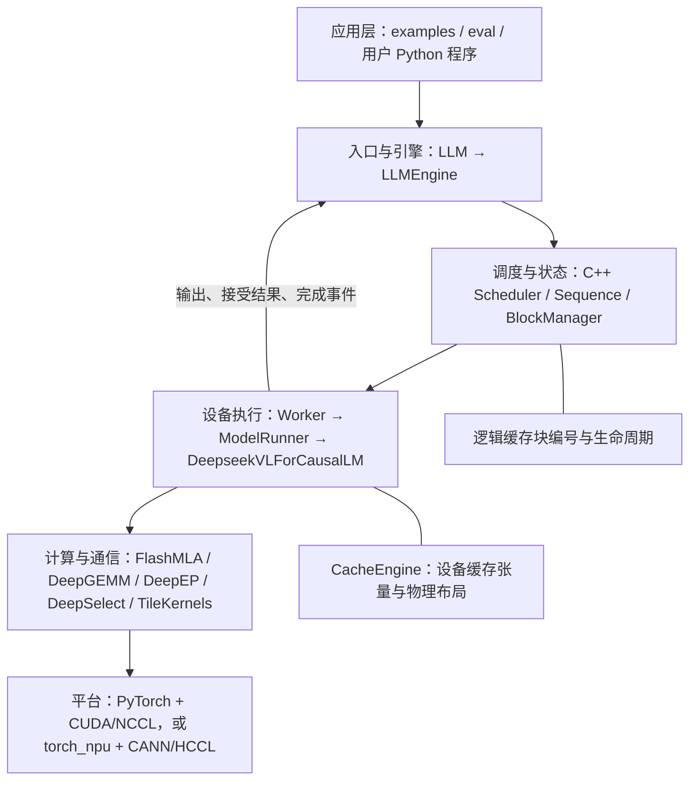

最关键的分工是：

> **Scheduler 决定“算谁、算多少”；ModelRunner 决定“如何准备和发射计算”；模型与算子决定“数学上怎么算”；CacheEngine 决定“数据在设备内存里怎么摆”。**

这些部分分开后，同一调度决策可以驱动不同硬件实现，缓存分配也不必混入每个矩阵乘法算子。[S06][S07][S09][S12][S13]

### 3.2 目录地图

```text
DeepInfer/
├── examples/                 离线运行、性能测试、启动辅助代码
├── eval/                     AIME、HLE、GPQA 的生成与评分
├── deepinfer/
│   ├── entrypoints/          LLM 离线 API
│   ├── engine/               引擎生命周期、每轮调度协调、统计
│   ├── worker/               每卡执行器、缓存张量、图捕获与重放
│   ├── hugging_face/         配置、参数名称、分片权重加载
│   ├── model_executor/
│   │   ├── models/           DeepSeek 文本/视觉模型及各层
│   │   │   ├── v4_modules/   注意力、MoE、Engram、mHC、跨层共享
│   │   │   ├── mtp/          DFlash 草稿模型、置信度预测
│   │   │   └── vision_encoder/ ViT 与视觉投影
│   │   ├── input_metadata/   模型输入及分页、CP、YoCo 元数据
│   │   ├── layers/           采样、线性层、注意力接口等
│   │   │   └── tilelang_ops/ 公共接口 + cuda/asc 设备实现
│   │   ├── parallel_utils/   分布式进程组、通信、共享缓冲区
│   │   └── eplb/             专家副本、放置策略、权重重排
│   ├── ve/                   图文预处理、异步工作进程、共享内存
│   ├── structure_output/     语法编译、匹配器、token 掩码
│   ├── distributed/          共享内存广播
│   └── npu_ops/              昇腾侧补充适配
├── csrc/
│   ├── engine/               C++ 序列、调度器、块分配、输入元数据
│   ├── graph_timer/          图执行计时
│   └── pybind.cpp            Python 与 C++ 的连接
├── deep_cluster/             设备发现、CPU/NUMA 拓扑与绑定
├── vendor/                   六个版本固定的算子与通信子模块
├── scripts/                  编译外部库、编译本地扩展
├── tests/                    模型、采样、缓存、通信、内核回归
└── doc/                      官方部署 Q&A、图表与本文
```

`deep_cluster` 这个名字容易让人误解：**当前目录主要做硬件发现和拓扑绑定，不是 Kubernetes、资源调度平台或完整的集群控制器。**

### 3.3 主要对象及其职责

| 对象 | 核心职责 | 不应该归给它的职责 |
| --- | --- | --- |
| `LLM` | 批量收取输入、调用引擎、整理并返回结果 | HTTP 路由、跨实例负载均衡 |
| `LLMEngine` | 初始化模型与缓存；协调调度、Worker、采样结果和资源释放 | 代替算子做矩阵乘 |
| `Scheduler` | 维护等待/运行队列，选择本轮请求和 token 数，处理抢占 | 保存整个分布式缓存目录 |
| `Sequence` | 保存单个请求的输入、生成状态、KV 块表、MTP 状态等 | 模型参数容器 |
| `BlockManager` | 分配物理块编号、引用计数、固定状态槽管理 | 实际计算注意力 |
| `WorkerBase` | 设备/通信初始化、权重加载、缓存初始化和进程生命周期 | 业务请求鉴权 |
| `Worker` | 执行当前轮 forward、采样和前一轮后处理 | 集群自动扩缩容 |
| `ModelRunner` | 准备输入张量、执行模型、图重放、准备采样输入 | 改变模型训练定义 |
| `CacheEngine` | 分配 KV/state 大张量，切出各层视图 | 实现完整远端缓存服务 |
| `DeepseekVLForCausalLM` | 视觉嵌入 + 文本主干 + 输出/草稿路径 | 启动整个多机作业 |

Python 通过 `deepinfer._C.engine` 使用 C++ 类型，关键 CPU 热路径不只是普通 Python 循环。这也是源码中有大量 `.hpp`、`.cpp` 和 `.pyi` 的原因。[S05][S06][S07][S08][S09][S10][S11][S12][S13]

## 4. 模型如何加载

### 4.1 先区分“下载模型”和“加载参数”

`examples/_config.py::resolve_model_path()` 负责解析示例里的 `model_name`：

- 如果是本地目录，要求存在 `config.json`。
- 如果不是本地目录，调用 `huggingface_hub.snapshot_download()` 下载到 HF 缓存。
- `DEEPINFER_HF_MODEL_DIR` 可以把**默认模型 ID**指向本地副本；不会覆盖显式传入的其他模型名。

**底层运行时配置加载器要求的是本地 HF 目录。示例能够接收远端模型 ID，是示例辅助层先下载再传入路径。**因此，直接使用 `LLM(model=...)` 时，最稳妥的做法是传已准备好的本地目录。[S03][S14][S15]

### 4.2 启动和加载顺序

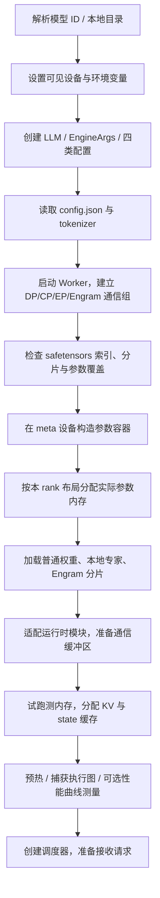

这里“设置可见设备”必须足够早。CUDA 或 ACL 初始化后再修改可见设备，可能已经来不及；因此示例把重型 import 放在设备配置之后，包本身也采用延迟平台初始化。[S03][S06][S10][S19][S27]

### 4.3 四类配置各管什么

| 配置 | 管理内容 |
| --- | --- |
| `ModelConfig` | 模型路径、tokenizer、最大长度、运行数据类型等 |
| `CacheConfig` | block 大小、显存比例、lookahead；初始化后补上实际缓存容量 |
| `ParallelConfig` | DP、CP、EP、Engram 并行大小及 rank |
| `SchedulerConfig` | 一轮 token 上限、并发序列数、分块 Prefill、抢占策略 |

配置从 `EngineArgs` 产生。该版本分页逻辑 block 对应 **128 个压缩前 token**；不是任意设置一个分页尺寸都可使用。未显式设置时，`ModelConfig.max_model_len` 是 4096，离线示例显式改为 32768；它不会自动启用检查点支持的全部上下文长度。[S36][S40]

### 4.4 为什么先在 meta 设备构造模型

`meta` 是“只记录形状和类型，暂不存真正数据”的设备。

例如要构造一个巨大的矩阵，先知道它需要多大、是什么类型、属于哪个专家，再决定本进程实际分配多少。这样可以：

1. 先规划结构与参数映射。
2. 按 rank 只创建本地专家等所需存储。
3. 让共享参数一开始就共用内存，避免重复分配大词表矩阵。
4. 对需要的参数分配实际存储，再填入检查点数据。

这里不能简化成“每卡先加载完整模型，再删掉多余参数”。实际加载路径专门处理本地专家和 Engram 的分片范围。[S14][S17][S19]

### 4.5 三种不同的权重加载路径

#### A. 普通参数

从 `model.safetensors.index.json` 找到参数所在分片，按模型名称映射读取并复制。部分门控与上投影权重需要拼接；FP8 参数还要加载缩放因子，并转换成后端需要的布局。

#### B. MoE 专家参数

先根据当前 EP rank 和“物理专家槽 → 逻辑专家”映射，确定本卡负责哪些专家。

- 只读取这些专家对应的数据。
- 一个热点专家有多个物理副本时，可以读取同一份逻辑专家权重填入不同槽位。
- FP4 参数保持打包形式，缩放因子按运行时布局恢复，不在加载时随意重新量化。

#### C. Engram 大表

按本 rank 的 `row_start` 与本地行数，分块读取巨大 n-gram 表；读取暂存按约 256 MiB 权重字节量划分，避免一次读入全局大表。后续转入 `EngramBuffer` 提供的存储和跨 rank 查询路径。

NVIDIA 路径允许 CPU 存储方案；昇腾当前通过配置强制使用设备存储。不能据此推断整个主模型都支持通用 CPU offload。[S17][S19][S25][S35]

### 4.6 加载时会做哪些检查

源码包含分片存在性、索引引用的张量可读性、参数覆盖、普通参数形状和类型、绑定参数兼容性检查；专家与 Engram 路径还有各自的布局检查。HC 折叠权重和 attention sink 等参数有明确精度要求。

加载还设置了超时保护。`load_format="dummy"` 是性能调试用的合成权重路径，不能用于验证模型回答质量。[S14][S16][S17][S19]

## 5. 一次请求如何执行

### 5.1 用户侧调用链

```text
LLM.generate(prompts, sampling_params)
  → LLM._add_request()
  → tokenizer.encode()，或直接使用 prompt_token_ids
  → LLMEngine.add_request()
  → 创建 Sequence 并进入调度器
  → 循环 LLMEngine.step()
  → Worker.execute_model_step()
  → ModelRunner.execute_main_model() / execute_sample()
  → 更新 Sequence，返回 token 输出
  → flush_inflight_reqs() 收完异步在途结果
  → tokenizer.decode()，按原请求顺序返回
```

`decode_sequence=True` 时返回字符串；示例设为 `False`，拿到逐 token 的 `RequestOutput`，再统计 logprob、PPL 和投机接受率。看示例时不要把这两种返回形式混用。[S02][S03][S05]

### 5.2 请求对象会保存什么

一个 `Sequence` 至少涉及：

| 状态类别 | 例子 |
| --- | --- |
| 请求身份 | request ID、用户 ID、分支 ID |
| 输入 | token ID、图片相关信息 |
| 生成参数 | temperature、top-p、最大输出长度、请求随机种子等 |
| 生成结果 | 已输出 token、是否结束、结束原因 |
| 缓存 | 物理 block table、已计算 token 数、state ID |
| 投机状态 | 草稿 token、接受情况、在途步骤计数 |
| 调度状态 | 等待、运行、是否可调度、剩余 Prefill 分块 |
| 结构化输出 | 语法匹配器和匹配进度 |

这些状态必须一起更新。例如只回退 token 数，不回退压缩状态、草稿状态或语法状态，就可能出现错误。[S08]

### 5.3 Prefill：处理输入的新增部分

【代码实现】调度器从等待队列选请求，检查：

1. 请求是否已中止或预处理失败。
2. 输入长度是否合规。
3. KV block 与 state slot 是否足够。
4. 一轮 token 总预算、序列数和上下文跨度预算是否允许。
5. 是否需要分块，以及分块边界能否避开图片内部。

允许分块时，长输入可以分多轮处理。前面的块积累 KV，最后一个块才产生该请求的正常首个输出 token。`chunked_prefill` 限制的是每轮工作量，不能理解为截掉长输入。[S07]

### 5.4 Decode：反复延长序列

解码时，模型读取过去的 KV，并处理新输入 token。开启投机解码后，新输入还包含待验证草稿，一轮的查询长度会大于 1。

大致流程：

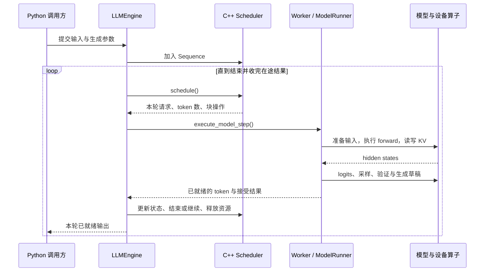

这张图表达数据依赖；实际 ZOS 路径中 CPU 和设备执行会重叠，返回的可能是前一轮已经完成的输出。[S06][S11][S12]

### 5.5 图文输入会多出哪条路径

```text
图片字节 / 图片信息
  → CPU 多进程预处理：读取、缩放、组织图片段
  → 共享内存中的图像数据与元信息
  → GPU/NPU 上补 patch、归一化
  → ViT 视觉编码器
  → 下采样和语言空间投影
  → 把图像 embedding 写入相应输入位置
  → 进入同一套语言模型主干
```

离线版本可把 ViT 和语言模型放在同一个引擎里。生产系统可以把视觉编码服务独立部署；这部分服务级路由不等于当前图文模型类已经替你部署好了。[S20][S41][S39]

### 5.6 输出对象为什么需要复制

引擎底层使用对象池，`step()` 返回的数据中包含由池管理的对象地址，下一轮会回收。离线封装会 `RequestOutput.clone()` 后保存。

如果自己在引擎上开发流式封装，应遵守输出对象和元数据的生命周期，不能把某轮借来的对象一直留着。`DeferredRelease` 也会用事件确认拷贝结束后再减少缓存引用，避免设备仍在使用数据时被提前回收。[S05][S06]

## 6. 模型内部如何计算

### 6.1 先看实际模型配置

官方默认检查点的关键字段如下。字段取自 2026-10-22 读取的[官方 `config.json`][M01]，仅用于解释本次检查点，不能套用到所有 DeepSeek 模型。

| 字段 | 值 | 怎么理解 |
| --- | ---: | --- |
| 语言主干层数 | 40 | 输入依次经过 40 层主干计算 |
| 隐藏向量宽度 | 5120 | 每个位置的主干表示宽度 |
| 注意力头数 | 64 | 多组查询关注历史信息 |
| 共享 KV 头数 | 1 | 不是每个查询头都保存一份独立大 KV |
| KV 向量宽度 | 512 | 包含 64 维 RoPE 部分 |
| 路由专家数 / 每 token 选择数 | 384 / 6 | 每层每个 token 只激活部分路由专家 |
| 共享专家数 | 1 | 另有共享计算路径 |
| 滑动窗口 | 128 | 局部注意力关注最近一段 |
| 稀疏选择数 `index_topk` | 512 | 根据索引分数选择历史位置 |
| MTP 草稿模块层数 | 3 | 与每轮最多生成 5 个草稿 token 是两回事 |
| 检查点最大位置数 | 1,048,576 | 不代表当前运行已分配足够缓存 |

### 6.2 主干层的简化计算图

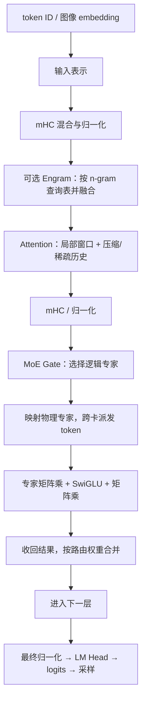

这是帮助理解的简图。实际代码会融合操作、保留 residual，并通过惰性 mHC 后处理减少中间读写。[S19][S21][S24]

### 6.3 注意力：先筛选，再精算

如果每生成一个 token，都把完整历史逐项做昂贵注意力计算，长上下文会很慢。当前实现把几个机制结合起来：

1. **SWA（滑动窗口注意力）**：保存并读取最近一小段历史。
2. **压缩历史表示**：部分层按压缩率组织历史 KV；当前元数据检查允许的配置值是 0、1、2，不能照搬旧版本的 C4/C128 描述。
3. **Indexer**：先计算历史位置的相关性分数。
4. **TopK**：选出值得进一步关注的历史位置。
5. **Sparse Attention**：只在选择出的历史位置等有效范围内计算注意力。

一个直观分工：

```text
当前查询
  → DeepGEMM：计算 indexer 相关性分数
  → DeepSelect：找 TopK 位置
  → 转换为物理 KV 缓存位置
  → FlashMLA：读取选中 KV，计算注意力结果
```

因此，“用了 FlashMLA”并不意味着所有注意力工作都在同一个库里。分数计算、筛选、缓存寻址和注意力各有实现。候选块筛选、跨层复用还会进一步减少重复工作。[S22][S23][S28][S40]

### 6.4 跨层共享与 YoCo

在普通模型里，各层往往各自构造和保存 KV。这里会根据配置建立共享关系：

- 某些层共用 KV 源层。
- 某些层共用 indexer K 或索引结果。
- consumer 层可以从共享 hidden 等中间结果构造所需信息。

`SharedLayerTopology` 描述“谁向谁取数据”，`CrossLayerRuntime` 保存当前 forward 的共享中间结果；缓存分配器也遵守同样的映射，避免为共享部分重复分配内存。[S19][S21][S42][S13]

还要区分两个“编码/解码”概念：

- **模型内部的 encoder/consumer 划分**：层与层之间如何共享计算、KV 和 hidden。
- **服务层的 Prefill/Decode 分离**：输入阶段与生成阶段部署在不同机器。

两者有关联，但不是同一个维度。

### 6.5 MoE：不是每张卡都算完整 FFN

把专家看作不同的子网络。对一个 token：

1. Gate 根据输入选择若干**逻辑专家**及其路由权重。
2. EPLB 把逻辑专家映射到当前的**物理副本**。
3. 需要跨卡时，把 token 向量送到持有该副本的设备。
4. 专家执行两次主要矩阵乘及中间激活。
5. 把结果送回原来的 token 所在位置，按权重合并，并结合共享专家路径。

`mlp.py` 同时有普通 `DeepEP dispatch → grouped GEMM → combine` 路径和 **Mega MoE** 路径。在合适的通信域和数据类型下，Mega MoE 把通信、专家计算与合并融合、重叠执行。不能把普通分步路径当成所有部署都会经过的唯一实际路径。[S24]

用简化公式理解一个专家的工作：

```text
专家输出 = W_down × [SiLU(W_gate × x) ⊙ (W_up × x)]
MoE 输出 ≈ 共享专家输出 + 各选中专家输出的加权和
```

`x` 是 token 的向量，`W` 是权重矩阵，`⊙` 表示逐元素相乘。代码会将 gate/up 投影合并存储和计算，并处理量化、激活限制和路由缩放；这两行用于理解计算结构，不是逐项复刻全部数值细节。

### 6.6 Engram：查询型记忆，不是 KV cache

Engram 根据最近若干 token 组成的 n-gram 计算哈希，到分片表中取向量，再经过门控与投影融入主干。

```text
最近几个 token
  → 压缩 token 映射 / n-gram 哈希
  → EngramBuffer 跨 rank 取表项
  → 每层等待对应 fetch hook
  → 门控、投影、融入 hidden states
```

这些表是模型权重的一部分，KV cache 是请求计算产生的状态。Engram 的远端表查询与 KV 前缀复用也不是同一种缓存命中。[S25]

### 6.7 mHC：改变层间信息组合方式

mHC（manifold-constrained Hyper-Connections）可以粗略理解为：模型维护多路信息流，通过受约束的混合矩阵组合各路，再送入注意力或 FFN。

这影响模型计算图、参数精度与内存布局，因此有专门的 `hc.py`、`hc_lazy.py`、`mhc_ops.py` 以及 DeepGEMM/TileKernels 算子。它属于模型结构和数值实现，不属于请求调度策略。[S21][S43]

### 6.8 哪些地方最消耗资源

| 阶段 | 典型压力 | 框架的应对方向 |
| --- | --- | --- |
| 长输入 Prefill | 较大的矩阵计算、长上下文注意力、中间张量 | 分块、CP、稀疏筛选、跨层共享、YoCo 截断 |
| Decode | 反复读取权重/KV、小批量发射开销、跨卡通信 | 低精度、Wide-EP、图重放、投机解码、异步调度 |
| 热点专家 | 少数卡算得多，其他卡等待 | 冗余专家副本与 EPLB |
| 图文输入 | CPU 图片预处理、ViT 算力与搬运 | 异步预处理；生产环境独立视觉服务 |
| 启动 | 检查点读取、JIT 编译、图捕获 | 本地模型副本、合理存储、编译缓存与预热 |

这是性能分析方向，不是固定结论。实际瓶颈会随 batch、上下文、草稿接受率、硬件和网络改变，应结合 trace 判断。

## 7. 缓存如何分配、共享、回收

### 7.1 必须区分两层缓存管理

| 层次 | 本仓库包含什么 | 本仓库缺少什么 |
| --- | --- | --- |
| 引擎内运行时 | HBM 大张量、分页块表、state slot、引用计数、fork、克隆和释放 | 不缺基本运行所需的设备 KV 管理 |
| 跨请求、跨实例缓存服务 | 保存/恢复 state 的布局和接入钩子 | 完整键索引、远端匹配、拉取、落盘、GC 与服务编排 |

所以，“README 说未包含 KV cache system”不能解释为“模型没有 KV cache”；它强调的是完整服务层的缺口。[S01][S06][S09][S13]

### 7.2 两个主要内存池

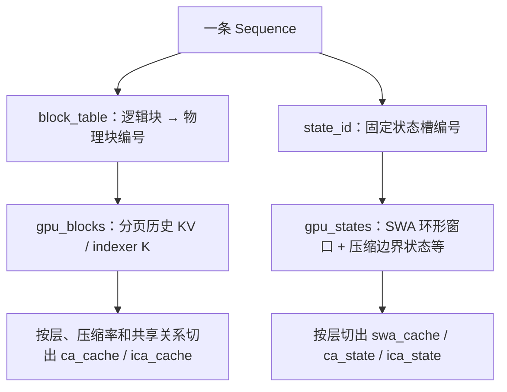

**Block 池随历史增长；state 池主要随并发序列数量增长。**即使还剩许多分页块，也可能因为没有可用 state slot 而暂时不能接入新请求。[S09][S13]

### 7.3 分页块表解决什么问题

假设一块覆盖 128 个原始 token，一条请求已经处理 300 个 token。逻辑上需要 3 块，实际可能分配到：

```text
逻辑块 0：token   0–127 → 物理块 17
逻辑块 1：token 128–255 → 物理块  4
逻辑块 2：token 256–299 → 物理块 92

block_table = [17, 4, 92]
```

设备内存无需为这条请求找到一整段连续空间。实际每个物理块还包含各个**拥有独立缓存的层**对应的区域；压缩率为 2 的区域只保存对应的压缩记录，共享层则复用已有视图。

因此，block 的“128”是逻辑覆盖长度，不能直接当成所有层都各存 128 条相同大小的记录。[S13][S40]

### 7.4 `BlockManager` 与 `CacheEngine` 的区别

`BlockManager` 维护编号和引用计数：

- 分配前返回 `OK`、`LATER` 或 `NEVER`。
- `pin` 增加引用，释放减少引用。
- 引用为 0 才进入空闲链表。
- 0 号块/槽保留为 dummy，不分配给真实请求。

`CacheEngine` 维护实际内存：

- 分配 `gpu_blocks` 与 `gpu_states`。
- 计算每个 block 的总字节量、每条序列的 state 字节量。
- 根据层间共享、压缩率、精度、对齐约束构造各层 tensor view。

可以把前者理解成“房间号和入住登记”，后者理解成“真正的房间及内部布局”。[S09][S13]

### 7.5 KV 与 state 中到底存什么

| 名称 | 主要内容 | 分配方式 |
| --- | --- | --- |
| `ca_cache` | 主注意力使用的历史 KV 表示 | 分页 block |
| `ica_cache` | Indexer 使用的历史 K | 分页 block |
| `swa_cache` | 最近窗口的 KV | 每条请求的固定 state 槽，环形写入 |
| `ca_state` | 压缩主 KV 时需要的边界中间状态 | 固定 state 槽 |
| `ica_state` | 需要时保存 indexer 压缩边界状态 | 固定 state 槽 |

具体模型和层未必同时拥有表里所有字段。**这里的 KV 是模型专用的共享/压缩表示，不能直接套用普通 Transformer“每层 K 张量 + V 张量”的完整尺寸公式。**[S13]

### 7.6 为什么低精度不只是“每个数占几 bit”

当前布局的例子：

- 主 KV 的 FP4 记录：512 个数的打包数据约 256 B，加缩放信息后为 **288 B/记录**。
- SWA 的 MXFP8 记录：512 B 数据 + 16 B 缩放信息，为 **528 B/记录**。
- Indexer 的 FP4 记录：还要加按通道分组的缩放信息。

此外还有块对齐、层共享、压缩率与 state ring 的空间。不能简单用“参数量 × 0.5 字节”或“token 数 × 256 B”推算整个部署显存。[S13]

### 7.7 如何决定能分配多少缓存

启动时先用临时缓存试跑，测量模型执行的设备内存峰值，再估算分页 KV 可用空间：

```text
KV 可用预算 ≈ 总 HBM × gpu_memory_utilization
             − 试跑峰值内存（含非 PyTorch 占用的估算）
             − 固定 state 与状态复制缓冲区预留

候选 block 数 = floor(KV 可用预算 / 每块字节数)
```

需要留意两个源码细节：

1. `WorkerBase.profile_num_available_blocks()` 预留 state 及其复制空间，不能把全部剩余显存都当作分页 KV。
2. 当前代码把各 rank 候选块数 **all-reduce 求和后取平均，再向下对齐为偶数**，不是常见的“取所有 rank 最小值”。这是对部署对称性的一个重要假设；异构显存、其他进程抢占、各卡余量差异较大时需要特别验证。[S10]

之后还有上下文容量检查与图预热。显存比例过高可能在图捕获或真实运行时 OOM；它不是一个“越接近 1 性能一定越好”的开关。[S05][S06]

### 7.8 共享前缀与写前复制

【代码实现】`fork_seq()` 可以从已经计算过的序列分出新分支，复用前缀 KV。

例如：

```text
父请求：公共前缀 ─────────────┐
                            ├── 子请求 A：后缀 A
                            └── 子请求 B：后缀 B

完整的只读前缀块：共享，引用计数增加
最后一个未写满块：分支继续写之前复制
每条请求的可变 state：克隆到自己的槽
```

如果两个分支直接写同一个尾块，后一个分支会覆盖前一个分支的数据。因此调度器安排尾块与状态克隆，待设备复制完成后再解除旧引用。这就是 **copy-on-write，写前复制**。[S07][S09][S06]

**这证明引擎具备显式前缀共享能力；不等于任意两个独立 `generate()` 请求会自动通过全局哈希索引复用前缀。**完整的匹配、路由与远端命中属于服务层。

### 7.9 显存不足时会怎样

- 请求暂时分配不到资源：等待。
- 输入从容量上永远不可能容纳：拒绝或以相应结束状态返回。
- Decode 需要扩展缓存但资源不足：调度器可能抢占其他请求。
- NORMAL 引擎允许重算时：释放相应缓存，重置状态，回到等待队列重新 Prefill。
- `stop_preempted_request=True`：结束被抢占请求。
- 当前结构化输出请求无法按普通重算路径恢复，相关请求被抢占时会结束。
- COMPLETION 引擎没有 Prefill 通道，构造时要求 `stop_preempted_request=True`。[S07]

当前核心路径不能描述为“显存不够就自动把 KV 换到 CPU，之后再换回来”。

### 7.10 SWA 状态为何要多留几个 token

滑动窗口不断覆盖旧位置，但投机解码可能写入后来被拒绝的草稿，需要回退。

因此推理 ring 大小由：

```text
SWA ring 大小 = window_size + DEEPINFER_MAX_BACKTRACKING_TOKENS
```

决定。默认 nextn=5 时，回退配置至少为 6；128 的窗口因此通常至少保留 134 个位置。额外的持久化对齐或 YoCo 预留选项还会让存储视角 ring 更大，不能把 134 当成所有配置下的固定值。[S13][S44]

### 7.11 “stored / dropped”不等于“内存还要不要”

`StateBlock` 将每条请求的状态分成：

```text
[stored：需保存以供后续命中的 SWA]
[dropped：YoCo consumer SWA + 压缩边界中间状态]
```

`dropped` 表示不写入长期前缀存储，**运行时仍可能必须保留**。P→D 交接需要的状态范围与长期存储需要的范围也不同。`GPUCacheInterface` 提供重排、选择保存片段、恢复等布局操作，真正的存储服务由外部系统接入。[S13]

### 7.12 另外几种缓存该如何理解

| 缓存 | 保存什么 | 主要用途 |
| --- | --- | --- |
| Hugging Face 文件缓存 | 配置、tokenizer、检查点分片 | 避免重复下载模型 |
| TileLang / DeepJIT 缓存 | 已编译的设备程序 | 避免相同 kernel 反复编译 |
| Decode 性能曲线缓存 | 某配置下测得的 batch/耗时数据 | 辅助变长验证预算选择 |
| XGrammar 编译缓存 | 编译后的语法 | 避免重复处理相同 schema |

`DEEPINFER_JIT_CACHE_DIR` 设置后，Worker 会将 TileLang、DeepGEMM、DeepEP 缓存分别放到根目录下的不同子目录，DeepGEMM/DeepEP 还可查找预热目录。编译结果的复用需要编译输入和硬件条件匹配；这些目录都不保存用户的 KV 历史。[S03][S12][S34][S35][D12]

## 8. 多卡如何分工与通信

### 8.1 DP、CP、EP 各自切什么

| 方式 | 切分对象 | 通俗理解 |
| --- | --- | --- |
| Attention DP | 不同请求 | 各卡各算自己那批请求的注意力 |
| CP | 一段上下文的 token 工作 | 多卡一起处理同一批长输入，平衡因果注意力计算 |
| MoE EP | 不同专家权重与专家计算 | token 到专家所在卡计算，再送回 |
| Engram 并行 | 大表的行分片 | 哈希查询到持有表项的 rank 取数据 |

DP 的“副本”在这里主要指注意力侧的请求分工；在共享一个 EP 组时，某个 DP rank 不是完全独立运行完整模型的孤岛。

### 8.2 最容易算错的设备数量

默认没有额外扩展 Engram 并行时：

```text
设备进程数 world_size = DP × CP
EP 在这些进程内部再划组，要求能整除 DP × CP

不是 world_size = DP × CP × EP
```

更完整地说，`ParallelConfig` 使用：

```text
engram_parallel_size 默认 = DP × CP
world_size = max(DP × CP, engram_parallel_size)
```

并校验各维度的整除关系。自定义更大 Engram 并行时，还需要能配套启动相应进程；不能只改一个数字。[S36][S26]

### 8.3 用 8 张卡理解 DP8 + EP8

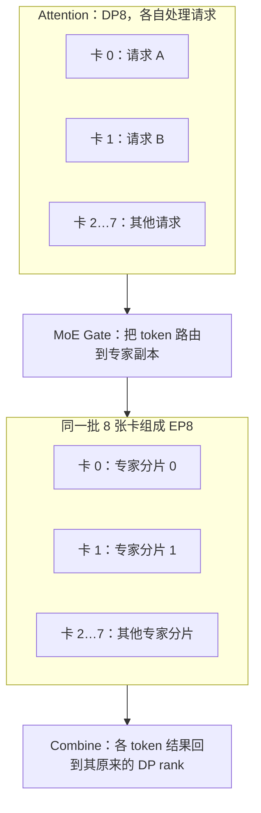

是 8 张卡，不是 64 张卡。注意力阶段各自算请求，MoE 阶段这些请求的 token 在同一 EP 组内交换。

### 8.4 balanced CP 为什么需要特殊排列

因果注意力中，靠后的 token 可以关注更长历史。如果简单把长输入前半段给卡 0、后半段给卡 1，后者的注意力工作往往更重。

实现中使用 mirror/balanced 的输入排列与索引映射，把不同位置组合起来分摊负载，再通过通信和逆映射恢复所需顺序。相关元数据不只是“平均切 token 数”。[S19][S45]

当前代码支持 CP；官方 Q&A 同时说其所述生产布局当时没有使用 CP/TP。两句话描述的范围不同，并不冲突。[S01][S39]

### 8.5 通信组如何建立

`ParallelProcessGroup.create_process_groups()` 建立 world、DP、CP、EP、Engram 及辅助组。

- NVIDIA 设备组用 NCCL。
- 昇腾设备组用 HCCL。
- CPU 协调用 Gloo 组。
- CP 组内的控制信息广播使用 `MessageQueue`，结合共享内存等路径。
- 初始化后先做设备 collective，确保通信器真正建立。

`WorkerBase` 根据 `engine_rank × CP + cp_rank` 得到全局 rank。CP>1 时，一个引擎会启动多个卡级 Worker，首个 Worker 为 driver，其他 Worker 接收广播命令。[S06][S10][S26]

### 8.6 三种通信任务不要混淆

1. **控制通信**：本轮做什么、元数据如何传给其他 Worker。
2. **模型数据通信**：MoE token 派发与合并、CP 聚合、Engram 查询。
3. **专家重排通信**：EPLB 改变放置后搬运权重及缩放因子。

它们的频率、数据量和性能要求不同。看到项目用了 NCCL，并不意味着每类通信都通过同一种 collective 实现。[S24][S26][S29][S31]

## 9. 调度与加速机制

### 9.1 连续批处理：每轮重新决定谁参加

如果把一批请求绑死，短请求结束后空出来的位置就浪费了。DeepInfer 以 step 为单位调度：完成的移出，新请求在条件允许时加入；长输入可以分块，不必一次独占所有计算预算。[S07]

该版本 NORMAL 引擎的一轮总体上选择 **Prefill 或 Decode**。不要把“支持 chunked prefill”误解成“每个 batch 必然混装 Prefill 和 Decode token”。源码有跨 DP rank 的阶段协调投票，保证合作执行的 rank 保持一致。[S07]

### 9.2 Prefill 的 ALL / ANY 投票

默认配置每隔一定 Decode 步数尝试 Prefill：

- **ALL 点**：各 rank 都有合适工作时一起做，减少大量 rank 空陪跑。
- **ANY 点**：只要某个 rank 有工作就允许整体做，避免孤立请求一直饿死。
- ALL 默认间隔 70，ANY 默认间隔 100，可通过环境配置调整。
- 真正排出 Prefill 后还有确认，避免“投票同意但资源不足”的空转。[S07][S44]

这是引擎组内阶段协调，不能代替跨服务实例的请求负载均衡。

### 9.3 ZOS：用重叠减少 CPU 造成的设备空等

普通串行概念流程：

```text
schedule N → forward N → sample N → postprocess N → schedule N+1
```

ZOS 路径的核心是：采样后不立刻等待并处理全部 CPU 结果，而是把本轮状态留到下一轮。下一轮先发射主模型 forward，再处理前一轮已经完成的输出，让 CPU 工作尽可能落在设备计算期间。[S11]

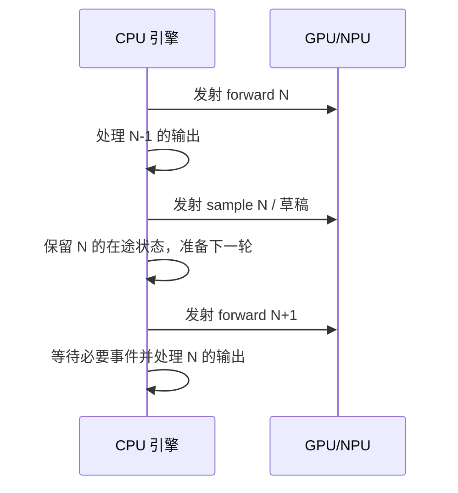

为了提前准备下一轮，设备侧输入 gather、序列长度修正和 remap 会直接使用前轮仍留在设备上的结果；这不是忽略数据依赖“随便提前算”。资源释放同样必须延后。[S11][S12][S46][S06]

“zero overhead”是优化目标：**减少调度落在关键路径上的开销**。CPU 调度依然执行，不代表真的没有开销。Prefill 或关闭 ZOS 的步骤会当场后处理；退出前必须 flush 在途结果。[S05][S11]

### 9.4 执行图：把反复发射算子的成本降下来

Decode 会重复执行形状相近的操作序列。`CudaGraphRunner` 预先捕获若干 batch 档位，运行时选择可容纳当前 token 数的档位，用 dummy 位置补齐，再重放。

- 主要用于 Decode，Prefill 路径走普通执行。
- 形状档位按小尺寸幂次和后续固定间隔建立。
- 主模型和 DFlash 有各自的图执行管理。
- NPU 也有图执行适配；名字里有 CUDA 不足以判定该类只走 GPU。
- 调试时可用 `DEEPINFER_ENFORCE_EAGER=1` 关闭图路径，以牺牲性能换取更直接的执行流程。[S12][S47]

图重放缓存的是**执行计划和缓冲区**，不是某个问题的答案。

### 9.5 DSpark / DFlash / MTP 的关系

在本仓库里：

- **MTP / nextn**：多 token 草稿及验证这套运行时机制和命名。
- **DFlash**：实现草稿生成、主模型特征利用和置信度预测的代码模块。
- **DSpark**：官方对所述投机推理方案的命名，包含置信度驱动的变长验证。

不要理解为三个互不相关的服务。

普通解码一轮大致输出一个 token；投机解码先用较轻的路径预测多个草稿，再用主模型一次验证一段：

```text
草稿：A B C D E
主模型验证：A B C 正常接受，D 被拒绝
本轮输出：A B C + 在拒绝位置按校正规则采样的新 token
未接受的后续草稿作废，相关 KV/state 按有效长度处理
```

实现有接受/拒绝和残差分布重采样，不是简单比较“草稿是否等于主模型贪心结果”。`nextn=5` 代表最多草稿长度，并不保证每轮输出 6 个真实 token。[S32][S33]

### 9.6 置信度调度为什么还要测硬件性能曲线

验证更多草稿能多接受一些 token，也会增加主模型工作量。粗略目标是：

```text
有效吞吐 ≈ 预期接受并输出的 token 数 / 一轮耗时
```

置信度头预测草稿接受概率，调度器结合硬件上测得的 batch/延迟曲线，选择验证预算。开启 `DEEPINFER_ENABLE_MTP_VARLEN=1` 后，不同请求可验证不同长度。

ZOS 下，CPU 决定下一轮预算时可能尚未拿到最新置信度，因此会由设备端算子重新计算各请求的长度分配。这体现了调度与执行配合：CPU 控制总预算，GPU/NPU 使用最新结果落实具体工作。[S07][S12][S33][S39]

### 9.7 SWA bounded replay 与 YoCo 截断

在共享缓存和 consumer 层设计下，没有必要每次都让 consumer 的所有计算覆盖整段超长输入。

README 给出的 Decoder SWA bounded replay 配置是：

```bash
export DEEPINFER_YOCO_PREFILL_TRUNCATION_MODE=compact
export DEEPINFER_YOCO_PREFILL_KEEP_TOKENS=140
```

保留长度必须覆盖滑动窗口与最大回退余量；实际使用还要考虑具体模型拓扑。

三种模式：

| 模式 | 含义 |
| --- | --- |
| `off` | 不启用这项截断 |
| `mask` | 保留完整行布局，使用截断相关掩码，便于对照 |
| `compact` | consumer 路径只保留必要行，真正减少相应部分计算 |

共享 KV 所需的 full-source 路径仍有专门保留处理，不能概括为“超过 140 的输入直接丢弃”。用户输入的远程信息仍由共享历史等机制提供。[S01][S19][S21][S48]

**重要数值边界：**官方生产说明把 bounded replay 描述为近似重建 SWA。`mask/compact` 等价性测试检查的是两种截断实现的一致性，不证明截断与完整上下文精确重算在所有场景完全等价。调度抢占、回放和配置变化也需要数值回归。[S39][S48]

### 9.8 EPLB：让热点专家多一份副本

如果所有 token 都偏爱少数专家，持有这些专家的卡会拖慢整个 EP 组。EPLB 的工作顺序是：

1. 收集各专家在多个 step 的 token 数。
2. 给负载重的逻辑专家分配冗余物理副本。
3. 用贪心策略安排副本所在 rank，降低每步最慢 rank 的负担。
4. 搬运权重和缩放因子。
5. 更新逻辑/物理映射，后续路由按新布局执行。

源码以同构布局分组管理主干和 DFlash 的专家，不能假设二者专家数相同。冗余专家数还会向上取整，保证物理专家总数能被 EP 大小整除。[S14][S19][S29][S30][S31]

**EPLB 平衡的是专家计算负载；Prefill/Decode Load Balancer 平衡的是用户请求。**两者解决的问题不同。

### 9.9 结构化输出与确定性

结构化输出使用 XGrammar 编译 JSON Schema、正则或 EBNF，匹配器每步计算允许输出的 token 掩码，采样时屏蔽不合法 token；投机路径还需支持匹配器回退。它能约束输出结构，不能保证事实内容正确。[S34][S32]

NVIDIA 上需要可重复采样时，README 的组合是：

```bash
export DEEPINFER_BATCH_INVARIANT=1
export DEEPINFER_ENABLE_MTP_VARLEN=0
```

同时给 `SamplingParams` 传固定 `seq_seed`。batch invariant 关注 batch 组成变化下的数值一致；确定性采样还需要控制随机源和相关调度方式。当前 NPU 路径明确拒绝启用 `DEEPINFER_BATCH_INVARIANT`，不能承诺两种硬件逐 bit 相同。[S01][S35]

## 10. NVIDIA 与昇腾如何适配

### 10.1 适配分成四层

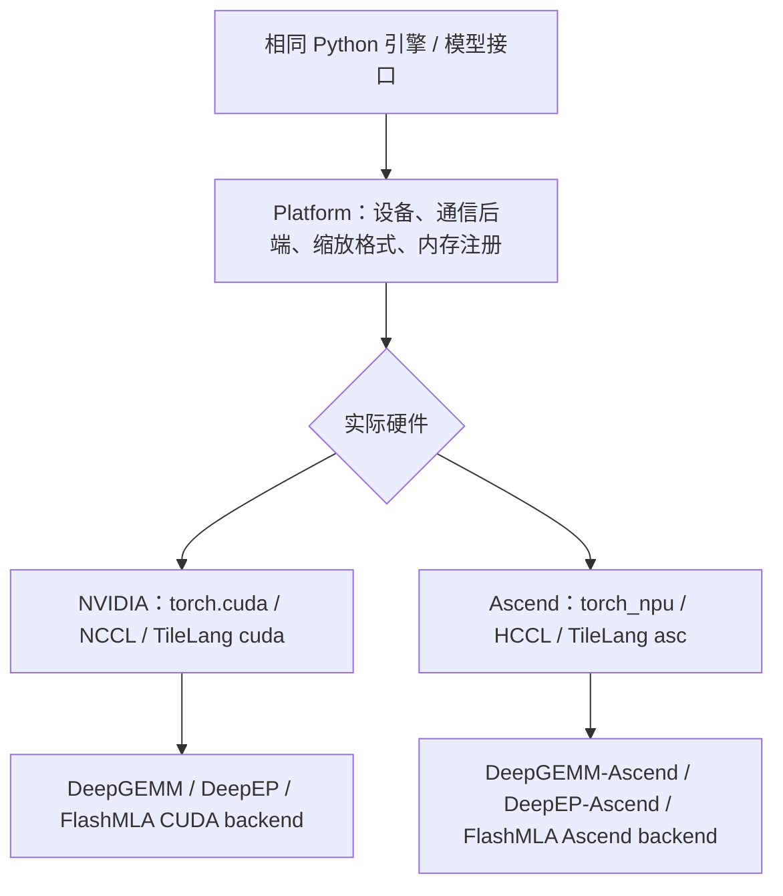

1. **硬件发现**：`deep_cluster.hardware` 识别设备、数量、可见设备和 NUMA 位置。
2. **运行时平台**：`PlatformGPU` / `PlatformNPU` 选择通信、内存与兼容行为。
3. **算子分发**：公共 Python 接口调用 `cuda/` 或 `asc/` 下的实现。
4. **外部库和 C++ 扩展**：按平台构建并安装对应实现。[S27][S28][S35][S37][S49]

### 10.2 相同包名，平台不同实现

| 上层导入 | NVIDIA 构建来源 | 昇腾构建来源 |
| --- | --- | --- |
| `deep_gemm` | `vendor/DeepGEMM` | `vendor/DeepGEMM-Ascend` |
| `deep_ep` | `vendor/DeepEP` | `vendor/DeepEP-Ascend` |
| `flash_mla` | `vendor/FlashMLA` CUDA backend | 同仓库 Ascend backend |
| `deep_select` | `vendor/DeepSelect` CUDA backend | 同仓库 Ascend backend |

上层尽量保持相同接口，不代表两种硬件使用相同机器码、张量格式或全部优化。[S37]

### 10.3 为什么 NPU 代码里还能看到 `torch.cuda`

`PlatformNPU` 使用 `torch_npu.contrib.transfer_to_npu`，将一部分 CUDA 风格 API 映射到 NPU API，以复用上层逻辑。此外还处理流对象属性、NPU 图执行和导入补丁。

因此，源码里的 `.cuda()` 或 `torch.cuda.Stream` 在该路径下可能实际指向 NPU 行为。仅替换字符串名称不足以完成移植，真正的设备算子、通信和内存行为仍需逐项适配。[S27]

### 10.4 几个真实的后端差异

| 项目 | NVIDIA | Ascend |
| --- | --- | --- |
| 集合通信 | NCCL | HCCL |
| TileLang 实现目录 | `cuda` | `asc` |
| 打包 FP8 缩放因子类型 | `int32` | `int16` |
| 主机内存注册 | `cudaHostRegister` | ACL host register API |
| Engram 存储 | 可有 CPU 方案 | 当前强制设备存储 |
| 完整 batch invariant | README 支持 | 当前未支持该开关 |
| 部分融合注意力优化 | CUDA 提供 | 固定版本 FlashMLA 并非全部提供同等融合功能 |

NPU 的 DeepSelect 原生接口也有 BF16、索引类型等限制，因此 DeepInfer 用自己的包装补充采样等需求。后端适配涉及语义与布局约束，不只是“选 NCCL 还是 HCCL”。[S27][S35][D01][D04][D06]

### 10.5 环境变量需要在合适的时间设置

- 构建、运行都要保留 `DEEPINFER_ACCELERATOR=nvidia` 或 `ascend`，用于本地扩展平台目录等选择。
- 实际平台探测也会检查设备，环境变量不负责凭空模拟某种硬件。
- NPU 路径要求 `CUDA_VISIBLE_DEVICES` 与 `ASCEND_RT_VISIBLE_DEVICES` 一致；示例会代为设置。
- 昇腾设置 `TILELANG_DEFAULT_TARGET=ascend`，避免兼容映射让 TileLang 错判为 CUDA。
- 本地扩展按 `deepinfer/_so/平台-架构/` 放置，支持同一源码树保存不同平台产物。[S03][S27][S49]

### 10.6 能否直接扩展到 AMD、CPU、其他 NVIDIA 卡

【代码分析】增加一种设备至少要补齐：设备发现与运行时平台、核心注意力和 MoE 算子、量化/缓存布局、通信库、图执行及计时、构建依赖和正确性验证。

即使 TileLang 本身支持更多后端，也不能推出 DeepInfer 整条依赖链已经支持。固定版本 FlashMLA 已移除 Hopper 路径；DeepGEMM 单独支持 SM90，也不能证明这个版本 DeepInfer 能在 H100/H800 上运行。[D01][D02]

## 11. 外部仓库分别负责什么

### 11.1 实际拉取与版本策略

本次已经拉取：

- `.gitmodules` 中的六个直接子模块，保持主仓库固定的提交。
- 它们的递归子模块，包括 DeepJIT、CUTLASS、magic_enum、clangd-ascend 等。
- TileKernels、TileLang、XGrammar、deepseek-recipe、3FS。
- README 致谢的 vLLM、SGLang、TensorRT-LLM，用于核对来源与边界。

TileLang 检出 `v0.1.15`，XGrammar 检出 `v0.2.2`，对应主仓库依赖版本。TileKernels 远端未提供可获取的 `v2.1.0` 标签，分析使用拉取时的源码快照；**没有把该快照声称为 PyPI `tile-kernels==2.1.0` 的精确源码映射**。

六个直接子模块已完成递归检出。其他参考仓库主要检查源码、接口与说明，未编译，也未递归展开它们全部的通用软件依赖。TensorRT-LLM 的完整工作区检出遇到 Windows 长路径和 LFS 文件处理问题，已停止该检出；其 Git 对象已获取，本文需要的 README、LLM 入口可通过 `git show` 阅读，不依赖那些预编译二进制。

完整提交与本地位置记录在同目录的 `deepinfer_analysis_sources.json`。后续升级时应重新核对接口，不宜任意替换成各外部库的最新版本。

### 11.2 六个直接子模块

| 仓库 | 固定提交前缀 | 在 DeepInfer 中的职责 | 阅读入口 |
| --- | --- | --- | --- |
| FlashMLA | `2e5429fc5653` | 稀疏注意力 Prefill/Decode、KV 读取与部分融合操作 | `flash_mla/flash_mla_interface.py` |
| DeepGEMM | `1fc9c66975ee` | 低精度矩阵乘、Indexer 分数、Mega MoE、mHC 等 | `csrc/apis/`、`csrc/jit_kernels/` |
| DeepEP | `f6aa38fe06cd` | MoE 派发/合并、Engram、部分 CP/DP 通信原语 | `deep_ep/buffers/ep.py`、`engram.py` |
| DeepSelect | `bfa4507d935f` | 稀疏注意力 TopK、采样 TopK | `deep_select/interface.py` |
| DeepGEMM-Ascend | `3a35326271b0` | 同名 `deep_gemm` 接口的 NPU 计算实现 | `csrc/apis/`、`csrc/jit/` |
| DeepEP-Ascend | `3b25377d04b2` | 同名 `deep_ep` 接口的 NPU 通信实现 | `deep_ep/buffers/`、设备通信实现 |

这些固定版本来自主仓库 Git tree。构建脚本按硬件选择不同组合，而不是把六个包同时装进一个环境。[S37]

### 11.3 FlashMLA：注意力执行器，不是请求调度器

检查接口可见：

- `flash_mla_sparse_fwd()` 处理选定位置的 Prefill 注意力。
- `flash_mla_with_kvcache()` 读取分页 KV 执行 Decode 注意力。
- `FlashMLASchedMeta` 保存设备内部 tile 调度元数据。
- `fused_norm_rope_attn_rope_cast` 在支持的 CUDA 路径中融合注意力前后操作。

这里的“schedule metadata”指一个注意力 kernel 内部如何分配 tile，不是 `Scheduler` 决定用户请求进入哪个 batch。

固定版本的接口根据设备选择 CUDA/NPU backend；README 明确移除早期硬件/模型支持并修改缓存格式。因此参数名称相似，不代表旧版 FlashMLA 二进制能直接替换。[D01][S22]

### 11.4 DeepGEMM：比普通 GEMM 库范围更广

`csrc/apis/` 下不仅有矩阵乘，还有 attention scoring、Mega Gate、Mega MoE 和 mHC 接口。`csrc/runtime/jit.hpp` 使用 DeepJIT 的 CUDA runtime，把源码、包含文件与依赖签名等交给编译缓存层。

Mega MoE 在高速互联域内融合 token 交换、两次专家矩阵乘、SwiGLU 和结果合并。DeepInfer 会事先转换专家权重布局，准备 `SymmBuffer`，再调用该路径。**计算布局和通信布局必须配套**，不能只把任意矩阵乘替换进去。[D02][S24]

Ascend 实现使用其矩阵乘加原语、特殊布局与流水技术，并沿用包名和多数 API。缩放因子的打包、对齐和通信实现仍有平台差别。[D05]

### 11.5 DeepEP：跨卡搬 token，也为 Engram 提供远端访问

`EPBuffer.dispatch()` 把 token 发送到目标专家；返回的 handle 保存布局，`combine()` 用它将结果还原到原 token 空间。事件和延迟 epilogue 接口允许框架尽量重叠通信与计算。

固定版本已经是 V2.5 风格 `EPBuffer`，使用 NCCL Gin 相关设施；README 明确说明已移除 V1 和 NVSHMEM 依赖。**不要依据早期 DeepEP 教程，给这个版本强加 NVSHMEM 构建流程。**[D03]

`EngramBuffer` 则支持分层取表项与等待 hook，不能只把 DeepEP 理解为一次 `all_to_all`。NPU 版本公开 buffer API 尽量对齐，但部分实验原语、CPU Engram 和某些图捕获能力仍有限制；DeepInfer 会选择其可用路径。[D03][D06][S25]

### 11.6 DeepSelect：快在针对具体 TopK 工作负载优化

它提供统一 `topk()` 接口，但对输入类型、行步长、TopK 上限、索引类型与排序能力有约束。

DeepInfer 的稀疏 indexer 可以只要位置索引而不要值，并把结果转换为实际 KV 位置；采样器则有另一类分数分布与输入精度要求。两者数学上都叫 TopK，最快的实现和兼容性却不完全相同。[D04][S23]

### 11.7 TileLang 与 TileKernels：编写工具和成品算子的关系

```text
TileLang：写高性能 kernel 的语言、编译与 JIT 基础设施
  ├── TileKernels：通用的量化、MoE routing、Engram、mHC 等成品算子
  └── DeepInfer 自有 tilelang_ops：分页 KV、输入 gather、采样、状态回退等
```

TileLang 把 Python 风格 kernel 定义逐步降低为目标后端代码，再经适配器编译/加载；TileKernels 的公共包装根据平台选择具体实现。框架自己的 `tilelang_ops/ops.py` 也统一分发 `*_tl` 工厂函数。

好处是：引擎调用统一接口，设备实现集中维护。但数据类型和布局检查不会因为统一 API 就自动消失。[D07][D08][S28]

### 11.8 DeepJIT、CUTLASS、magic_enum、clangd-ascend

| 递归依赖 | 本次分析关注的作用 | 是否负责管理用户请求 |
| --- | --- | --- |
| DeepJIT | C++ kernel 的编译、磁盘/内存缓存、加载与发射 | 否 |
| CUTLASS / CuTe | NVIDIA 设备计算需要的底层模板、类型、布局等支持 | 否 |
| magic_enum | C++ 枚举反射等工具支持 | 否 |
| clangd-ascend | 昇腾代码的 IDE/静态分析辅助 | 否 |

不同上游库固定的 DeepJIT/CUTLASS 提交不一定相同，不宜手动把所有副本强行合成一个“最新版”。这些子模块被拉取并检查了定位；本文没有展开其全部编译器或模板实现。[D12][D13][D14][D15]

### 11.9 XGrammar：从语法到合法 token 集合

检查其 `compiler.py` 和 `matcher.py` 可以看到语法编译、接受 token、回退与下一 token bitmask 接口。DeepInfer 在此之上加入异步构建、超时、请求失败处理、采样掩码和 MTP 回退配合。

语法编译缓存也是一种缓存，但与模型 KV 没有关系。[D09][S34]

### 11.10 deepseek-recipe：协议转换组件

它把不同 API 请求转换为统一 Conversation，渲染 DeepSeek prompt、编码 token，并将模型输出转换回协议响应。

检查 Python/Rust 服务示例可确认：**示例默认使用 mock inference**。它提供接入位置，不会自动运行 DeepInfer。要形成真实服务，需要把推理回调接到引擎，并处理异步迭代、流式输出、取消和使用量统计。[D10]

当前 DeepInfer `requirements.txt` 并未把 recipe 当作核心运行依赖；官方 Q&A 把它作为生产协议层的相关项目介绍。离线评测还会加载检查点随附的 `encoding/encoding.py`，也不是直接调用 recipe。[S38][S39][S50]

### 11.11 3FS：存储底座不等于 KV 服务

拉取的 3FS 公开实现分为 cluster manager、metadata service、storage service、client。它提供文件/分块存储、元数据管理和高速 RDMA I/O，性能敏感程序可以通过 native/USRBIO 接口提交批量异步请求。

但它不知道“这段 token 前缀对应哪些模型层 KV”。这仍需要 kvcache-store 完成键生成、元信息匹配、模型版本隔离、状态选择、读写和回收策略等。

还有一处必须区分：**DeepInfer 生产 Q&A 描述 10+2 纠删码存储；本次拉取的公开 3FS 设计文档描述 CRAQ 链式复制。**不能把内部生产描述直接说成公开仓库中已经实现且默认启用的相同配置。[D11][S39]

### 11.12 与 vLLM、SGLang、TensorRT-LLM 的关系

README 说明：DeepInfer 最初主要基于 vLLM，也受到 SGLang 和 TensorRT-LLM 启发。很多文件保留了 vLLM 来源标记。[S01]

本次检查这些仓库的入口与调度/缓存组织，是为了核对这种关系：

| 项目 | 可帮助理解的部分 | 不应得出的结论 |
| --- | --- | --- |
| vLLM | `LLM`、`LLMEngine`、请求、迭代调度与分页缓存的分层思路 | 当前 DeepInfer 会调用安装好的 vLLM 引擎 |
| SGLang | Scheduler、Radix cache 等完整服务组织 | DeepInfer 必然使用同一棵 Radix tree 或同一缓存策略 |
| TensorRT-LLM | LLM API、执行器、硬件专用运行时设计 | DeepInfer 必须先构建 TensorRT engine 文件 |

**来源或启发关系，与运行依赖关系不同。**这三个框架不在当前核心 requirements 中；比较只用于定位，不把它们最新源码的功能反推给 DeepInfer。[H01][H02][H03][S38]

## 12. 生产集群如何组织和管理

### 12.1 先看完整服务需要哪些层

下图根据官方生产 Q&A 重新整理。图中路由、存储、伸缩组件不是本次开源包里的完整可运行服务。[S39]

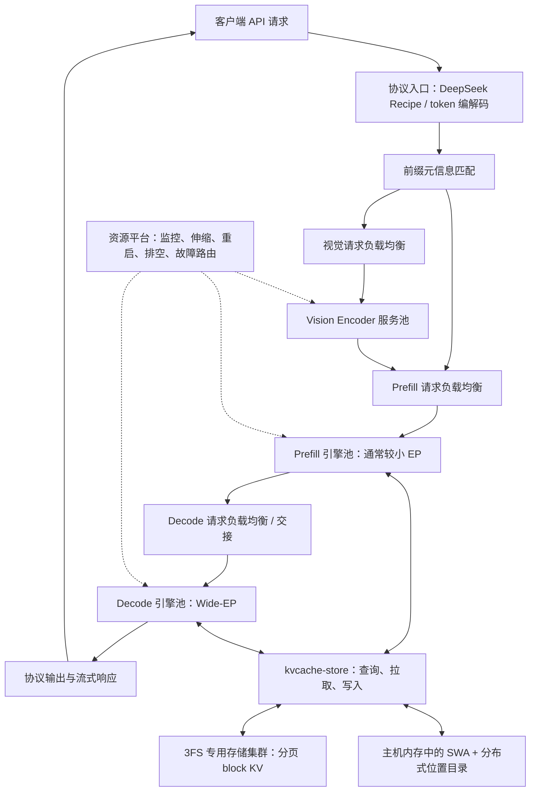

### 12.2 为什么分离视觉、Prefill、Decode

三种负载很不一样：

- VE 处理图片，计算量更多跟图片 patch 数有关。
- Prefill 处理新输入，大 batch 矩阵计算较多，长上下文成本差异很大。
- Decode 长时间占据并发请求槽，受每步延迟、权重/KV 访问与通信影响。

分离后可以给每类阶段独立增加实例，并分别控制首 token 延迟和输出速度。但代价是要搬运视觉表示、KV/state，还要协调请求生命周期。

【代码实现】`EngineType` 有 `NORMAL`、`PROMPT`、`COMPLETION`；`LLMEngine` 有 `init_pd_split()`、`send_processed_prompts()`、`do_save_kvcache()` 等接入钩子。多个钩子的基类实现为空，说明扩展位置已经预留，服务级实现仍需补齐。[S06][S51]

### 12.3 官方给出的计算布局思路

【官方生产说明】Q&A 给出的典型方向是：

- Prefill 选择 HBM 能放下模型前提下较小的 EP/DP，例如 2–8。
- Decode 使用较大的 EP/DP，例如 64–128，尽量放在一个高速 scale-up 域中。
- VE 通常单卡一实例，并可使用更经济的设备。

Wide-EP 让每卡只持有较少的专家权重，减少每步专家侧读取压力，并汇合多个 DP rank 的 token；收益需要高速互联、足够批量和 EPLB 支持。把 64 张普通网络连接的卡凑起来，不能直接等同于同一个高带宽 scale-up 域。[S39]

Q&A 所说“较小高效单元可为 64 张 Prefill + 64 张 Decode”是生产效率讨论，**不是离线推理的最低卡数要求**。最低能否运行由权重、冗余专家、Engram、上下文、并发、图和通信内存共同决定。

### 12.4 三种请求负载均衡

【官方生产说明】

| 层次 | 平衡什么 | 说明中的方法 |
| --- | --- | --- |
| Prefill LB | 输入计算工作 | 按上下文长度分桶，依据计算配额拉取/分发 |
| Decode LB | 并发数与 KV 总长度 | 同时考虑 batch 大小和注意力历史负担 |
| VE LB | 图片工作量 | 依据 patch 数分配到较空闲设备 |

Prefill 的生产描述还包含拟合成本模型、时间配额和求解 chunk 大小。**本次公开 `_schedule_prefill()` 直接可见的主要是 token/序列/上下文预算约束；不能把完整生产配额调度器说成全部已在该函数公开。**[S07][S39]

引擎组内部 ALL/ANY 投票只保证阶段一致与进度，不负责把来自互联网的新请求均匀分给所有实例。

### 12.5 分布式 KV 的存储路径

【官方生产说明】

1. 入口根据 token 前缀的哈希链匹配元信息，得到可命中的长度。
2. 外部进程异步从 3FS 拉取分页 KV 到主机共享内存。
3. 引擎内线程尽量按层把数据搬入 HBM，与 forward 重叠。
4. 缺少 SWA 状态时，根据策略回退并重建一小段窗口。
5. Prefill/Decode 新产生的可复用状态按策略保存，供后续请求命中。

生产说明中，分页 block KV 在专用 3FS 存储；SWA 留在生产它的机器内存，靠位置目录找到持有者，跨机器拉回。它不是简单的“全部 KV 统一按 GPU → CPU → SSD 层层淘汰”。[S39]

说明里的缓存 TTL、纠删码、存储规模和专用传输路径依赖其内部系统。当前公开基础引擎没有自动建好这些服务。

### 12.6 伸缩、排空、容错

【官方生产说明】

- Prefill 根据未缓存 token 工作量估算需求。
- Decode 根据运行请求数调整实例需求。
- 伸缩有速率、上下限和冗余资源约束。
- Decode 缩容时先进入约一分钟宽限期，剩余长请求连同 KV 转给其他引擎。
- EP 实例中的一张卡故障可能使整个通信组不可用；通过冗余实例与请求重路由应对。
- 重启时可依据健康设备重新确定 EP 大小；这不是训练式梯度恢复，也不是在线无感热改 EP 组。[S39]

【代码实现】当前 Worker 有进程退出、父进程死亡处理、通信组和 userbuffer 清理等生命周期逻辑。[S10]

但本仓库没有完整的全局资源分配器、服务发现、自动扩缩容控制器、故障重调度服务和生产监控部署清单。要做到生产可靠性，必须把外部控制面一起设计。

### 12.7 官方生产说明中的容量数据如何使用

下表是 Q&A 中的部署数据点，仅用于理解量级；不是公开离线引擎的默认配置或经过本文复测的保证。[S39]

| 数据点 | 官方说明 | 对设计的启示 |
| --- | --- | --- |
| 前缀保存时间 | Agent 流量约 3 天，聊天流量约 7 天 | 缓存命中与存储容量要一起评估 |
| 存储服务器示例 | 20 块 30.73 TB SSD；读至少 40 GB/s、写至少 5 GB/s | 只满足容量不够，还要满足并发 I/O |
| SWA 跨机器拉取 | 使用 400 Gbps VLAN | 内存目录与网络带宽同样影响命中收益 |
| 缩容保护 | 有就绪资源与在线冗余，配额利用率高于 0.8 时禁止缩容 | 要为流量变化和故障保留余量 |

README 的性能图分别在 4 张 SM100 的 Prefill 和 64 张的 Decode 上测量，且各在一个 scale-up 域内。比较自己的数据时必须同时比较硬件规模、网络域、上下文、batch、投机和计数口径。[S01]

## 13. 调度原理：所有并行执行如何协作

阅读重点是：**工作切给谁、什么时候开始、在哪里等待、什么时候可以释放数据。**“当前实现”均以本文固定提交为准；TP、PP 的通用解释会单独标明。

### 13.1 先区分四件事

| 概念 | 直观含义 | 例子 |
| --- | --- | --- |
| 并发 | 多项工作在同一段时间内推进，可以交替进行 | CPU 管多个请求，不必一条结束才接下一条 |
| 并行 | 多个执行资源在同一时刻做不同工作 | 多卡、多核、同卡不同计算单元同时计算 |
| 异步提交 | 提交方先返回，工作稍后完成 | CPU 发射 kernel 后继续准备下一批数据 |
| 重叠 | 两项工作的实际执行时间存在交集 | 取远端数据时，设备计算不依赖它的投影 |

**异步接口只创造重叠的可能；数据依赖、等待位置和硬件资源共同决定是否真的重叠。**同一个 stream 的普通依赖操作仍然有序；多个 stream 也不能让相互依赖的操作无条件同时完成。

DeepInfer 的调度有三个相互关联的维度：

1. **空间分工**：请求、token、专家、矩阵小块分别放在哪个 rank、核或线程组上。
2. **时间安排**：本轮做 Prefill 还是 Decode，先通信还是先算，哪里可以流水执行。
3. **资源所有权**：谁可以写某段 KV、哪个缓冲区仍在使用、何时能回收或重用。

### 13.2 所有主要并行点的地图

下面覆盖公开推理主路径及其直接辅助路径。它不是在声称每次推理都会同时启用所有优化；配置、模型分支和硬件会决定实际路径。

| 层次 | 工作如何划分 | 谁决定 | 主要汇合点或约束 |
| --- | --- | --- | --- |
| 服务实例间 | 把请求交给不同 VE/P/D 实例 | 外部负载均衡器 | 缓存命中、容量、交接与故障状态；未完整开源 |
| Attention DP | 不同 rank 处理不同请求 | 各引擎请求队列 + 组内协调 | Prefill/Decode 阶段投票、MoE 通信 |
| Prefill CP | 按 token 位置分摊同一批输入 | mirror 索引与 CP 元数据 | KV/投影 all-gather、输出逆排列 |
| MoE EP | 专家分散在不同 rank | Gate + 物理专家映射 | dispatch、专家计算、combine |
| EPLB | 给热点专家复制并重新安排位置 | 历史负载统计与放置策略 | 权重搬运完成后更新路由映射 |
| Engram | 大表按行分片，提前取多层所需项 | 哈希 + EngramBuffer | 每个消费层调用对应等待 hook |
| GEMM | 输出矩阵切成 tile | 算子调度器 | K 维累加、分组边界、输出写回 |
| Attention kernel | 查询、头与被选 KV 分片 | FlashMLA 内部调度 | 分片注意力结果正确归并 |
| TopK/采样/归一化/mHC | 按行、请求、通道等并行 | 各设备 kernel | 行内归约、语法掩码、采样状态 |
| 同卡搬运与计算 | 内存加载、矩阵计算、写回分工 | kernel 流水与 stream/event | 消费前等待数据就绪 |
| CPU 与设备 | CPU 调度/后处理和设备 forward 交叠 | Worker 的 ZOS 顺序 | 设备依赖、采样完成事件 |
| KV 块克隆与回收 | 批量安排复制、清零、引用解除 | Scheduler + DeferredRelease | 复制完成事件与引用计数 |
| KV 跨层复用 | 源层生成一次，多个层读取 | SharedLayerTopology | 源层必须先产生所需结果 |
| MTP/DFlash | 多请求/多草稿行打包，验证长度可变 | 置信度 + 性能模型 + 设备修正 | 接受前缀、回退、下一轮草稿依赖 |
| 结构化输出 | 后台编译；掩码拷贝与 logits 计算交叠 | 编译线程池、独立拷贝流 | 掩码 ready event，匹配器顺序状态 |
| 图文预处理 | 多个 CPU 子进程处理图片 | 输入/输出队列 | 图像结果就绪、队列背压 |
| 控制与记录 | Worker 命令广播、日志、采样分析 | 消息队列与辅助线程 | 顺序、缓冲区生命周期与交接 |

这些“调度器”并不都叫 `Scheduler`。请求调度器、GEMM tile scheduler、设备线程调度器解决的是不同粒度的问题。[S06][S07][S24][S26][S41][S59][S62][S63][S65][S66][S67][S68][S69][S70][D16][D17][D18][D19]

### 13.3 数据依赖决定哪些可以并行

同一条普通自回归生成链有真实依赖：下一 token 的输入依赖本轮采样结果。同一 token 的第 L+1 层也需要第 L 层输出。因此，当前主干中的层循环不能直接变成“40 层全部同时算”。

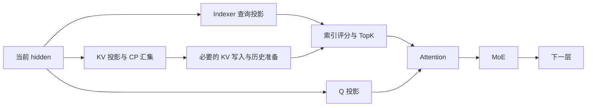

这是依赖示意图，实际融合路径会合并部分节点。Q 投影和 KV 汇集之间存在可重叠空间；Attention 必须等自己实际要读的 Q、KV 和索引准备好。**“存在两条独立分支”也不保证当前实现为两条分支都建立独立 stream。**[S19][S63]

### 13.4 请求调度：先确定本轮的工作集合

Prefill 不是单看请求数量，而是同时受 token 总预算、序列数、KV 块、state 槽和图像完整性约束。长输入可以切成多个 chunk；每个 chunk 完成后，后续 chunk 依赖前面已经产生的状态。[S07]

Decode 调度还有具体取舍：当前代码先按已输出长度排序，在缺块时可能抢占输出较长的请求，优先为另一端的请求扩展槽位；随后把已选请求按总长度重新排序，再确定每条请求的验证长度。它不是一个没有区别的永久 FIFO 队列，也不是对外承诺严格公平的服务策略。[S07]

```text
本轮候选请求
  → 清理终止/失败请求
  → 检查块与 state 是否可用
  → 必要时抢占、重算或结束
  → 选出本轮请求
  → 为各请求确定 seqlen_q
  → 形成总 token 工作量 total_q
  → 选择执行图档位并补齐
```

这里 `seqlen_q` 是本轮需要计算的查询 token 数；`total_q` 是这些数之和。投机开启后，二者都不能用“请求数”替代。

### 13.5 Attention DP：请求不同，阶段还要协调

DP rank 持有各自的请求队列，在注意力侧处理自己的请求。但它们的 token 会在后面的 EP 组里协同完成专家计算，因此不能把每个 rank 当成彼此无关的完整服务。

NORMAL 引擎通过 CPU/设备进程组上的 all-reduce 投票统一阶段：

- ALL 点要求各相关 rank 都愿意做 Prefill，减少空陪跑。
- ANY 点允许少数 rank 的 Prefill 被安排，避免等待请求饿死。
- 还有一次“是否真正排出工作”的确认，处理内存不足等情况。
- 没有真实请求的 rank 也可能需要走 placeholder 路径，保持协作调用的执行顺序；不能自行跳过组内通信或过早退出。[S06][S07][S11]

投票发生在源码建立的 DP 协调组上，不是每个用户请求各自发起投票。异步调度时优先把这类协调放在 CPU Gloo 组，减少与设备计算的直接争用；通信本身仍有成本。[S06][S26]

### 13.6 用 DP4、CP2、EP4 看懂进程组交叉

忽略额外 Engram 扩展，总共 8 个设备 rank：

| 请求侧 DP 编号 | CP rank 0 | CP rank 1 | 该行的 CP 组 |
| --- | --- | --- | --- |
| DP0 | 全局 rank 0 | 全局 rank 1 | 0、1 |
| DP1 | 全局 rank 2 | 全局 rank 3 | 2、3 |
| DP2 | 全局 rank 4 | 全局 rank 5 | 4、5 |
| DP3 | 全局 rank 6 | 全局 rank 7 | 6、7 |

- DP 协调组按列：`[0,2,4,6]` 与 `[1,3,5,7]`。
- EP 组按连续全局 rank：`[0,1,2,3]` 与 `[4,5,6,7]`。
- CP 组按表中的行。

这说明同一张卡在不同阶段会扮演不同角色。**进程组是在已有 rank 上建立合作关系，不是每多一种组就再增加一批卡。**当前 `world_size=max(DP×CP, Engram并行大小)`，并校验整除关系。[S26][S36]

### 13.7 CP：平衡查询工作，再汇集必要数据

用简化的密集因果注意力解释 mirror 分配：8 个位置切为 4 段，卡 0 取最前段和最后段，卡 1 取中间两段。靠后的查询要读更多历史，前后配对比连续平分更容易平衡工作量。

```text
原序列： [0,1] [2,3] [4,5] [6,7]
卡 0：   [0,1]             [6,7]
卡 1：         [2,3] [4,5]
```

实际模型有稀疏筛选、压缩、不同请求长度和 padding，上图只解释平衡思想，不是精确性能公式。

当前实现的重要顺序是：

1. driver 广播输入与控制信息，建立一致的序列元数据。
2. mirror 索引把 hidden、位置和相关掩码切到各 rank 的查询布局。
3. attention 先发射 KV 投影结果的 all-gather，再计算 Q 投影。
4. 到压缩/写 KV 或注意力真正需要全体相关数据时，调用等待 getter。
5. 层末/模型末按需要 all-gather，再逆排列恢复供输出和采样使用的顺序。[S12][S19][S63][S64]

`CPManager` 的 gather 返回等待函数。先启动、后等待，才有通信与独立计算重叠的机会；若拿到函数就立即调用，重叠空间会缩小。[S45]

### 13.8 CP 不等于“KV 显存自动除以 CP”

源码中的 mirror CP 主要用于 Prefill 查询计算；`attn.py` 的 `use_cp` 条件明确包含 `is_prompt`。它会汇集当前 KV/压缩输入并建立注意力需要的数据视图，而不是通用地把历史 KV 永久按长度分散、让 Decode 做跨卡环式读取。

所以不能据此推断：CP=8 就把每卡所有 KV 和全部权重缩到八分之一。Decode 也不能照搬 Prefill 的分工图；跟随 Worker、采样协调和 DFlash 集合通信仍需按当前实现参与。[S12][S19][S63]

还有一个容易漏掉的生命周期限制：`BucketBuffer` 分配的 gather 结果可能是共享通信缓冲区的视图，下一 session 会重用。等待函数必须在有效 session 内消费，不能留到任意后续层再调用。[S45][S62]

### 13.9 EP：先把 token 变成各专家的工作队列

EP 调度分为四步：

1. Gate 选择逻辑专家 ID 和路由权重。
2. EPLB 映射选到当前物理副本，再确定其所属 rank。
3. dispatch 把同一专家的输入聚合，形成适合 grouped GEMM 的连续或带计数布局。
4. 专家算完后，combine 根据 handle 把结果送回原 token，并按权重汇总。

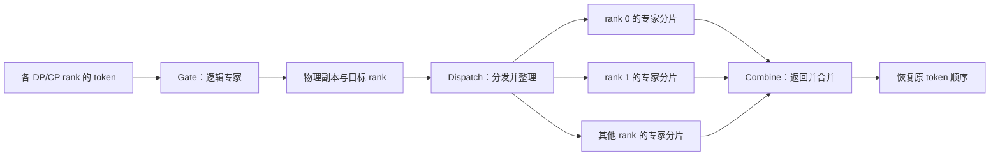

一个 token 选择多个专家时会产生多份专家工作；它不等于多条独立用户请求。各专家 token 数可能不同，调度必须同时处理不等长数据、对齐 padding 和有效计数。handle 正是后续还原对应关系所需的账本。[S24][D03]

### 13.10 普通 EP 路径与 Mega MoE 的重叠方式不同

**普通路径的源码顺序**：

```text
gate
  → dispatch（通信流）
  → current_stream_wait（取得整理好的专家输入）
  → routed experts 计算
  → 记录 combine_pre_event
  → 发射 shared expert 计算，并预留通信 SM
  → combine（通信流从事件后推进）
  → current_stream_wait（完成必要合并）
```

这里 dispatch 后很快就等待，不能声称这段代码必然把 dispatch 全部隐藏在 shared expert 计算后面。combine 的前置事件则记录在 shared 计算之前，允许通信与随后排入计算流的 shared 工作存在重叠；依赖 shared 结果的收尾仍要等待。[S24]

`limit_num_sms()` 会暂时降低计算库使用的 SM 预算，为通信工作留下资源。**流之间没有直接数据依赖，不代表它们没有竞争 SM、HBM 和互联带宽。**[S62]

**Mega MoE 路径**把派发、第一线性层、激活、第二线性层和合并放进一个持续执行的设备程序，以小块为单位推进依赖。不同 token 块可以处于不同阶段；不必等待“整批派发全部结束”才开始所有专家计算。其内部还要管理环形容量、任务就绪与预热波次，避免消费者一直等待尚未安排的生产者而死锁。[S24][D18][D19]

同一批 token 仍有先后关系：数据没到，专家就不能读取；专家输出没写好，combine 就不能消费。优化改变的是等待粒度，并没有删除依赖。

### 13.11 EPLB：周期性调整空间分工，不是任意时刻改权重

EPLB 周期性汇总各逻辑专家负载，用冗余槽位复制热点，再算新的物理放置。重排路径需要组内 all-reduce、权重及缩放因子搬运，最后更新映射。

这条路径有显式同步和性能记录；不能把它描述成“另起线程不停换专家，上轮还在读也没关系”。安全顺序是：**历史统计 → 统一计划 → 所需权重就位 → 新映射生效**。普通推理读取和原地重排必须在框架设定的步骤边界及设备依赖约束下协调。[S29][S30][S31]

局部统计、全局统计、真实重排的周期也不同；日志统计的 collective 会产生偶发延迟。这是 benchmark 需要避开部分统计 flush 窗口的原因之一。[S29][S54]

### 13.12 TP 的通用原理，以及本仓库为什么不能按名称认定启用

**通用原理，以下公式是教学示意：**对 `Y=XW`，可按矩阵维度拆分。

```text
按输出列拆 W：
W = [W0 | W1]
卡 0 算 Y0 = XW0，卡 1 算 Y1 = XW1
需要完整结果时拼接 Y0、Y1

按输入行拆 W，同时拆 X：
W = [W0; W1]，X = [X0 | X1]
卡 0 算 P0 = X0W0，卡 1 算 P1 = X1W1
完整 Y = P0 + P1，需要求和归约
```

列并行可用 all-gather 收齐分片，行并行常需要 all-reduce；后续算子若能继续消费分片，则不必每层立刻收齐。TP 的核心是“共同完成同一次稠密计算”，与 EP“选择并分配不同专家”不同。

**当前 DeepInfer 的代码事实**：

- `EngineArgs` 没有通用 `tensor_parallel_size` 配置，进程组也没有独立 TP 组。
- `ReplicatedLinear` 断言本地参数是完整的输入/输出矩阵形状。
- `VocabParallelEmbedding` 本地持有完整词表矩阵并执行 gather。
- `get_logits()` 直接用本地完整词表权重做矩阵乘，没有通用 TP logits 拼接路径。

因此，`ParallelLMHead`、`VocabParallelEmbedding`、`ColumnParallelLora` 等名称不能替代实际数据流证据。本版本应按 DP/CP/EP/Engram 的真实分工理解，而不是凭类名补出一个不存在的 TP 调度流程。[S26][S55][S59][S60][S71]

### 13.13 PP、微批流水与 P/D 分离的区别

**通用 PP 原理**：把模型的不同层放在不同设备阶段上。一个微批从前段传到后段；多个微批同时在不同阶段推进，例如卡 0 算微批 B 的前层时，卡 1 算微批 A 的后层。填充和排空流水期间会有空泡。

**当前仓库**没有通用按层 PP 的配置和相应主模型阶段调度；`DeepseekModel` 在本 Worker 的层循环中向前执行。DeepEP 有实验性 `PPBuffer`，不等于 DeepInfer 已经接入完整 PP 调度器。[S19][S26][S55][D03]

服务 P/D 分离则按请求生命周期切：P 处理输入，D 接着生成。这两个阶段通常都需要其所执行模型路径的权重与缓存能力，不能简单理解成“前半模型放 P，后半模型放 D”。不同请求可以同时处于 P 与 D 阶段，但同一请求的 D 必须等必要 KV/state 交接完成。

### 13.14 Engram：把远端取表提前到真正使用之前

主模型在进入层循环前计算 n-gram 哈希，然后一次提交本轮多个 Engram 层所需的取表工作。`fetch()` 返回按层的 hook；到了某个 Engram 层，`embed_hook()` 才等待对应结果并交给融合投影。

```text
提交层 A、层 B 的远端查询
  → 算不依赖这些表项的前几层
  → 到层 A：等 A 的 hook，再融合 A 的向量
  → 继续其他层
  → 到层 B：等 B 的 hook
```

这样等待可能被前面的模型计算覆盖。它不是保证所有查询都瞬时命中：哈希分布、远端负载、RDMA 和 HBM 竞争会影响收益。取表结果也必须遵守通信缓冲区的使用期。[S19][S25][S62]

### 13.15 单卡 GEMM：矩阵切块由设备内调度器安排

把 `A[M,K]×B[K,N]` 看成生成 `M×N` 个输出。算子通常沿 M、N 切成小 tile，每个 tile 内沿 K 分段加载和累加。

- CPU 选具体 kernel、形状、数据类型、允许使用的 SM 等参数。
- 算子内的 scheduler 决定线程块下一步处理哪一个矩阵 tile、哪个专家组。
- GPU 硬件再决定就绪线程块在哪个 SM 上运行，以及哪个 warp 当前可执行。

固定版本 DeepGEMM 的 scheduler 可看到类似 `迭代号×SM数量 + blockIdx.x` 的工作编号，再换算为 M/N 坐标与专家组；还会重排访问顺序以提高缓存复用。这类持续领取 tile 的设计能减少小任务之间反复启动程序的成本，但不意味着调度器是一台全局自动负载均衡服务。[D17]

**三个 block 要区分**：KV block 是历史数据页；CUDA thread block/CTA 是线程组；矩阵 block/tile 是计算区域。三者大小和职责完全不同。

### 13.16 Attention 的 split-KV：一条请求也可以占用多个执行分区

只按请求分配计算，短 batch 下可能没有足够任务填满设备。FlashMLA 的 Decode 元数据 kernel 会根据有效 TopK/KV 工作量，把不同请求的 KV 块贪心分给多个执行分区，并允许同一请求拆成若干 split。

```text
请求 A 的被选 KV： [一段] [一段] [一段]
                     ↓      ↓      ↓
                 并行算注意力局部结果
                     └── 正确归并 ──┘
```

注意力中的 softmax 有归一化分母，分片结果不能简单做普通平均。需要携带局部归一化信息，按一致的尺度合并输出；实现还要处理数值稳定性。多分片增加并行度，也增加元数据与归并开销，不是 split 越多越快。[D16][S22]

这里拆的是**同卡注意力 kernel 的工作量**，不是把多个 GPU 组成 CP。FlashMLA 的 tile scheduler 与请求层 `Scheduler` 不能混为一谈。

### 13.17 算子内部流水、融合、TopK 与 PDL

算子内部可以把一份 tile 的生命周期拆为：加载数据 → 等待可读 → 矩阵/向量计算 → 输出处理 → 写回。不同 tile 可在不同阶段同时推进，局部双缓冲/多缓冲避免下一次加载覆盖仍在计算的数据。

NVIDIA 路径可由不同 warp/线程组分别负责搬运和计算，并用 barrier 管理依赖；Ascend 路径结合矩阵、向量、数据搬运单元及本地 UB 缓冲形成自己的流水。二者概念相通，但执行单元、容量、同步与布局不相同。当前 Ascend KV store 的 `T.Persistent` 和 `num_stages`、buffer versions 正体现了持续取 tile 与多阶段缓冲安排。[D19][S67]

融合进一步把多个操作合在一个 kernel 中：减少 CPU 发射和中间 HBM 读写，却可能提高每个线程的寄存器/本地存储需求，影响同时驻留的工作数量。量化、归一化、RoPE、mHC 和 TopK 也在不同粒度上按行/通道并行，行内归约则有局部同步。

**归一化、量化、RoPE 的分工**：不同 token 行可并行处理，行内各线程处理不同通道。归一化先汇总这一行的平方和等统计量，再缩放各通道；量化先得到相应分组的 scale，再编码该组元素；RoPE 对相应通道对做旋转。独立元素可同时算，需要共享统计量的步骤则必须先完成归约。这解释了为什么融合能省中间读写，却不能省掉数学依赖。[S28][D07]

**TopK 的两层并行**：不同查询行、采样行可以分开计算；单行太长时，还要让多个线程协作扫描。固定版本 DeepSelect 使用“分块扫描 → 用当前阈值筛选 → 在局部候选集做 radix-select → 更新阈值”的过程。候选写入位置通过计数、前缀和等安排，避免多个线程互相覆盖；阈值更新后才能据此筛下一块。[D20]

**小 batch 的 TopK 还会扩大单行并行度**：DeepSelect 用受支持设备上的 Threadblock Cluster，把一行拆给多个 CTA；各 CTA 求局部 TopK，再交给该 cluster 的 CTA0 选全局 TopK。这样少数请求也能利用多个 SM，但会增加候选传送与归并，不能按 CTA 数线性估算提速。它与“多个 DP rank 分别处理请求”处于不同层次。[D20]

**采样与 mHC 的边界**：不同请求的分数处理、概率和候选选择可以批量执行；同一请求的接受前缀、语法 matcher 和 Markov 修正仍有顺序依赖。mHC 的不同 token/通道和小矩阵可并行，Sinkhorn 的每轮行/列归一化则依赖相应前一轮结果。多路残差信息流不是多条彼此独立的设备 stream。[S32][S33][S43][D07]

PDL 是 NVIDIA 的程序化依赖启动机制：在支持的 kernel 配合下，后继工作可提前进入执行安排，在读取前驱结果前再执行必要依赖等待。DeepInfer 启用相关库选项，KV store 等 kernel 中有 `pdl_sync()`；这不等于自动让任意相邻两个 kernel 无依赖并行。[S35][S66]

### 13.18 ZOS：CPU 提前排队，设备仍按数据依赖执行

实际 Worker 顺序可以概括为：

```text
准备并发射 forward N
  → 等待必要的 N-1 采样完成事件，处理 N-1 输出
  → 发射 sample N / draft N
  → 保留 N 的在途状态，返回可交付输出
下一轮：准备并发射 forward N+1，再处理 N
```

CPU 处理 N-1 时，设备可以执行已发射的 forward N。CPU 准备 N+1 时，不必先把 N 的全部采样数据读回主机。

关键补偿在 `_correct_seqlens_qk()`：根据请求 remap，直接使用设备端上一轮接受数量、采样 token 和草稿 token，修正下一轮输入长度及 KV 有效长度。变长验证还会重算各请求的查询长度；需要回给 CPU 的部分通过事件确认后再使用。[S11][S46]

同一请求依然满足 `sample N → forward N+1 的相关读取`。这里消除的是 CPU 对设备结果的过早等待，不是删除自回归依赖。forward/sample 内的同步限制也不代表整个引擎没有同步点。

### 13.19 执行图：预先固定调度骨架，再填真实工作

执行图记录设备操作及依赖，避免每一轮都由 Python 逐个发射。当前 Decode 根据 `total_q` 选择不小于工作量的最小已捕获档位；额外行用 dummy/padding 补齐，有效位置由长度和掩码控制。[S12][S47]

图不负责决定用户请求优先级，CPU/C++ Scheduler 仍先选请求；图也不保证所有节点并行，依赖链仍然有效。固定地址缓冲会反复复用，因此不能把上一轮某个图输出的视图当作永久不变的数据。

主模型与 DFlash 有各自的图路径；NPU 有对应图执行适配，但不能套用全部 NVIDIA 的图计时或底层依赖优化。

### 13.20 KV 资源调度：有空闲块，不一定能再接请求

调度必须同时拿到：

1. 保存历史主 KV/indexer K 的分页块。
2. 保存 SWA 和压缩中间状态的 state slot。
3. 模型执行、通信和图运行所需的其他缓冲区。

块分配是 CPU 逻辑；按 slot mapping 写入 KV 是设备操作。两者通过编号关联，但不是同一个调度器。BlockManager 的互斥保护用于防止分配/引用账本被并发修改，不会让“两个线程写同一个物理 KV 位置”变得正确。[S09][S13][S70]

startup 的缓存容量测量、state 预留和跨 rank 汇总见第 7.7 节；运行中要在耗尽前停止接纳或按策略抢占。跨 rank 容量汇总不能替代每条请求、每个物理写入位置的生命周期检查。

### 13.21 KV kernel 的并行：不同记录能并行，同一槽不能乱写

KV store 根据 slot mapping，把本轮 token 的记录写到对应物理块与偏移。不同 token/通道可以分给多个线程或核；连续地址可合并搬运，散乱位置需要索引写入；无效 padding 位置应跳过。

读写依赖仍须满足：

```text
分配块与建立映射
  → 生成并量化 KV
  → 对应位置写入完成
  → Attention 或后续层读取
  → 最后一次使用完成
  → 解除引用，允许重用
```

这不要求每一步都让 CPU 全局等待。正确的同流顺序、跨流事件或 kernel 内依赖即可限定相关读取；若换到另一条流，就必须显式建立相应依赖。`non_blocking=True` 本身不提供“读的时候一定写好了”的保证。[S13][S66][S67]

### 13.22 前缀共享与缓存复制：分支并行需要独立可写状态

两个请求可以并行读同一份完整前缀块，但继续写同一尾块会相互覆盖。fork 后的处理是：共享只读整块并增加引用，复制未写满尾块，克隆可变 state，然后各分支写自己的部分。

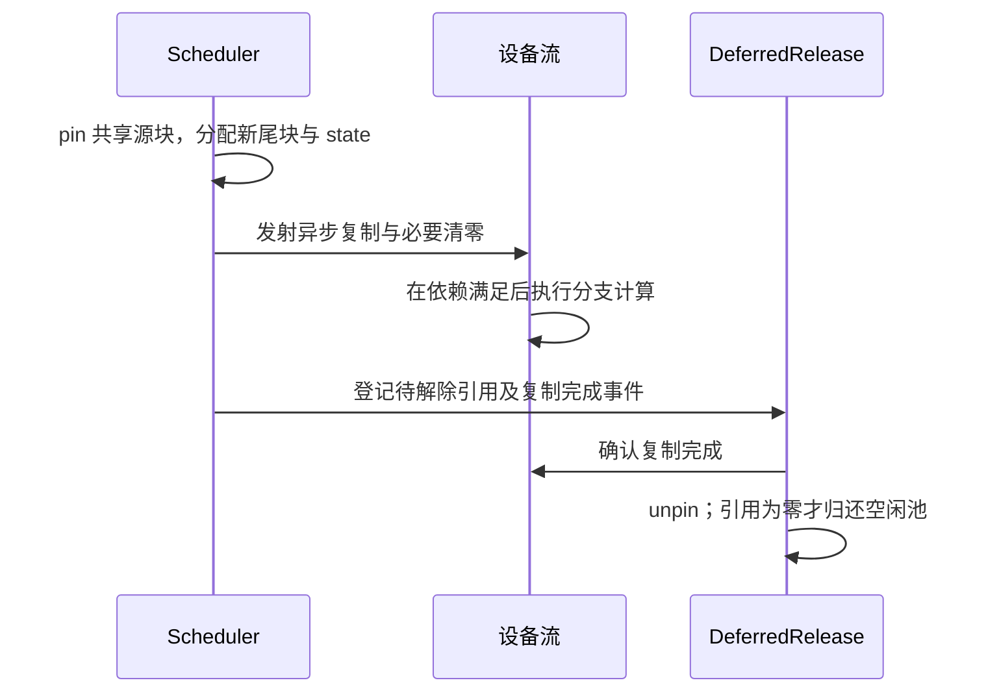

源码把 clone/zero 放到当前设备流，靠顺序与事件协调；不能据此说“所有 KV 克隆都在独立拷贝流和当前 forward 完全重叠”。引用计数 pin 与 CPU 内存 page pin 也不是同一种 pin。[S06][S07][S09][S69]

### 13.23 SWA、压缩状态与投机回退必须一起调度

SWA 是覆盖式环形窗口；压缩状态保留尚未完成压缩窗口所需的信息。投机写入可能超过最终接受位置，下一轮必须使用有效长度并保留足够回退历史，不能只删除输出列表里的几个 token。

同时，MTPInfoPool 保存跨轮草稿、概率和置信度。主模型的验证读取依赖上一轮 DFlash 写入完成；当前相应路径用流顺序保证，不能随意把两者移到无关联 stream。[S08][S13][S32][S33]

YoCo 跨层共享还要求“源层先产出，消费者再读”。它减少重复计算与存储，不等于消费者层互不依赖；compact 与 CP 组合时，还会把保留的行先汇集再重新分配，之后才能用新的 mirror 布局继续计算。[S19][S42][S64][S72]

### 13.24 MTP 预算调度：并行验证多少，和猜多少分开决定

主模型可以把多个候选位置打包成一次因果 forward 验证，各请求的验证长度不必相同。调度器尝试最大化：

```text
预期有效输出 token 数 /（主模型验证耗时 + 采样等耗时）
```

当前 CPU 策略会参考较早轮的置信度选择总预算，并用运行耗时更新估计；ZOS 下设备再根据最新可用置信度落实各请求的长度。这样既提前安排工作，又不必为低收益草稿支付全部验证成本。[S11][S68]

DFlash 的草稿层可以对块内位置做批量计算，但 `sample_drafts()` 仍有位置循环，Markov 修正使用前一步采到的 token。不能把它说成“5 个草稿的所有生成操作完全互相独立”，也不能说“必须把完整草稿模型顺序执行 5 遍”。[S33]

采样的随机源按请求和位置管理；多请求可批量计算概率与采样，但同一请求的语法状态、拒绝位置和后续草稿依赖必须保持一致。扩大 batch 或验证长度，还会改变图档位、padding、MoE 路由量和缓存写入量，因此这些调度参数必须联合理解。

### 13.25 结构化输出、图文和辅助 CPU 工作如何并发

**语法编译**：线程池编译 schema，完成后主线程的 `pump()` 才把 matcher 安装到请求并允许进入调度。后台线程不直接同时修改调度队列。[S65]

**每步语法掩码**：当前 CPU 路径更新 matcher 并构造 bitmask，随后在独立 `so_copy_stream` 上异步复制到设备；计算流可先做 logits，在真正应用掩码前等待 `so_mask_ready`。可重叠的是这段拷贝与独立设备计算，不能把 CPU matcher 更新也一概说成已经移到后台线程。[S32]

**图文预处理**：CPU 子进程通过队列处理输入，输出队列有容量上限；模型计算与其他请求的图片准备可以并发。某请求的图片未就绪就不能使用对应 embedding。多张图还可通过线程池加载，GPU/NPU 的 patch、ViT 和投影操作本身也有行/patch/矩阵并行。[S20][S41]

**其他辅助并发**：统计日志有后台线程；可选的 profile HTTP 控制运行在独立线程的异步事件循环，并用单槽请求和结果对象与引擎交接；模型加载 watchdog 有超时线程。它们服务于记录、调试和容错，不会自动增加主模型计算并行度。profile HTTP 也不是用户推理 API。[S14][S73][S74]

**控制广播**：同机小消息可走共享内存环形队列，较大/远端消息用相应 socket 路径，设备张量再走集合通信。数据所在内存、消息顺序与何时可重用必须分别处理。[S26][S61][S75]

### 13.26 跨节点 KV I/O 与 P/D 交接：属于外部流水

【官方生产说明】远端 KV 拉取、共享内存暂存、分层进入 HBM 与模型计算可形成流水。理想顺序是“提前取下一层所需数据，当前层计算；到下一层消费前等它就绪”。同样，VE/P/D 可以同时处理不同请求。[S39]

把这条流水拆开，才能看清哪些等待可以覆盖：

| 阶段 | 谁推进 | 能否与什么重叠 | 必须先满足的条件 |
| --- | --- | --- | --- |
| 元信息前缀匹配 | Entrypoint 与 CHECK 角色 | 命中长度决定路由，这段不能靠后续 forward 隐藏 | 模型版本、内容键、元信息有效 |
| 从 3FS 拉 KV 到主机共享内存 | 独立取数进程 | 可与其他请求、已就绪部分计算并发 | 读取完成后才可消费该片段 |
| 从共享内存送入 HBM | 引擎内 swap-in 线程与传输硬件 | 按层预取，与当前层 forward 交叠 | 下一层读取前确认传输完成 |
| 主干 forward | 模型执行流 | 计算当前层时取下一层数据 | 该层的 KV/state 和索引准备好 |

官方说明还指出，细碎 KV 复制的传统拷贝引擎效率不足时，使用 GDR 让 RDMA 网卡利用 PCIe 搬运，避免消耗 SM。**不消耗 SM 仍会争用 PCIe/HBM/网络带宽**，并不意味着搬运对计算完全免费。[S39]

SWA 的异步保存还有一致性问题：生产 Decode 在设备上使用单独的副本区域，每跨过约定的 128-token 存储边界，复制一个可供保存的窗口快照；主请求继续更新运行窗口，保存路径使用已完成的副本。有限的额外 ring 位置吸收投机越过边界的余量。快照复制完成前不能当作有效命中，副本仍被保存路径读取时也不能随意覆盖。这里描述的是官方生产设计，不是公开引擎已经实现完整后台存储服务。[S39]

【设计原则】同一请求交接必须满足：相关 KV/state 版本正确 → 传输完成且接收端可见 → Decode 获得写入所有权 → 原持有者按确认解除引用。提前释放、重复启动两个写入者、把未完成写入当作缓存命中，都会破坏正确性。

这些原则解释了为什么需要异步 I/O 队列、完成事件、目录和引用生命周期，但**不表示基类空钩子已经实现完整传输协议**。公开 3FS 是存储底座，P/D 的请求所有权交接和 KV 语义仍需服务层完成。[S06][S39][D11]

### 13.27 用关键路径判断优化是否有效

可以先画出“数据必须经过的最长依赖链”，再看哪些独立工作能填进等待时间。

```text
完全串行：总时间约为 A + B
有充分资源、依赖允许的理想重叠：总时间接近 max(A, B)
现实情况：还要加无法覆盖的等待，并考虑资源竞争造成的变慢
```

检查一项并行优化时，依次回答：

1. 拆的是请求、token、专家、矩阵还是 I/O？
2. 工作交给哪个 rank、stream、线程或硬件执行单元？
3. 哪些数据必须先准备好？等待发生在哪里？
4. 是确实并行，还是仅异步提交后马上等待？
5. 是否争用 SM、HBM、互联或 CPU 核？
6. 使用的缓存和通信 buffer 在什么时候可以覆盖/释放？
7. 当前路径是否真正开启，还是仅依赖库拥有该功能？

观察指标也要分层：队列等待看请求调度；rank 最慢者看 DP/EP 负载；stream 空泡看事件与 CPU；kernel 占用和内存访问看算子；KV 拉取等待看存储流水。端到端有效吞吐还必须统计真实接受、实际交付的 token，而不是把草稿数全部计成产出。[S53][S54]

**把这些层连起来看：请求调度形成 batch，空间并行分配工作，算子调度填满设备，事件和状态所有权保证结果正确。**只调大某一种并行度，无法自动改善其余所有层。

## 14. 源码阅读路线与常见误解

### 14.1 第一遍：只走通一条普通文本请求

按下面顺序阅读，先忽略图片、MTP 和 YoCo 的分支：

```text
examples/offline_inference.py
  → examples/_config.py / _launch.py
  → deepinfer/entrypoints/llm.py：generate / _run_engine
  → deepinfer/engine/llm_engine.py：add_request / step
  → csrc/engine/scheduler.hpp：_schedule_prefill / _schedule_decode
  → deepinfer/worker/worker.py：execute_model_step
  → deepinfer/worker/model_runner.py：execute_main_model / execute_sample
  → deepinfer/model_executor/models/deepseek.py：forward / sample
  → deepinfer/model_executor/layers/sampler.py
```

第一遍的目标：能说明“请求在哪排队、模型在哪算、输出在哪回来”。

### 14.2 第二遍：单独跟踪缓存生命周期

```text
Sequence.cache
  → BlockManager 分配块和 state ID
  → Scheduler 产生 block_table / clone / zero 操作
  → CacheEngine 分配真实张量和层视图
  → input_metadata 产生 slot mapping / 索引
  → attention 读取、store_kv_cache 写入
  → process_outputs 更新有效长度
  → finalize_seq / free_seq 解除引用
```

自己画出一条 300-token 请求的块表，再分叉成两个后缀，是理解分页与写前复制的好练习。

### 14.3 第三遍：逐项加回性能机制

建议顺序：

1. batch 与 chunked prefill。
2. DP/EP 交叉分工与 MoE 数据流。
3. 执行图与异步调度。
4. DFlash 草稿生成、验证和回退。
5. 变长验证与性能曲线。
6. YoCo、跨层共享和状态保存。
7. NPU 平台分发及外部 kernel 实现。

不要一开始就逐行阅读 CUDA/Ascend kernel。先知道它的输入、输出、数据布局和它替代了什么工作，再读线程和 tile 级细节。

### 14.4 十个常见误解

| 误解 | 正确理解 |
| --- | --- |
| README 说缺 KV 系统，所以没有 KV cache | 设备内运行时缓存完整；跨实例缓存服务未完整发布 |
| DP8 + EP8 就是 64 张卡 | 通常是同一批 8 张卡的两种分工 |
| 支持 HF 目录就支持任意 HF 模型 | 注册表、结构、量化和 kernel 都有限制 |
| SM90 的 DeepGEMM 能用，所以 H100 能跑整个框架 | 必须同时满足 FlashMLA 等完整依赖链 |
| max_model_len 设大就能跑长上下文 | 还要有缓存、运行时位置余量和资源预算 |
| nextn=5 每步必定输出 6 个 token | 要经过验证，可能提前拒绝 |
| compact 模式把长输入直接截成 140 token | 截减 consumer 特定计算；共享历史路径仍存在 |
| ZOS 不需要 CPU 调度 | CPU 工作通过流水重叠，仍有同步与状态管理 |
| deep_cluster 是全局集群管理平台 | 当前主要是本机设备发现和拓扑辅助 |
| 装上 recipe 和 3FS 就得到完整线上服务 | 还要实现推理接入、缓存语义、路由和控制面 |

理解这些边界后，DeepInfer 可以看成一个明确的合作关系：**请求调度组织工作，缓存保存历史，模型定义数学计算，算子和通信把这些计算高效地落到硬件，外部服务系统负责把引擎组织成可用集群。**

## 15. 证据索引与分析边界

### 15.1 可以直接回到源码核对的结论

| 结论 | 关键证据 |
| --- | --- |
| 发布为离线推理，线上组件有缺口 | [README][S01]、[LLMEngine][S06]、[生产 Q&A][S39] |
| 远端模型 ID 先由示例解析成本地目录 | [示例配置][S03]、[配置加载][S15] |
| 只有一个已注册模型架构 | [ModelRegistry][S18] |
| 元数据容器先在 meta 上构造，分路径加载权重 | [model_loader][S14]、[主模型加载][S19]、[HF 权重][S17] |
| 调度器在 C++，Prefill/Decode 有组内阶段协调 | [scheduler.hpp][S07] |
| block 编号管理与物理缓存布局分离 | [BlockManager][S09]、[CacheEngine][S13] |
| 缓存容量汇总使用平均数而非最小值 | [WorkerBase][S10] 的 `profile_num_available_blocks` |
| 普通序列 fork 支持共享前缀、克隆可写部分 | [scheduler.hpp][S07] 的 `fork_seq` 等路径 |
| DP×CP 决定通常设备数，EP 在其中划组 | [配置][S36]、[parallel_state][S26] |
| ZOS 把上轮后处理放到本轮 forward 发射之后 | [Worker][S11] |
| 生产 P/D/缓存钩子在基类中有空实现 | [LLMEngine][S06] 的接入钩子 |
| benchmark 的 Decode 吞吐按满接受计数 | [benchmark.py][S54] |

### 15.2 本文没有实证验证的内容

- 没有在本机运行支持的 Linux GPU/NPU 推理环境。
- 没有下载庞大的模型权重，也没有现场复现吞吐、首 token 延迟或质量指标。
- 官方生产规模和运维行为来自 Q&A，不是通过公开代码部署后观测得到。
- 外部参考仓库没有全部编译，通用依赖与历史致谢项目没有开展逐行全库审计。
- 第 13 章的重叠关系来自源码中的依赖与等待位置分析，实际重叠程度、资源竞争和性能收益仍需在目标硬件上通过 trace 验证。

### 15.3 源码链接约定

下面的 S 编号链接固定到主仓库分析提交；D/H 编号固定到本次读取的依赖或参考快照。HF 模型配置单独列为 M01。具体外部提交、本地位置与检出限制另见 `deepinfer_analysis_sources.json`。

#### 主仓库源码

| 编号 | 内容 | 路径 |
| --- | --- | --- |
| S01 | [README / 发布范围][S01] | `README.md` |
| S02 | [离线运行入口][S02] | `examples/offline_inference.py` |
| S03 | [模型路径与示例配置][S03] | `examples/_config.py` |
| S04 | [多节点、多进程启动][S04] | `examples/_launch.py` |
| S05 | [LLM Python API][S05] | `deepinfer/entrypoints/llm.py` |
| S06 | [LLMEngine][S06] | `deepinfer/engine/llm_engine.py` |
| S07 | [C++ Scheduler][S07] | `csrc/engine/scheduler.hpp` |
| S08 | [C++ Sequence 状态][S08] | `csrc/engine/sequence.hpp` |
| S09 | [C++ BlockManager][S09] | `csrc/engine/block_manager.hpp` |
| S10 | [Worker 资源与缓存容量估算][S10] | `deepinfer/worker/base.py` |
| S11 | [Worker 执行与 ZOS][S11] | `deepinfer/worker/worker.py` |
| S12 | [ModelRunner][S12] | `deepinfer/worker/model_runner.py` |
| S13 | [CacheEngine / StateBlock / GPUCacheInterface][S13] | `deepinfer/worker/cache_engine.py` |
| S14 | [模型加载协调][S14] | `deepinfer/model_executor/model_loader.py` |
| S15 | [HF 配置解析与限制][S15] | `deepinfer/hugging_face/config.py` |
| S16 | [HF 完整性与覆盖检查][S16] | `deepinfer/hugging_face/loading.py` |
| S17 | [HF 参数读取与本地分片][S17] | `deepinfer/hugging_face/weights.py` |
| S18 | [模型注册表][S18] | `deepinfer/model_executor/models/__init__.py` |
| S19 | [主模型 / 加载 / forward][S19] | `deepinfer/model_executor/models/deepseek.py` |
| S20 | [视觉语言模型][S20] | `deepinfer/model_executor/models/deepseek_vl.py` |
| S21 | [DecoderLayer][S21] | `deepinfer/model_executor/models/decoder_layer.py` |
| S22 | [FlashMLA 包装接口][S22] | `deepinfer/model_executor/layers/attention_backend.py` |
| S23 | [稀疏注意力 Indexer][S23] | `deepinfer/model_executor/models/v4_modules/index_attn.py` |
| S24 | [MoE 计算与通信][S24] | `deepinfer/model_executor/models/v4_modules/mlp.py` |
| S25 | [Engram 运行时][S25] | `deepinfer/model_executor/models/v4_modules/engram.py` |
| S26 | [并行进程组][S26] | `deepinfer/model_executor/parallel_utils/parallel_state.py` |
| S27 | [GPU/NPU 平台适配][S27] | `deepinfer/platform.py` |
| S28 | [TileLang 后端分发][S28] | `deepinfer/model_executor/layers/tilelang_ops/ops.py` |
| S29 | [EPLB 运行状态][S29] | `deepinfer/model_executor/eplb/__init__.py` |
| S30 | [EPLB 副本与放置策略][S30] | `deepinfer/model_executor/eplb/policy.py` |
| S31 | [专家权重重排][S31] | `deepinfer/model_executor/eplb/shuffle.py` |
| S32 | [采样与投机验证][S32] | `deepinfer/model_executor/layers/sampler.py` |
| S33 | [DFlash 与置信度头][S33] | `deepinfer/model_executor/models/mtp/dflash.py` |
| S34 | [结构化输出编译与匹配][S34] | `deepinfer/structure_output` |
| S35 | [运行时与 JIT 缓存配置][S35] | `deepinfer/worker/runtime_config.py` |
| S36 | [模型/缓存/并行/调度配置][S36] | `deepinfer/config.py` |
| S37 | [按平台构建 vendor][S37] | `scripts/build_vendor.sh` |
| S38 | [依赖版本][S38] | `requirements.txt` |
| S39 | [官方生产部署 Q&A][S39] | `doc/inference_deployment_qa.md` |
| S40 | [模型元数据与 128-token 分页][S40] | `deepinfer/model_executor/model_metadata_utils.py` |
| S41 | [异步多模态预处理][S41] | `deepinfer/ve/multimodal_processor.py` |
| S42 | [跨层共享拓扑][S42] | `deepinfer/model_executor/models/v4_modules/cross_layer.py` |
| S43 | [mHC 算子接入][S43] | `deepinfer/model_executor/models/v4_modules/mhc_ops.py` |
| S44 | [环境变量默认值][S44] | `deepinfer/environ.py` |
| S45 | [CP 通信辅助][S45] | `deepinfer/model_executor/parallel_utils/cp.py` |
| S46 | [ZOS 输入准备][S46] | `csrc/engine/zos.cpp` |
| S47 | [执行图捕获与重放][S47] | `deepinfer/worker/cuda_graph_runner.py` |
| S48 | [YoCo 等价性检查说明][S48] | `examples/yoco/README.md` |
| S49 | [延迟平台加载与扩展路径][S49] | `deepinfer/__init__.py` |
| S50 | [评测流程与编码器][S50] | `eval/README.md` |
| S51 | [引擎类型][S51] | `deepinfer/engine/engine_type.py` |
| S52 | [分布式初始化地址][S52] | `deepinfer/utils.py` |
| S53 | [运行、测试、性能口径说明][S53] | `examples/README.md` |
| S54 | [性能测量脚本][S54] | `examples/benchmark.py` |
| S55 | [EngineArgs][S55] | `deepinfer/engine/arg_utils.py` |
| S56 | [顶层构建流程][S56] | `build.sh` |
| S57 | [本地扩展与 ABI][S57] | `setup.py` |
| S58 | [设备发现][S58] | `deep_cluster/hardware/device.py` |

| S59 | [完整矩阵线性层与低秩投影][S59] | `deepinfer/model_executor/layers/linear.py` |
| S60 | [完整词表 embedding 与输出头][S60] | `deepinfer/model_executor/layers/vocab_parallel_embedding.py` |
| S61 | [通信封装][S61] | `deepinfer/model_executor/parallel_utils/communication_op.py` |
| S62 | [通信缓冲区与 SM 资源预算][S62] | `deepinfer/model_executor/parallel_utils/userbuffer.py` |
| S63 | [Attention 的 CP 与计算依赖][S63] | `deepinfer/model_executor/models/v4_modules/attn.py` |
| S64 | [输入元数据与 CP 布局][S64] | `deepinfer/model_executor/input_metadata/input_metadata.py` |
| S65 | [后台语法编译与主线程安装][S65] | `deepinfer/structure_output/so_matcher_builder.py` |
| S66 | [CUDA KV 并行写入][S66] | `deepinfer/model_executor/layers/tilelang_ops/cuda/store_kv_cache.py` |
| S67 | [Ascend KV 多阶段流水写入][S67] | `deepinfer/model_executor/layers/tilelang_ops/asc/store_kv_cache.py` |
| S68 | [MTP 变长验证预算][S68] | `csrc/engine/mtp_varlen.hpp` |
| S69 | [KV 克隆与延迟释放][S69] | `csrc/engine/scheduler.hpp` |
| S70 | [调度对象互斥保护][S70] | `csrc/utils/lockable.hpp` |
| S71 | [完整词表 logits 计算][S71] | `deepinfer/model_executor/layers/sampler_utils.py` |
| S72 | [YoCo 紧凑重排与 CP 协调][S72] | `deepinfer/model_executor/models/v4_modules/yoco.py` |
| S73 | [后台统计线程][S73] | `deepinfer/engine/stats_logger.py` |
| S74 | [Profile 控制线程与事件循环][S74] | `deepinfer/engine/profile_server.py` |
| S75 | [共享内存与 socket 消息广播][S75] | `deepinfer/distributed/shm_broadcast.py` |

#### 外部依赖与相关系统

| 编号 | 仓库 | 分析提交 |
| --- | --- | --- |
| D01 | [deepseek-ai/FlashMLA][D01] | `2e5429fc5653` |
| D02 | [deepseek-ai/DeepGEMM][D02] | `1fc9c66975ee` |
| D03 | [deepseek-ai/DeepEP][D03] | `f6aa38fe06cd` |
| D04 | [deepseek-ai/DeepSelect][D04] | `bfa4507d935f` |
| D05 | [deepseek-ai/DeepGEMM-Ascend][D05] | `3a35326271b0` |
| D06 | [deepseek-ai/DeepEP-Ascend][D06] | `3b25377d04b2` |
| D07 | [deepseek-ai/TileKernels][D07] | `c1cf914a82e6` |
| D08 | [tile-ai/tilelang][D08] | `a35f8ddf45eb` |
| D09 | [mlc-ai/xgrammar][D09] | `4d145cc13d87` |
| D10 | [deepseek-ai/deepseek-recipe][D10] | `935817c66f5d` |
| D11 | [deepseek-ai/3FS][D11] | `22fca04564c7` |
| D12 | [deepseek-ai/DeepJIT][D12] | `cba802df0819` |
| D13 | [NVIDIA/cutlass][D13] | `f3fde58372d3` |
| D14 | [Neargye/magic_enum][D14] | `b233b96e49d3` |
| D15 | [deepseek-ai/clangd-ascend][D15] | `f407eca30e07` |

| D16 | [FlashMLA Decode split-KV 调度][D16] | `2e5429fc5653` |
| D17 | [DeepGEMM 矩阵 tile 调度][D17] | `1fc9c66975ee` |
| D18 | [DeepGEMM Mega MoE 任务调度][D18] | `1fc9c66975ee` |
| D19 | [DeepGEMM Mega MoE 设备流水][D19] | `1fc9c66975ee` |

| D20 | [DeepSelect 算法与跨 CTA 单行并行][D20] | `bfa4507d935f` |

#### 来源与设计参考

| 编号 | 仓库 | 分析提交 |
| --- | --- | --- |
| H01 | [vllm-project/vllm][H01] | `9d61ade7f657` |
| H02 | [sgl-project/sglang][H02] | `b453996b7dcd` |
| H03 | [NVIDIA/TensorRT-LLM][H03] | `af3e5eb257ff` |

这些参考快照不代表 DeepInfer 使用的历史派生版本。

[S01]: https://github.com/deepseek-ai/DeepInfer/blob/9bd9cf243fc53ef9afbf8f04d391d989117d6ab9/README.md
[S02]: https://github.com/deepseek-ai/DeepInfer/blob/9bd9cf243fc53ef9afbf8f04d391d989117d6ab9/examples/offline_inference.py
[S03]: https://github.com/deepseek-ai/DeepInfer/blob/9bd9cf243fc53ef9afbf8f04d391d989117d6ab9/examples/_config.py
[S04]: https://github.com/deepseek-ai/DeepInfer/blob/9bd9cf243fc53ef9afbf8f04d391d989117d6ab9/examples/_launch.py
[S05]: https://github.com/deepseek-ai/DeepInfer/blob/9bd9cf243fc53ef9afbf8f04d391d989117d6ab9/deepinfer/entrypoints/llm.py
[S06]: https://github.com/deepseek-ai/DeepInfer/blob/9bd9cf243fc53ef9afbf8f04d391d989117d6ab9/deepinfer/engine/llm_engine.py
[S07]: https://github.com/deepseek-ai/DeepInfer/blob/9bd9cf243fc53ef9afbf8f04d391d989117d6ab9/csrc/engine/scheduler.hpp
[S08]: https://github.com/deepseek-ai/DeepInfer/blob/9bd9cf243fc53ef9afbf8f04d391d989117d6ab9/csrc/engine/sequence.hpp
[S09]: https://github.com/deepseek-ai/DeepInfer/blob/9bd9cf243fc53ef9afbf8f04d391d989117d6ab9/csrc/engine/block_manager.hpp
[S10]: https://github.com/deepseek-ai/DeepInfer/blob/9bd9cf243fc53ef9afbf8f04d391d989117d6ab9/deepinfer/worker/base.py
[S11]: https://github.com/deepseek-ai/DeepInfer/blob/9bd9cf243fc53ef9afbf8f04d391d989117d6ab9/deepinfer/worker/worker.py
[S12]: https://github.com/deepseek-ai/DeepInfer/blob/9bd9cf243fc53ef9afbf8f04d391d989117d6ab9/deepinfer/worker/model_runner.py
[S13]: https://github.com/deepseek-ai/DeepInfer/blob/9bd9cf243fc53ef9afbf8f04d391d989117d6ab9/deepinfer/worker/cache_engine.py
[S14]: https://github.com/deepseek-ai/DeepInfer/blob/9bd9cf243fc53ef9afbf8f04d391d989117d6ab9/deepinfer/model_executor/model_loader.py
[S15]: https://github.com/deepseek-ai/DeepInfer/blob/9bd9cf243fc53ef9afbf8f04d391d989117d6ab9/deepinfer/hugging_face/config.py
[S16]: https://github.com/deepseek-ai/DeepInfer/blob/9bd9cf243fc53ef9afbf8f04d391d989117d6ab9/deepinfer/hugging_face/loading.py
[S17]: https://github.com/deepseek-ai/DeepInfer/blob/9bd9cf243fc53ef9afbf8f04d391d989117d6ab9/deepinfer/hugging_face/weights.py
[S18]: https://github.com/deepseek-ai/DeepInfer/blob/9bd9cf243fc53ef9afbf8f04d391d989117d6ab9/deepinfer/model_executor/models/__init__.py
[S19]: https://github.com/deepseek-ai/DeepInfer/blob/9bd9cf243fc53ef9afbf8f04d391d989117d6ab9/deepinfer/model_executor/models/deepseek.py
[S20]: https://github.com/deepseek-ai/DeepInfer/blob/9bd9cf243fc53ef9afbf8f04d391d989117d6ab9/deepinfer/model_executor/models/deepseek_vl.py
[S21]: https://github.com/deepseek-ai/DeepInfer/blob/9bd9cf243fc53ef9afbf8f04d391d989117d6ab9/deepinfer/model_executor/models/decoder_layer.py
[S22]: https://github.com/deepseek-ai/DeepInfer/blob/9bd9cf243fc53ef9afbf8f04d391d989117d6ab9/deepinfer/model_executor/layers/attention_backend.py
[S23]: https://github.com/deepseek-ai/DeepInfer/blob/9bd9cf243fc53ef9afbf8f04d391d989117d6ab9/deepinfer/model_executor/models/v4_modules/index_attn.py
[S24]: https://github.com/deepseek-ai/DeepInfer/blob/9bd9cf243fc53ef9afbf8f04d391d989117d6ab9/deepinfer/model_executor/models/v4_modules/mlp.py
[S25]: https://github.com/deepseek-ai/DeepInfer/blob/9bd9cf243fc53ef9afbf8f04d391d989117d6ab9/deepinfer/model_executor/models/v4_modules/engram.py
[S26]: https://github.com/deepseek-ai/DeepInfer/blob/9bd9cf243fc53ef9afbf8f04d391d989117d6ab9/deepinfer/model_executor/parallel_utils/parallel_state.py
[S27]: https://github.com/deepseek-ai/DeepInfer/blob/9bd9cf243fc53ef9afbf8f04d391d989117d6ab9/deepinfer/platform.py
[S28]: https://github.com/deepseek-ai/DeepInfer/blob/9bd9cf243fc53ef9afbf8f04d391d989117d6ab9/deepinfer/model_executor/layers/tilelang_ops/ops.py
[S29]: https://github.com/deepseek-ai/DeepInfer/blob/9bd9cf243fc53ef9afbf8f04d391d989117d6ab9/deepinfer/model_executor/eplb/__init__.py
[S30]: https://github.com/deepseek-ai/DeepInfer/blob/9bd9cf243fc53ef9afbf8f04d391d989117d6ab9/deepinfer/model_executor/eplb/policy.py
[S31]: https://github.com/deepseek-ai/DeepInfer/blob/9bd9cf243fc53ef9afbf8f04d391d989117d6ab9/deepinfer/model_executor/eplb/shuffle.py
[S32]: https://github.com/deepseek-ai/DeepInfer/blob/9bd9cf243fc53ef9afbf8f04d391d989117d6ab9/deepinfer/model_executor/layers/sampler.py
[S33]: https://github.com/deepseek-ai/DeepInfer/blob/9bd9cf243fc53ef9afbf8f04d391d989117d6ab9/deepinfer/model_executor/models/mtp/dflash.py
[S34]: https://github.com/deepseek-ai/DeepInfer/tree/9bd9cf243fc53ef9afbf8f04d391d989117d6ab9/deepinfer/structure_output
[S35]: https://github.com/deepseek-ai/DeepInfer/blob/9bd9cf243fc53ef9afbf8f04d391d989117d6ab9/deepinfer/worker/runtime_config.py
[S36]: https://github.com/deepseek-ai/DeepInfer/blob/9bd9cf243fc53ef9afbf8f04d391d989117d6ab9/deepinfer/config.py
[S37]: https://github.com/deepseek-ai/DeepInfer/blob/9bd9cf243fc53ef9afbf8f04d391d989117d6ab9/scripts/build_vendor.sh
[S38]: https://github.com/deepseek-ai/DeepInfer/blob/9bd9cf243fc53ef9afbf8f04d391d989117d6ab9/requirements.txt
[S39]: https://github.com/deepseek-ai/DeepInfer/blob/9bd9cf243fc53ef9afbf8f04d391d989117d6ab9/doc/inference_deployment_qa.md
[S40]: https://github.com/deepseek-ai/DeepInfer/blob/9bd9cf243fc53ef9afbf8f04d391d989117d6ab9/deepinfer/model_executor/model_metadata_utils.py
[S41]: https://github.com/deepseek-ai/DeepInfer/blob/9bd9cf243fc53ef9afbf8f04d391d989117d6ab9/deepinfer/ve/multimodal_processor.py
[S42]: https://github.com/deepseek-ai/DeepInfer/blob/9bd9cf243fc53ef9afbf8f04d391d989117d6ab9/deepinfer/model_executor/models/v4_modules/cross_layer.py
[S43]: https://github.com/deepseek-ai/DeepInfer/blob/9bd9cf243fc53ef9afbf8f04d391d989117d6ab9/deepinfer/model_executor/models/v4_modules/mhc_ops.py
[S44]: https://github.com/deepseek-ai/DeepInfer/blob/9bd9cf243fc53ef9afbf8f04d391d989117d6ab9/deepinfer/environ.py
[S45]: https://github.com/deepseek-ai/DeepInfer/blob/9bd9cf243fc53ef9afbf8f04d391d989117d6ab9/deepinfer/model_executor/parallel_utils/cp.py
[S46]: https://github.com/deepseek-ai/DeepInfer/blob/9bd9cf243fc53ef9afbf8f04d391d989117d6ab9/csrc/engine/zos.cpp
[S47]: https://github.com/deepseek-ai/DeepInfer/blob/9bd9cf243fc53ef9afbf8f04d391d989117d6ab9/deepinfer/worker/cuda_graph_runner.py
[S48]: https://github.com/deepseek-ai/DeepInfer/blob/9bd9cf243fc53ef9afbf8f04d391d989117d6ab9/examples/yoco/README.md
[S49]: https://github.com/deepseek-ai/DeepInfer/blob/9bd9cf243fc53ef9afbf8f04d391d989117d6ab9/deepinfer/__init__.py
[S50]: https://github.com/deepseek-ai/DeepInfer/blob/9bd9cf243fc53ef9afbf8f04d391d989117d6ab9/eval/README.md
[S51]: https://github.com/deepseek-ai/DeepInfer/blob/9bd9cf243fc53ef9afbf8f04d391d989117d6ab9/deepinfer/engine/engine_type.py
[S52]: https://github.com/deepseek-ai/DeepInfer/blob/9bd9cf243fc53ef9afbf8f04d391d989117d6ab9/deepinfer/utils.py
[S53]: https://github.com/deepseek-ai/DeepInfer/blob/9bd9cf243fc53ef9afbf8f04d391d989117d6ab9/examples/README.md
[S54]: https://github.com/deepseek-ai/DeepInfer/blob/9bd9cf243fc53ef9afbf8f04d391d989117d6ab9/examples/benchmark.py
[S55]: https://github.com/deepseek-ai/DeepInfer/blob/9bd9cf243fc53ef9afbf8f04d391d989117d6ab9/deepinfer/engine/arg_utils.py
[S56]: https://github.com/deepseek-ai/DeepInfer/blob/9bd9cf243fc53ef9afbf8f04d391d989117d6ab9/build.sh
[S57]: https://github.com/deepseek-ai/DeepInfer/blob/9bd9cf243fc53ef9afbf8f04d391d989117d6ab9/setup.py
[S58]: https://github.com/deepseek-ai/DeepInfer/blob/9bd9cf243fc53ef9afbf8f04d391d989117d6ab9/deep_cluster/hardware/device.py
[D01]: https://github.com/deepseek-ai/FlashMLA/tree/2e5429fc5653bab6e081f09477126f731882a6a9
[D02]: https://github.com/deepseek-ai/DeepGEMM/tree/1fc9c66975ee322d628b3288534ca0e9ce12a64d
[D03]: https://github.com/deepseek-ai/DeepEP/tree/f6aa38fe06cd4a0489e7730365d4e0114970a2f3
[D04]: https://github.com/deepseek-ai/DeepSelect/tree/bfa4507d935f17ebfc3d0f00ff7d3c9a4d0e5c18
[D05]: https://github.com/deepseek-ai/DeepGEMM-Ascend/tree/3a35326271b069b8b5bf1a754435acd6cc91575b
[D06]: https://github.com/deepseek-ai/DeepEP-Ascend/tree/3b25377d04b24fc6154698ded78a2bcb2c59afff
[D07]: https://github.com/deepseek-ai/TileKernels/tree/c1cf914a82e6901c679445f872051ce44ac2cc63
[D08]: https://github.com/tile-ai/tilelang/tree/a35f8ddf45eba16c21211ec8822d56ce5363036f
[D09]: https://github.com/mlc-ai/xgrammar/tree/4d145cc13d878c751ebeed36af1c013074be76bc
[D10]: https://github.com/deepseek-ai/deepseek-recipe/tree/935817c66f5d6e64838f419692545f06787e485f
[D11]: https://github.com/deepseek-ai/3FS/tree/22fca04564c7cc230fd8b9523b8b92864e1dad47
[D12]: https://github.com/deepseek-ai/DeepJIT/tree/cba802df081985141eeee36803685775c183a047
[D13]: https://github.com/NVIDIA/cutlass/tree/f3fde58372d33e9a5650ba7b80fc48b3b49d40c8
[D14]: https://github.com/Neargye/magic_enum/tree/b233b96e49d371bad00300f59b5ba581100b8745
[D15]: https://github.com/deepseek-ai/clangd-ascend/tree/f407eca30e07e647ce2e556f9b08e145b65362c7
[H01]: https://github.com/vllm-project/vllm/tree/9d61ade7f657833df27e43c4561455523c78c8fb
[H02]: https://github.com/sgl-project/sglang/tree/b453996b7dcd20c6b1927c2c66e240a236be2189
[H03]: https://github.com/NVIDIA/TensorRT-LLM/tree/af3e5eb257ff49cf31cb8ce441d46aed585e902d
[M01]: https://huggingface.co/deepseek-ai/DeepSeek-V4.1-Flash-1017/blob/1bae0e1/config.json
[S59]: https://github.com/deepseek-ai/DeepInfer/blob/9bd9cf243fc53ef9afbf8f04d391d989117d6ab9/deepinfer/model_executor/layers/linear.py
[S60]: https://github.com/deepseek-ai/DeepInfer/blob/9bd9cf243fc53ef9afbf8f04d391d989117d6ab9/deepinfer/model_executor/layers/vocab_parallel_embedding.py
[S61]: https://github.com/deepseek-ai/DeepInfer/blob/9bd9cf243fc53ef9afbf8f04d391d989117d6ab9/deepinfer/model_executor/parallel_utils/communication_op.py
[S62]: https://github.com/deepseek-ai/DeepInfer/blob/9bd9cf243fc53ef9afbf8f04d391d989117d6ab9/deepinfer/model_executor/parallel_utils/userbuffer.py
[S63]: https://github.com/deepseek-ai/DeepInfer/blob/9bd9cf243fc53ef9afbf8f04d391d989117d6ab9/deepinfer/model_executor/models/v4_modules/attn.py
[S64]: https://github.com/deepseek-ai/DeepInfer/blob/9bd9cf243fc53ef9afbf8f04d391d989117d6ab9/deepinfer/model_executor/input_metadata/input_metadata.py
[S65]: https://github.com/deepseek-ai/DeepInfer/blob/9bd9cf243fc53ef9afbf8f04d391d989117d6ab9/deepinfer/structure_output/so_matcher_builder.py
[S66]: https://github.com/deepseek-ai/DeepInfer/blob/9bd9cf243fc53ef9afbf8f04d391d989117d6ab9/deepinfer/model_executor/layers/tilelang_ops/cuda/store_kv_cache.py
[S67]: https://github.com/deepseek-ai/DeepInfer/blob/9bd9cf243fc53ef9afbf8f04d391d989117d6ab9/deepinfer/model_executor/layers/tilelang_ops/asc/store_kv_cache.py
[S68]: https://github.com/deepseek-ai/DeepInfer/blob/9bd9cf243fc53ef9afbf8f04d391d989117d6ab9/csrc/engine/mtp_varlen.hpp
[S69]: https://github.com/deepseek-ai/DeepInfer/blob/9bd9cf243fc53ef9afbf8f04d391d989117d6ab9/csrc/engine/scheduler.hpp
[S70]: https://github.com/deepseek-ai/DeepInfer/blob/9bd9cf243fc53ef9afbf8f04d391d989117d6ab9/csrc/utils/lockable.hpp
[S71]: https://github.com/deepseek-ai/DeepInfer/blob/9bd9cf243fc53ef9afbf8f04d391d989117d6ab9/deepinfer/model_executor/layers/sampler_utils.py
[S72]: https://github.com/deepseek-ai/DeepInfer/blob/9bd9cf243fc53ef9afbf8f04d391d989117d6ab9/deepinfer/model_executor/models/v4_modules/yoco.py
[S73]: https://github.com/deepseek-ai/DeepInfer/blob/9bd9cf243fc53ef9afbf8f04d391d989117d6ab9/deepinfer/engine/stats_logger.py
[S74]: https://github.com/deepseek-ai/DeepInfer/blob/9bd9cf243fc53ef9afbf8f04d391d989117d6ab9/deepinfer/engine/profile_server.py
[S75]: https://github.com/deepseek-ai/DeepInfer/blob/9bd9cf243fc53ef9afbf8f04d391d989117d6ab9/deepinfer/distributed/shm_broadcast.py
[D16]: https://github.com/deepseek-ai/FlashMLA/blob/2e5429fc5653bab6e081f09477126f731882a6a9/csrc/cuda_kernels/smxx/decode/get_decoding_sched_meta/get_decoding_sched_meta.cu
[D17]: https://github.com/deepseek-ai/DeepGEMM/blob/1fc9c66975ee322d628b3288534ca0e9ce12a64d/deep_gemm/include/deep_gemm/scheduler/gemm.cuh
[D18]: https://github.com/deepseek-ai/DeepGEMM/blob/1fc9c66975ee322d628b3288534ca0e9ce12a64d/deep_gemm/include/deep_gemm/scheduler/mega_moe.cuh
[D19]: https://github.com/deepseek-ai/DeepGEMM/blob/1fc9c66975ee322d628b3288534ca0e9ce12a64d/deep_gemm/include/deep_gemm/impls/sm100_fp8_fp4_mega_moe.cuh
[D20]: https://github.com/deepseek-ai/DeepSelect/blob/bfa4507d935f17ebfc3d0f00ff7d3c9a4d0e5c18/docs/DeepSelect-deep-dive.zh.md


## 16. 名词解释：从基础概念到并行调度

本章含 **224 个词条组**，把正文涉及的缩写、代码对象名及其依赖概念集中解释；一个词条组可同时解释数个紧密相关的名称。G 编号用于定位，不表示执行先后。

阅读方法：先看中文含义，再对照英文别名；词条中的链接指向它依赖的概念。基础数学、硬件、线程和内存概念也在这里解释，避免用一串未解释的缩写说明另一个缩写。通用原理与本仓库实现边界会明确区分。

**并行调度速查**：[DP](#g103-数据并行) · [CP](#g104-上下文并行) · [EP](#g105-专家并行) · [TP](#g106-张量并行) · [PP](#g107-流水线并行) · [Engram 并行](#g108-记忆表并行) · [EPLB](#g110-专家负载均衡) · [算子](#g132-算子与设备程序) · [stream](#g092-设备执行流) · [event](#g093-事件与同步) · [KV cache](#g147-注意力历史缓存) · [写前复制](#g152-写前复制与分支) · [ZOS](#g096-零开销批调度目标) · [split-KV](#g142-注意力历史分片归并)

**分组索引**：

- [16.1 基础数据、数学与内存](#161-基础数据数学与内存)
- [16.2 模型、注意力与生成](#162-模型注意力与生成)
- [16.3 调度、进程与异步执行](#163-调度进程与异步执行)
- [16.4 并行分工与集合通信](#164-并行分工与集合通信)
- [16.5 硬件、互联与设备算子](#165-硬件互联与设备算子)
- [16.6 KV 缓存、状态与生命周期](#166-kv-缓存状态与生命周期)
- [16.7 数值格式、随机性与验证指标](#167-数值格式随机性与验证指标)
- [16.8 模型文件、编译与软件依赖](#168-模型文件编译与软件依赖)
- [16.9 结构化输出、图文与服务系统](#169-结构化输出图文与服务系统)
- [16.10 正文中的对象名、接口与补充概念](#1610-正文中的对象名接口与补充概念)

### 16.1 基础数据、数学与内存

#### G001 数据

**英文与别名**：Data。

程序要处理的信息，可以是文本、数字、图片或模型状态。计算机用[比特](#g002-比特与字节)表示这些信息；同一组比特需要按照约定的[数据类型](#g010-数据类型)解释才有意义。

#### G002 比特与字节

**英文与别名**：Bit / Byte / B。

比特是一个二进制位，取 0 或 1；8 比特组成 1 字节。FP4 的 4 指每个数的数据部分占 4 比特，不代表整个[张量](#g008-张量)连同缩放、对齐和元信息也恰好只占这些空间。本文 B 表示字节，Gbps 中的小写 b 表示比特。

#### G003 容量与速率单位

**英文与别名**：KB / MB / GB / TB / GiB / TiB / PiB / Gbps。

十进制 GB 是 10 的 9 次方字节，GiB 是 2 的 30 次方字节；其余单位依同类规则递增。GB/s 是每秒字节数，Gbps 是每秒比特数，理论换算需要除以 8；真实传输还存在协议开销。容量与速率不同，容量大的存储也可能[带宽](#g145-带宽延迟与吞吐)不足。

#### G004 程序与函数

**英文与别名**：Program / Function。

程序是一套可执行的处理步骤；函数把其中一段步骤封装成有输入、输出的操作。函数调用返回不一定代表设备任务完成，必须结合[异步提交](#g082-异步与重叠)与[完成事件](#g093-事件与同步)理解。

#### G005 标量

**英文与别名**：Scalar。

一个单独的数，例如温度 0.8 或 token 数 128。与包含多个数的[向量](#g006-向量)、[矩阵](#g007-矩阵)相比，标量没有额外排列的轴；它仍然有[数据类型](#g010-数据类型)。

#### G006 向量

**英文与别名**：Vector。

按顺序排成一行的数，例如一个 token 的 5120 个特征值。向量的维数表示数的个数；模型用这些数描述输入，而不是把整段文字存成一个可直接阅读的字符串。

#### G007 矩阵

**英文与别名**：Matrix。

按行和列排列的数表，形状常记作 M×N。矩阵乘法要求参与计算的内侧维度相容，例如 A[M,K] 乘 B[K,N] 得到 C[M,N]；每个输出是对应行、列元素乘积的累加。

#### G008 张量

**英文与别名**：Tensor。

可以有任意多个轴的数值容器。单个数、向量、矩阵分别可视为零轴、一轴、两轴张量；模型常用“请求×token×特征”等多轴张量。张量还包含形状、数据类型和所在设备信息。

#### G009 形状与轴

**英文与别名**：Shape / Dimension / Axis。

形状描述张量每个轴有多少元素，例如 [8,128,512]；轴是“请求、token、特征”等排列方向。切轴、拼接和并行拆分必须保持语义一致，不能只因为总元素数相等就互换布局。

#### G010 数据类型

**英文与别名**：Dtype / int8 / int16 / int32 / uint8。

数据类型规定每组比特解释成整数还是浮点数、占多少位、是否可表示负数。int32 是 32 位有符号整数，uint8 是 8 位无符号整数；FP4 数据有时打包在 int8/uint8 容器里，容器类型不等于实际数学格式。

#### G011 浮点数

**英文与别名**：Floating Point。

用符号、指数和有效数字近似表示实数的编码方式。指数影响可表示的数量级，有效数字影响精细程度；有限位数会造成[舍入](#g012-舍入与数值误差)误差。浮点数的加法、乘法结果因此可能依计算顺序发生细小变化。

#### G012 舍入与数值误差

**英文与别名**：Rounding / Numerical Error。

结果不能被目标[浮点格式](#g011-浮点数)精确表示时，需要选一个可表示的近似数，这就是舍入。误差会随累加顺序和精度改变；[确定性](#g165-确定性与批次无关性)不等于没有误差，只是相同条件下结果可重复。

#### G013 线性层与投影

**英文与别名**：Linear Layer / Projection。

用权重矩阵把输入向量变换为另一组特征，常写作 y=xW 或 y=Wx，两种记法取决于约定。有时还加一个偏置向量；DeepInfer 中很多层无偏置。这里“投影”不一定是几何学里的正交投影。

#### G014 拼接与拆分

**英文与别名**：Concatenation / Split。

拼接把多个张量沿指定轴接起来，拆分则按该轴切成若干片段。例如 [TP](#g106-张量并行) 的列分片可拼出完整输出；它与逐元素求和不是同一个操作。

#### G015 逐元素运算

**英文与别名**：Elementwise / Hadamard Product。

对对应位置分别运算，例如两个等形状向量逐项相乘，常记为 ⊙。它不等于矩阵乘；[SwiGLU](#g053-门控激活) 会把两路投影逐元素组合。

#### G016 归约与累加

**英文与别名**：Reduction / Accumulation。

把多个数合成较少的数，例如按行求和、求最大值。累加是持续加入部分结果；[all-reduce](#g117-全归约) 则把这个概念扩展到多个进程。浮点归约顺序不同可能造成细小数值差异。

#### G017 转置

**英文与别名**：Transpose / NT / NN。

矩阵转置把行、列互换。GEMM 接口中的 NT、NN 等名称表示实现采用的操作数约定，不能只凭名字判断实际存储是否已经搬动；可能通过[步长](#g022-步长)和访问方式实现。

#### G018 索引与映射

**英文与别名**：Index / Mapping / Remap。

索引用编号选出位置；映射说明一个编号对应另一个空间的哪个编号。remap 是重建对应关系，例如下一批请求顺序变化后，找到上一批中同一请求所在行。张量 gather 的索引与跨卡[all-gather](#g116-全聚集)不是一个概念。

#### G019 张量聚集与散写

**英文与别名**：Tensor Gather / Scatter。

gather 按索引读出指定行或元素，scatter 按索引写回指定位置；可以完全在一张卡上完成。多个写入者指向同一位置时，必须有明确规则或归约，否则会有[数据竞争](#g091-数据竞争与死锁)。

#### G020 内存与地址

**英文与别名**：Memory / Address / Pointer。

内存是保存数据的空间；地址标识其中的位置，指针是程序里用来引用地址的值。地址相同或两个视图指向同一底层存储时，它们修改的可能是同一份数据。主机内存、[HBM](#g124-设备高带宽内存)和 kernel 本地存储的位置与速度不同。

#### G021 数据布局

**英文与别名**：Layout / Row-major / Column-major。

布局规定逻辑元素怎样排列到实际内存中。行主序通常让一行相邻元素连续，列主序通常让一列相邻元素连续；专用算子还可能使用分块、交错等布局。改变逻辑形状不一定改变底层排列。

#### G022 步长

**英文与别名**：Stride。

沿某个张量轴前进一个位置，要跨过多少底层存储元素。例如实际每行带 padding 时，行步长会大于可见列数；算子必须用真实 stride 寻址，不能只靠 shape 推算。

#### G023 对齐与填充

**英文与别名**：Alignment / Padding。

对齐要求地址、长度或步长满足某个倍数；padding 是为满足对齐或固定形状而加入的无效位置。例如图档位容纳 16 行而实际只有 13 行时，要补 3 行并用[掩码](#g025-掩码)排除。padding 有真实内存和计算成本。

#### G024 视图与别名

**英文与别名**：View / Alias / In-place。

视图以不同形状或步长引用同一底层存储；别名是多个对象引用同一数据。in-place 表示原地修改，修改后其他别名也会观察到变化。[写前复制](#g152-写前复制与分支)和缓冲区复用必须考虑这种关系。

#### G025 掩码

**英文与别名**：Mask / Bitmask / Sentinel。

掩码标识哪些位置有效或允许参与计算；bitmask 用每个比特代表一个允许/禁止状态。哨兵值 sentinel 是有特殊含义的占位编号，例如 -1 表示无效索引；它必须与真实数据范围区分。

#### G026 元数据

**英文与别名**：Metadata。

描述数据的数据，例如 shape、长度、位置、块表、映射和有效计数。元数据通常比权重/KV 小，但决定算子访问哪些地址、处理多少行；异步运行中元数据滞后也会导致错误。

### 16.2 模型、注意力与生成

#### G027 大语言模型与推理框架

**英文与别名**：LLM / Inference Framework。

大语言模型根据上下文预测 token 分布；推理框架负责把已经训练好的模型运行起来，管理请求、内存、硬件和输出。框架中的 Python `LLM` 类是入口封装，不等于模型的全部数学结构。

#### G028 词元与词表

**英文与别名**：Token / Token ID / Vocabulary。

token 是分词器使用的文本或特殊符号单位，不一定是一个字或词。token ID 是其整数编号，词表是编号与表示之间的集合；向量 embedding 与 ID 是两种不同的数据。

#### G029 分词与反分词

**英文与别名**：Tokenizer / Detokenizer。

分词器按既定规则把字符串编码为 [token ID](#g028-词元与词表)，反分词把输出编号转换为文本。相同模型必须匹配正确分词器；协议消息到训练格式 prompt 的转换还包含额外规则。

#### G030 提示词与上下文

**英文与别名**：Prompt / Context。

prompt 是送入模型的输入序列；context 是本次预测可参考的历史，通常包括输入与已生成输出。对话角色、工具标记和图片占位也需要编码进约定格式；它不是只把用户可见的一句话交进去。

#### G031 特殊词元

**英文与别名**：BOS / EOS / PAD / Image Token。

BOS 常表示序列开始，EOS 表示生成结束，PAD 用于占位补齐，image token 标记图片相关位置。各自具体 ID 来自模型配置和分词器，不能在不同模型间随意套用。

#### G032 权重与检查点

**英文与别名**：Weights / Parameter / Checkpoint。

权重是模型训练得到的数值参数；检查点是保存这些参数及相关配置的文件集合。推理主要读取权重，专家重排会改变存放位置而不改变其数学含义。权重不同于运行中产生的[KV cache](#g147-注意力历史缓存)。

#### G033 训练与反向传播

**英文与别名**：Training / Gradient / Backpropagation。

训练通过损失衡量输出差距，并用梯度描述参数改变对损失的影响，再更新权重。反向传播沿计算关系计算这些梯度；普通推理只做向前计算，不执行这套权重学习过程。

#### G034 前向计算

**英文与别名**：Forward Pass。

按模型层的依赖，从输入逐步算到输出分数。一个 forward 可以批量处理多个请求和多个 token；它不一定就等于完整的一次用户请求。

#### G035 模型架构与层

**英文与别名**：Architecture / Layer / Backbone。

架构描述层及其连接方式，层是模型中完成一段计算的模块；主干 backbone 是主要特征处理路径。DeepInfer 的注册表只接入特定架构，文件格式兼容不意味着结构也兼容。

#### G036 隐藏状态与激活

**英文与别名**：Hidden States / Activation。

隐藏状态是输入在层间的向量表示；激活是运行时产生的中间数值，也可泛指非线性函数的输出。它们随输入变化，不是固定权重；显存估算必须把这些临时数据计算在内。

#### G037 嵌入

**英文与别名**：Embedding。

把离散 ID 或图片特征表示成模型使用的向量。词表 embedding 常是可按 ID 取行的权重矩阵；图像 embedding 来自视觉模型和投影。它与整个历史的 KV cache 不同。

#### G038 残差连接

**英文与别名**：Residual Connection。

把较早的表示直接加入或传到后面的计算，使层间信息保留一条直接路径。mHC 在多路表示上进行更复杂的混合，不能把 residual 看成任意可丢弃的临时变量。

#### G039 归一化与 RMSNorm

**英文与别名**：Normalization / RMSNorm / Q-norm。

归一化调整数值尺度以稳定计算。RMSNorm 按一组元素的均方根缩放，再结合可学习权重；Q-norm 是对注意力查询做相应归一化的操作。具体模型是否使用要看配置，不能因为融合接口能做就认定每次都做。

#### G040 注意力

**英文与别名**：Attention。

根据当前查询与历史信息的匹配程度，给历史内容分配权重并汇总。教学公式常写为 softmax(QK的转置/缩放)×V；当前模型还加入共享KV、稀疏筛选、窗口和特殊布局，不能用简化公式直接推算其内存量。

#### G041 查询键值与注意力头

**英文与别名**：Q / K / V / Attention Head。

Q 是当前查询，K 是被比较的历史键，V 是被汇总的信息。注意力头是不同的查询/表示子空间；多个 Q 头可以共用一组 KV，因此头数不一定等于 KV 副本数。

#### G042 Softmax

**英文与别名**：Softmax / Normalization Denominator。

softmax 把一组分数变成非负且总和为 1 的权重。它需要整组的归一化分母；分片计算后必须按分母等信息正确合并，不能直接平均局部输出。为避免数值溢出，实际实现通常先减去最大分数。

#### G043 因果注意力

**英文与别名**：Causal Attention / Autoregressive。

因果注意力限制位置只能读取允许的过去，不能泄露后续答案。自回归生成中，下一步输入依赖已经采样出的历史；位置在一次验证 forward 中可以并行处理，但仍需符合因果掩码。

#### G044 稠密与稀疏

**英文与别名**：Dense / Sparse。

稠密计算处理允许范围内的所有相关位置；稀疏计算只处理挑选出的部分。稀疏减少主计算量，但筛选、索引、间接读取也有成本，不能只按减少的元素比例估算速度。

#### G045 共享与潜在表示注意力

**英文与别名**：MQA / MLA。

MQA 让多个查询头共享较少的 KV 头；MLA 利用低维潜在表示等方式降低 KV 保存和使用成本。当前源码包含专用低秩投影和共享 KV 布局，不能把旧模型的所有 MLA 细节原样套到本版本。

#### G046 稀疏注意力与索引器

**英文与别名**：DSA / Indexer / Lightning Indexer。

DSA 是 DeepSeek Sparse Attention；索引器先给历史位置评分，再选择少量位置供较贵的注意力计算使用。评分、TopK 和最终注意力由不同算子协作完成；索引器并不是跨请求缓存服务的前缀目录。

#### G047 取前 K 项

**英文与别名**：TopK。

按分数选出最大的 K 项及其位置。注意力 TopK 选择历史，MoE TopK 选择专家，采样 TopK 选择候选输出 token；它们目的与数据类型不同，不能把三种 K 混用。

#### G048 历史压缩与压缩边界状态

**英文与别名**：C1 / C2 / Compression State。

压缩把一组历史信息变成较少记录。本文 C1、C2 分别对应 kv_compress_ratio 为 1、2 的路径，C1 并不按两条压成一条；0 是另一种配置取值，不是浮点精度标签。未完成压缩窗口所需的中间累积状态，要与最终历史记录分开管理。

#### G049 滑动窗口注意力

**英文与别名**：SWA / Sliding Window Attention。

只读取最近一段历史的注意力机制。窗口向前移动时可覆盖不再需要的旧位置，适合用[环形缓冲区](#g150-环形缓冲区)保存；投机回退会要求额外保留一些历史，不能只按窗口长度分配。

#### G050 旋转位置编码

**英文与别名**：RoPE / Conjugate O-RoPE。

通过依位置变化的旋转变换，让注意力向量携带位置信息。共轭或反向方向的输出旋转属于具体算子设计；其与投影、注意力融合能减少中间读写，但不能忽略先后关系。

#### G051 长上下文位置扩展

**英文与别名**：YaRN。

调整旋转位置编码尺度的一类方法，用于扩展可处理的位置范围。检查点里允许更多位置，不等于引擎已经分配足够长上下文所需的 KV 和临时内存。

#### G052 前馈网络

**英文与别名**：FFN / MLP。

每个位置经过的一组线性变换和非线性计算。传统 FFN 常在每层对所有 token 使用同一组参数；MoE 则为 token 选择部分专家 FFN。

#### G053 门控激活

**英文与别名**：SiLU / SwiGLU / ReLU。

SiLU 用 x 与其 sigmoid 平滑门值相乘；SwiGLU 把一路 SiLU 输出与另一路投影逐元素相乘，再投影回主干。ReLU 把负数变为 0。它们是不同的非线性变换，具体实现还可能限制数值幅度以配合低精度。

#### G054 门控与路由权重

**英文与别名**：Gate / Routing Weight。

门控根据输入选择或调节计算路径。MoE Gate 决定专家 ID 及各专家结果的系数，Engram gate 控制表项信息如何融入主干；这些门值与最终输出 token 的采样概率不是同一分布。

#### G055 混合专家模型

**英文与别名**：MoE / Mixture of Experts。

每个 token 只激活一部分专家网络，以较大的总参数容量提供选择性计算。多卡实现需管理专家放置、token 派发与结果合并；“激活少”不等于其他专家权重可以不存或完全没有通信成本。

#### G056 逻辑专家与物理副本

**英文与别名**：Logical Expert / Physical Expert / Redundant Expert。

逻辑专家是模型定义的一个专家网络；物理副本是它实际存放的实例。冗余专家通常是同一逻辑专家的额外物理副本，用于分担热点；增加副本不会增加新的逻辑知识类别。

#### G057 共享专家

**英文与别名**：Shared Expert。

不与普通路由专家完全相同的共享计算路径，通常在多个 token 上共同使用。能否与远端派发/合并重叠，取决于普通路径或 Mega MoE 的实际调度；不是有 shared 名称就自动共享同一输出。

#### G058 流形约束超连接

**英文与别名**：mHC / HC / Hyper-Connection / Sinkhorn。

mHC 用受约束的混合方式连接多路隐藏表示，HC 是相关超连接命名。Sinkhorn 反复做行、列归一化，使矩阵接近满足规定和的约束；这里“流形约束”指混合矩阵受一类数学条件限制，不是硬件互联。mHC 的多路信息流也不是 CUDA stream。

#### G059 查询型记忆模块

**英文与别名**：Engram。

模型通过最近 token 的 n-gram 哈希查询大表，再门控和投影到主干的机制。表是模型参数，查询出的向量是本轮输入相关数据；它不是 KV cache，也不是编译缓存。

#### G060 相邻词元组合

**英文与别名**：N-gram。

连续 n 个 token 组成的片段，例如 n=3 时使用最近 3 个 token 的组合。Engram 可以把不同长度片段映射到表项，因而需要在 chunk、生成和回退时维护正确的历史窗口。

#### G061 哈希与哈希链

**英文与别名**：Hash / Hash Chain / Key。

哈希把输入映射为定长编号或摘要；不同输入有可能映射到同一位置，这叫碰撞。哈希链让后一个块的键依赖前面的摘要和当前内容，用于表示前缀关系；Engram 的取表哈希与 KV 目录的内容键并非同一套语义。

#### G062 预填充

**英文与别名**：Prefill / Prompt Stage。

处理输入中的新增 token，建立后续生成所需 KV/state，并在最后需要的位置产生首个正常输出。一次长输入可以分多个 chunk 执行；拆 chunk 是分批处理，不是直接丢弃输入。

#### G063 解码阶段

**英文与别名**：Decode / Completion Stage。

利用已有历史继续生成的阶段。无投机时一条请求每轮通常确认一个新 token；有投机时一轮可确认多个。它与 tokenizer 把 ID 转回字符串的“解码”是不同层次。

#### G064 语言模型输出头

**英文与别名**：LM Head。

把最后的隐藏表示转成词表各 token 分数的层。其权重有时与输入 embedding 共享，但当前具体模型需看绑定配置；类名带 Parallel 也不能证明实际按 TP 分片。

#### G065 原始输出分数

**英文与别名**：Logits。

模型对各候选 token 给出的未归一化分数，通常经参数处理和 softmax 得到概率。高分不等于已经选中该 token，后面还要执行采样与停止规则。

#### G066 采样

**英文与别名**：Sampling / Greedy。

根据模型分数和生成规则选出输出 token。greedy 选择最大分数项；随机采样按处理后的分布选择。请求种子与位置决定随机源，不能只固定全局种子就保证所有 batch 组成下输出相同。

#### G067 采样参数

**英文与别名**：Temperature / Top-p / Min-p / Max Tokens。

temperature 调整分数的尖锐程度；top-p 保留累计概率达到阈值的高概率候选，min-p 按相对概率门槛过滤；TopK 另按固定项数过滤。max_tokens 控制输出长度，它与输入加输出的运行长度上限不同。

#### G068 对数概率

**英文与别名**：Logprob / Log Probability。

把概率取自然对数后的数，便于连续位置概率的累计计算。它不是 logits；不同处理阶段的分布也可能不同。记录投机草稿概率时必须知道它来自草稿分布还是主模型分布。

#### G069 困惑度

**英文与别名**：PPL / Perplexity。

用真实或选定 token 的平均负对数概率计算的指数指标，可理解为模型对序列的不确定程度。本文回归用它检测数值变化；PPL 一致不代表任意业务任务的正确率都相同。

#### G070 多词元预测运行机制

**英文与别名**：MTP / NextN。

本文指草稿生成、验证及相关状态管理机制，nextn 是最多草稿长度。它与草稿模块的层数不同；nextn=5 不保证每轮都输出 6 个真实 token。

#### G071 投机解码

**英文与别名**：Speculative Decoding / Acceptance / Rejection。

先提出多个草稿 token，再由主模型检查并按接受/拒绝规则确认连续前缀。拒绝处可按校正后的残差概率重新采样，后续草稿作废；因此不是简单比较草稿与贪心结果，也不是允许输出未经验证的猜测。

#### G072 草稿模型与加速方案

**英文与别名**：DFlash / DSpark / Draft Model。

DFlash 是当前实现中利用主模型特征生成草稿及置信度的模块；DSpark 是官方所述相关推理方案名称，包含置信度变长验证。草稿模型在这里不是另一个独立部署服务的必然要求。

#### G073 置信度与变长验证

**英文与别名**：Confidence Head / Varlen Verification。

置信度头估计草稿接受概率；变长验证按收益和耗时决定不同请求验证多少位置。预测概率不等于实际接受率，还需主模型验证；调度总预算与设备端最新长度分配也要区分。

#### G074 依赖前项的修正

**英文与别名**：Markov Correction。

在本文草稿路径中，后一个位置的采样分数会结合前一步采到的 token 做修正。它说明块内采样仍可存在顺序依赖，不能因为草稿层批量计算了多个位置就认定所有采样完全独立。

#### G075 跨层共享与有界回放

**英文与别名**：YoCo / YOCO / Bounded Replay。

当前代码按模型结构在层间复用 KV、索引和共享隐藏表示；有界回放只重建必要的近期窗口，减少 consumer 路径工作。模型内部 consumer 划分不同于服务 P/D 分离；回放近似与完整重算的数值等价也不能混为一谈。

#### G076 生产者与消费者

**英文与别名**：Producer / Consumer / Source Layer。

生产者产生数据，消费者在数据就绪后读取；源层是共享数据的生产层。这个概念可用于层、warp 或 I/O，不表示它们都由同一个调度器管理。消费者早于生产完成就读会产生错误或等待。

### 16.3 调度、进程与异步执行

#### G077 请求与序列

**英文与别名**：Request / Sequence。

请求是一项用户生成任务；Sequence 是框架保存输入、输出、KV、采样与调度状态的对象。一条请求可以经历多个 step，并 fork 成分支；批次中的一行、一个 token 或一个专家工作单元不都等于一条请求。

#### G078 批次与连续批处理

**英文与别名**：Batch / Continuous Batching。

批次是某一轮一起处理的工作集合；连续批处理允许在轮次边界移出已结束请求、加入新工作。请求数与 token 数不同，尤其在分块 Prefill 和变长验证时，batch 的实际计算量会变化。

#### G079 执行轮次与分块

**英文与别名**：Step / Iteration / Chunk / Microbatch。

step 是引擎推进的一轮；chunk 是长输入的一段；microbatch 是供流水等方案推进的小批次。它们可以大小相近但用途不同，不能把一个 Prefill chunk 直接当作 PP 的模型阶段。

#### G080 调度器与预算

**英文与别名**：Scheduler / Budget / Admission Control。

调度器按资源和策略选择可执行工作，预算是允许消耗的 token 数、时间或其他额度。准入控制决定新请求是否能进入执行集合；它与最终 kernel 如何给线程分工不是同一层。

#### G081 并发与并行

**英文与别名**：Concurrency / Parallelism。

并发强调多项工作在同一时间范围内推进，并行强调同一时刻有多个执行资源真正工作。单核可以交替推进多个任务，属于并发；多卡同时计算是并行。实际是否提速还要看依赖和资源竞争。

#### G082 异步与重叠

**英文与别名**：Asynchrony / Overlap / Non-blocking。

异步表示提交后不必等待完成再返回；重叠表示不同任务的实际执行时间有交集。non-blocking 是接口行为的一种声明，仍需合适内存、设备能力和依赖安排才能实现有效重叠。

#### G083 数据依赖与关键路径

**英文与别名**：Dependency / Critical Path / DAG。

数据依赖要求消费者等待必要输入；把操作及其依赖画成箭头图，若没有循环，就形成有向无环图 DAG。关键路径是限制最短完成时间的最长依赖链；加速非关键工作可能不会缩短总延迟。

#### G084 进程与线程

**英文与别名**：Process / Thread。

进程是操作系统隔离程序状态和资源的单位；线程是在一个进程内推进执行的路径，通常共享该进程内存。不同进程通常需显式通信或共享内存；同进程多个线程也要保护共享可变状态。

#### G085 编号与进程组

**英文与别名**：Rank / Local Rank / Global Rank / Process Group / World。

rank 是分布式执行中的成员编号，local/global 区分本机与整体范围。进程组定义一批成员执行集合通信，world 是所讨论的整体成员集合；一个成员可同时属于 DP、CP、EP 等多种组。

#### G086 主工作进程与跟随者

**英文与别名**：Driver / Follower / Worker。

Worker 负责一张设备的资源和模型执行；driver 负责该引擎的调度协调和有效采样输出，follower 接收控制与数据并参与计算/通信。follower 没有用户输出也不代表可以跳过其必须参加的 collective。

#### G087 线程池与结果占位

**英文与别名**：ThreadPoolExecutor / Future / Hook / Callback。

线程池复用一组线程执行任务；Future 表示稍后取得的结果。hook 或 callback 是在指定时机执行的函数，例如 Engram 的 hook 等待某层数据。拿到 Future/hook 并不表示其工作已经完成。

#### G088 队列与背压

**英文与别名**：Queue / FIFO / Backpressure。

队列按规则存放待处理工作，FIFO 指先进先出。背压是在下游处理不过来时限制继续提交，常通过队列容量实现；它避免无限堆积，但可能让上游等待。请求排序或资源抢占可能使总体调度不再严格 FIFO。

#### G089 锁与互斥

**英文与别名**：Lock / Mutex / Atomic Operation。

互斥锁让受保护的共享状态同一时刻只被允许的执行者修改；原子操作保证某个单次更新不可被拆开观察。它们解决访问一致性，不会自动让一整段复杂模型操作正确并行；锁顺序不当还可能死锁。

#### G090 Python 全局解释器锁

**英文与别名**：GIL / CPython。

CPython 是 Python 的主要解释器实现，解释器负责推进 Python 程序。其常见运行方式用 GIL 保护内部状态，使部分 Python 执行不能在多个线程中任意同时进行。C++ 扩展可在安全范围释放 GIL；DeepInfer 调度路径如此处理，以免阻塞其他 Python 线程，但仍需自身互斥保护。

#### G091 数据竞争与死锁

**英文与别名**：Data Race / Race Condition / Deadlock。

多个执行者无正确协调地读写同一数据，会使结果依时序变化；多个工作互相等待且无法继续推进则是死锁。增加线程、流或设备会增加协作机会，也增加这些错误的风险。

#### G092 设备执行流

**英文与别名**：CUDA Stream / NPU Stream。

stream 是设备工作的有序提交路径，不是 CPU 线程，也不是 mHC 的信息路。普通依赖操作在同流按序推进；跨流需事件或其他机制建立依赖。实际同时运行还受硬件可用资源限制。

#### G093 事件与同步

**英文与别名**：Event / Synchronize / Wait。

设备事件标记某条流推进到一个位置；另一条流可等待它，CPU 也可等待完成。局部事件等待只约束相关工作；全设备同步范围更大，容易打断重叠。record event 是记录完成位置，不是立刻宣布前面工作已经完成。

#### G094 屏障与就绪信号

**英文与别名**：Barrier / Ready Signal。

屏障要求指定参与者或指定阶段满足条件后才能继续，范围可小到线程组、大到跨卡。就绪信号用于告诉消费者某块数据可读；使用者必须知道信号的有效期和覆盖范围。

#### G095 所有权与生命周期

**英文与别名**：Ownership / Lifetime。

所有权决定谁负责写入、释放和移交资源；生命周期描述数据从建立到不再可用的期间。异步操作返回后资源仍可能在使用，必须等最后一次设备访问完成才允许覆盖或释放。

#### G096 零开销批调度目标

**英文与别名**：ZOS / Zero-overhead Scheduling。

把 CPU 调度、后处理与设备计算错开重叠，减少关键路径上的空等。“零开销”是目标，不代表 CPU 不工作；设备结果依赖、长度修正、完成事件和最终 flush 仍然必要。

#### G097 在途状态与排空

**英文与别名**：In-flight / Flush / Drain / Grace Period。

在途表示工作已提交但还没完全确认或交付。flush/drain 是把这些工作收完；服务缩容的宽限期 grace period 则给正在运行的请求一段完成或迁移时间。没有排空就释放缓冲区可能丢失结果。

#### G098 空占位与有效计数

**英文与别名**：Placeholder / Dummy / Valid Count。

placeholder/dummy 用来维持执行形状或协作顺序，不代表真实用户任务；有效计数指出其中真正要计算的部分。0 号保留块与 -1 无效索引有各自规则，不能统一当作可写真实位置。

#### G099 公平性饥饿与抢占

**英文与别名**：Fairness / Starvation / Preemption。

公平性关心不同请求能否合理获得机会；饥饿表示有工作却长期排不上；抢占是暂停或结束某些请求让出资源。重算型抢占会释放状态后重新 Prefill，并不等于已经实现 CPU 换页恢复。

#### G100 组内阶段投票

**英文与别名**：ALL / ANY / All-vote / Any-vote。

ALL 要求相关 rank 都愿意执行某阶段，ANY 只要求至少一个愿意。它们可由 collective 归约布尔条件实现；当前用于 Prefill/Decode 协调，不能替代服务实例间的负载均衡。

#### G101 本轮长度与运行上界

**英文与别名**：Seqlen_q / Seqlen_k / Total_q / Max_model_len。

seqlen_q 是本轮查询 token 数，seqlen_k 是相应历史长度，total_q 是批内查询总数。max_model_len 是配置的输入加输出运行上限；投机和异步状态还需额外位置余量。它们不能用一个 batch_size 数值互相代替。

#### G102 即时执行与执行图

**英文与别名**：Eager / CUDA Graph / Graph Replay / Capture。

即时执行逐次调用算子；图捕获记录一组设备操作与依赖，重放时复用执行安排和固定缓冲区。图档位是预捕获形状，按有效长度填入数据；它不缓存问题答案，也不取代请求调度器。

### 16.4 并行分工与集合通信

#### G103 数据并行

**英文与别名**：DP / Data Parallelism / Attention DP。

把不同请求或数据分给不同执行成员。传统训练 DP 常复制完整模型；本文 Attention DP 指注意力侧处理各自请求，而专家计算仍可能通过 [EP](#g105-专家并行) 合作。因此“DP 副本”不一定拥有完全独立的全部专家与服务能力。

#### G104 上下文并行

**英文与别名**：CP / Context Parallelism / Mirror CP。

把同一批输入的不同 token 位置交给多卡处理。当前 mirror CP 给每卡配对较前、较后的片段，以平衡因果注意力工作，再汇集所需结果；主要用于 Prefill。它不同于同卡 [split-KV](#g142-注意力历史分片归并)，也不能直接推导所有 KV 显存除以 CP 数。

#### G105 专家并行

**英文与别名**：EP / Expert Parallelism。

把 MoE 专家分散到多个设备，token 按路由去相应设备计算，再合并返回。它主要拆专家权重和专家工作；Attention、共享专家等路径仍有自己的复制与分工方式。核心流程是 [dispatch](#g111-专家派发)、专家计算和 [combine](#g112-专家结果合并)。

#### G106 张量并行

**英文与别名**：TP / Tensor Parallelism / Row Parallel / Column Parallel。

多卡共同完成同一个矩阵计算。列切分产生不同输出分量，必要时拼接；行切分产生局部和，必要时归约。它需要明确的参数切片和通信路径；本版本没有通用 TP 组与配置，名字带 Parallel 的类不能作为已经启用 TP 的证据。

#### G107 流水线并行

**英文与别名**：PP / Pipeline Parallelism / Pipeline Bubble。

把不同模型层分到不同设备阶段，多个微批依次通过各阶段，形成流水。填充、排空或阶段不均衡会留下空泡，即设备等待。本文版本没有通用层级 PP 主路径；它与按请求处理阶段分开的 [P/D 分离](#g191-服务阶段分离)不是同一种切法。

#### G108 记忆表并行

**英文与别名**：Engram Parallelism / EnP。

按表项把 Engram 参数分布到多卡，再按 token 的哈希位置查询。它拆的是查询型记忆表，既不是按上下文位置切 CP，也不是把这些表当作 KV。它可以使用与 DP/EP 交叉的成员组。

#### G109 专家副本组与宽专家并行

**英文与别名**：EDP / EP-in-DP / Wide EP。

EDP 常表示专家数据并行，即不同组持有专家副本；具体组含义必须看构造代码。Wide EP 通常强调把专家协作范围扩展到更大的设备集合，并非新的一种矩阵算术。本文的 EP-in-DP、DP、EP 组应按实际 rank 列表理解，不能只凭缩写相乘计算设备数。

#### G110 专家负载均衡

**英文与别名**：EPLB / Expert Parallel Load Balancing。

统计各逻辑专家的实际工作量，为热点安排额外物理副本，并更新专家放置。需要先搬好权重与缩放数据，再切换映射；不是无条件把任意请求交给任意空卡。统计、计划、搬运和生效各有成本与同步要求。

#### G111 专家派发

**英文与别名**：Dispatch / Routing Layout。

把原 token 按目的专家或 rank 发送并整理成专家算子需要的布局。一个 token 选多个专家时可能产生多份工作，因此发送行数不等于原请求数。派发还要携带有效计数、路由权重和恢复顺序的信息。

#### G112 专家结果合并

**英文与别名**：Combine。

把专家输出送回来源 token 并按路由系数汇总。不同实现会把部分缩放、共享专家求和放在不同位置，不能只看一次函数调用推断全部数学步骤。它依赖专家计算完成以及对应 [handle](#g113-通信句柄与收尾) 的正确性。

#### G113 通信句柄与收尾

**英文与别名**：Handle / Epilogue / Deferred Epilogue。

handle 保存一次通信的对应关系、计数或内部资源，供等待和 combine 使用。epilogue 是主计算后的输出处理，例如加权、类型转换、整理或合并；deferred epilogue 表示把部分收尾推迟到适当位置，不表示可以省略它。句柄失效后不能继续复用内部视图。

#### G114 集合通信

**英文与别名**：Collective Communication。

一组进程按约定共同执行的通信操作，包括广播、全聚集和全归约等。参与者必须对调用次序、数据类型、形状和组成员达成一致；某个 rank 擅自跳过调用可能导致其他 rank 永久等待。

#### G115 广播

**英文与别名**：Broadcast。

从指定源成员把同一份数据分发给组内其他成员。它适合输入和控制信息同步，但不表示所有成员最后都执行相同角色；driver 和 follower 可以拿到同样信息后走不同合法分支。

#### G116 全聚集

**英文与别名**：All-gather。

每个成员提供自己的数据分片，所有成员取得按约定顺序拼接的结果。它主要增加数据可见范围，通常不对元素求和。各分片顺序、padding 和有效长度必须明确；它不同于单卡按索引取行的 tensor gather。

#### G117 全归约

**英文与别名**：All-reduce。

把各成员对应位置的数按求和、最大值等规则归约，再让每个成员都取得结果。平均值往往还要除以成员数；使用平均容量与使用最小容量是不同策略。浮点实现的归约顺序也可能影响末位数值。

#### G118 归约后分散

**英文与别名**：Reduce-scatter。

先对成员间对应数据进行归约，再把结果分片交给不同成员。常用于后续继续消费分片的通用 TP 等设计；解释此术语不代表 DeepInfer 主路径已经采用该方案。

#### G119 全互换与点对点

**英文与别名**：All-to-all / P2P / Send / Recv。

全互换允许每个成员向其他成员发送不同片段，适合专家路由这类多目的地数据交换；点对点则指定发送方与接收方。DeepEP 使用专用协议和布局实现相应语义，不必等同于直接调用一次框架 all-to-all。

#### G120 对称内存与通信缓冲区

**英文与别名**：Symmetric Memory / SymmBuffer / Userbuffer / BucketBuffer。

对称内存让多个成员按一致规则访问各自的对应存储，便于专用通信。userbuffer 是交给通信实现使用的预分配区域；BucketBuffer 从区域中分配临时视图。session 表示一段有效使用期，结束后空间可能复用，不能把视图当作永久独立数据。

#### G121 分组矩阵乘与融合专家流水

**英文与别名**：Grouped GEMM / Mega MoE。

grouped GEMM 一次安排多个矩阵组，常用于 token 数不同的多个专家。Mega MoE 进一步把通信、两次专家矩阵乘、激活和合并以小块流水衔接。它减少整批阶段间等待，但仍需要就绪信号、缓冲区容量和生产消费顺序。

### 16.5 硬件、互联与设备算子

#### G122 中央处理器与主机

**英文与别名**：CPU / Host / Device。

CPU 运行请求管理、调度和许多控制逻辑；host 通常指 CPU 及其内存侧，device 指 GPU/NPU 侧。设备程序由主机提交，但设备可以在主机继续做其他工作时执行；两侧时间线需要事件和数据传输协调。

#### G123 图形处理器与神经网络处理器

**英文与别名**：GPU / NPU / Accelerator。

GPU 提供大量并行执行资源；NPU 面向神经网络等计算配置专用单元。二者都可加速矩阵运算，但指令、内存层级、编译器、运行时和支持算子不同，不能因同样使用 PyTorch 接口就认为可直接互换。

#### G124 设备高带宽内存

**英文与别名**：HBM / VRAM / Device Memory。

紧邻加速器、容量相对有限的高带宽存储，主要放权重、KV 和中间结果。HBM 不等于寄存器或核内共享内存；显存还要留给通信和执行图，不能把全部标称容量用作 KV 预算。

#### G125 内存亲和性与处理器绑定

**英文与别名**：NUMA / CPU Affinity。

NUMA 主机不同 CPU 节点访问内存或设备的距离不同，远端访问可能更慢。CPU affinity 把线程或进程安排到指定核，减少迁移和跨节点访问。绑定改善数据位置与调度稳定性，不会增加设备数学吞吐上限。

#### G126 设备互联

**英文与别名**：PCIe / NVLink / NVSwitch / Scale-up / Scale-out。

PCIe 连接主机和设备等组件；NVLink 是 NVIDIA 的高速互联，NVSwitch 用于多设备互联交换。scale-up 常指扩展紧密互联域，scale-out 常指跨节点扩展；具体拓扑决定可用带宽和拥塞，不能把所有链路视为同速。

#### G127 远程直接内存访问

**英文与别名**：RDMA / NIC / InfiniBand / RoCE。

RDMA 让网卡按已建立的权限和映射直接搬运远端内存数据，减少 CPU 复制参与。NIC 是网络接口卡；InfiniBand 与 RoCE 是相关网络技术，RoCE 在以太网上承载 RDMA。传输仍有提交、完成、可见性和资源限制，不是零延迟远端内存。

#### G128 网络队列与流量类别

**英文与别名**：QP / Queue Pair / SL。

QP 是 RDMA 的发送、接收等队列及连接状态组合；数量和映射影响资源占用与通信并发。SL 是 InfiniBand 等环境中的服务级别标记，可参与流量分类；它不是模型的服务等级承诺。参数含义需结合网络栈与库实现。

#### G129 主机与设备数据传输

**英文与别名**：H2D / D2H / D2D / DMA。

H2D 是主机到设备，D2H 相反，D2D 是设备内或设备间传输。DMA 是硬件按描述搬运内存的方式；拷贝引擎可以帮助传输与部分计算重叠，但链路、内存和依赖仍可能成为瓶颈。

#### G130 页锁定主机内存

**英文与别名**：Pinned Memory / Page-locked Memory。

把主机内存页固定在物理内存，方便设备进行异步搬运；普通可分页内存不一定具有相同传输行为。它占用主机资源，不宜无限分配。它与 KV 引用计数里的 pin/unpin 保护不是同一个概念。

#### G131 设备运行时与通信后端

**英文与别名**：CUDA / CANN / NCCL / HCCL / Gloo。

CUDA 是 NVIDIA 设备编程与运行平台；CANN 是昇腾计算软件栈。NCCL、HCCL 分别提供相应设备的集合通信能力；Gloo 可用于 CPU 等进程间通信。选择后端要匹配设备、数据位置与操作，不能随意只替换名称。

#### G132 算子与设备程序

**英文与别名**：Operator / Kernel / Kernel Launch。

算子是一个计算操作的抽象，例如矩阵乘；kernel 是实际在设备执行的程序。一个算子可以发射多个 kernel，融合 kernel 也能实现多个算子。launch 是主机向设备提交程序的动作，其提交开销与实际计算耗时要区分。

#### G133 流式多处理器

**英文与别名**：SM / SM100 / Occupancy。

SM 是 NVIDIA GPU 内承载线程组和执行单元的主要计算组织。SM100 是一代硬件架构标识，不表示只有 100 个 SM。occupancy 描述实际驻留线程等相对资源上限的程度；高驻留率也不保证高有效吞吐，仍可能等内存或指令依赖。

#### G134 线程块与线程网格

**英文与别名**：CTA / Thread Block / Grid / blockIdx / Threadblock Cluster。

一个 CUDA 线程块是能局部协作和同步的一组线程，也叫 CTA；多个块构成一次发射的 grid，blockIdx 标识块编号。受支持设备上的 Threadblock Cluster 让若干 CTA 跨 SM 协作，例如 DeepSelect 的小 batch 分片与归并。线程块是执行组织，KV block 是数据页，二者没有固定的一一对应关系。

#### G135 线程束与并行指令

**英文与别名**：Warp / SIMT / SIMD / Lane。

NVIDIA 的 warp 通常有 32 个 lane，并按共同指令路径推进线程。SIMT 强调多线程执行组织，SIMD 强调一条指令处理多个数据；两者相关但层次不同。分支分歧和等待可降低有效并行，更多线程并不总会更快。

#### G136 通用矩阵乘与分块

**英文与别名**：GEMM / Tile / M / N / K。

GEMM 计算矩阵乘及可选缩放、累加；A[M,K] 乘 B[K,N] 的输出是 [M,N]。tile 是其中一小块计算区域，K 方向通常需要分段累加。不同 tile 可并行，但同一输出的多个 K 段必须按正确规则汇总。

#### G137 专用矩阵与向量单元

**英文与别名**：Tensor Core / AI Core / Cube / Vector。

Tensor Core 是 NVIDIA 的专用矩阵计算单元；昇腾 AI Core 组织矩阵 Cube、向量及搬运等能力。它们支持的精度、形状与本地存储不同。把工作送上专用单元前，往往需要量化、排布和对齐，不能只替换矩阵乘函数名。

#### G138 寄存器与核内缓冲

**英文与别名**：Register / Shared Memory / UB / L1 / L2 / TMEM。

寄存器保存线程常用数据；CUDA shared memory 是线程块协作存储，Ascend UB 是其体系中的统一缓冲。L1/L2 通常指硬件缓存，TMEM 是特定 NVIDIA 架构的张量相关存储；它们容量和访问规则不同。Mega MoE 源码注释中的 L1/L2 也可能指第一、第二线性层，必须按上下文辨认。

#### G139 算子流水与多缓冲

**英文与别名**：Pipeline / Double Buffer / Multistage / Warp Specialization。

把加载、计算、写回分成阶段，让不同 tile 处在不同阶段；双缓冲/多缓冲让下一次加载使用另一片空间。warp specialization 给不同 warp 分配搬运或计算职责。多缓冲增加并行机会也增加本地内存占用，读写阶段仍需同步。

#### G140 专用张量搬运

**英文与别名**：TMA / Tensor Memory Accelerator。

NVIDIA 特定架构中的张量数据搬运机制，可按描述在内存层级之间传输张量块。它减轻线程逐元素搬运的负担，但仍需建立完成屏障和正确布局。它不是通用的跨节点 KV 服务。

#### G141 持续执行算子

**英文与别名**：Persistent Kernel / Tile Scheduler / Swizzle。

persistent 设计让一批驻留线程块持续领取多个 tile，减少反复发射并控制资源占用。tile scheduler 决定下一份工作；swizzle 重排 tile 访问顺序以改善局部性或负载。它们解决设备内任务排列，与用户请求准入调度不同。

#### G142 注意力历史分片归并

**英文与别名**：Split-KV / Split-K。

split-KV 把同一查询的历史读取工作分成多份，同卡并行计算后归并。softmax 的局部结果需要用各自归一化信息正确合并，不能普通平均。split-K 则常指矩阵乘沿累加维分工；两者都可能增加归并开销，名称相似不代表算法相同。

#### G143 算子融合与资源竞争

**英文与别名**：Fusion / Resource Contention。

融合在一个设备程序中完成多个相邻操作，减少发射和中间读写。代价可能是寄存器、共享内存增加，以及可同时驻留的工作变少。资源竞争指不同工作争用计算单元、内存或互联，所以时间重叠也可能让单项工作变慢。

#### G144 程序化依赖启动

**英文与别名**：PDL / Programmatic Dependent Launch。

在受支持的 NVIDIA kernel 配合下，后继工作可提前被安排，并在消费前驱输出前执行必要等待。它需要前后 kernel 的协议配合；`pdl_sync()` 处理相应依赖，不能把任意两个依赖 kernel 无条件改成同时执行。

#### G145 带宽、延迟与吞吐

**英文与别名**：Bandwidth / Latency / Throughput。

带宽是单位时间可搬运的数据量；延迟是单项工作的等待与完成时间；吞吐是单位时间完成的工作数。更大 batch 可能增加总吞吐却提高单请求延迟。它们描述不同维度，GB/s、token/s 和毫秒不能互相替代。

#### G146 运算量与算力

**英文与别名**：FLOP / FLOPS / TFLOPS / Compute-bound / Memory-bound。

FLOP 计浮点操作次数，FLOPS 计每秒操作次数，TFLOPS 是每秒万亿次。compute-bound 表示主要受计算能力限制，memory-bound 表示主要受数据搬运限制。硬件峰值依精度与算术规则而变，实际推理还包含通信、索引和等待。

### 16.6 KV 缓存、状态与生命周期

#### G147 注意力历史缓存

**英文与别名**：KV Cache。

保存已处理 token 的键值或专用压缩表示，避免每次生成重新计算整个历史。它是输入相关的运行数据，不是模型权重；模型可能还需要 indexer K、SWA、压缩状态等旁路数据，因此“有 KV”不代表已具备继续运行的全部状态。

#### G148 分页块与块表

**英文与别名**：Block / Page / Block Table / Paged Cache。

把长历史拆为固定粒度物理块，块表记录逻辑块到物理块编号的映射。不同请求可以共享只读整块，不必有一段连续显存。本文主分页粒度为 128 token；这不是 CUDA 线程块大小，也不是所有旁路缓冲都按相同粒度分页。

#### G149 物理写入位置映射

**英文与别名**：Slot Mapping / State Slot / ca / ica。

slot mapping 把本轮 token 映射到物理块内偏移，供设备正确写入。state slot 给请求保留 SWA、压缩等可变状态；ca_cache 存主注意力压缩 KV，ica_cache 存 indexer K，对应的 ca_state/ica_state 存压缩边界累积状态。拿到主 KV 块不代表也拿到了足够 state 槽。

#### G150 环形缓冲区

**英文与别名**：Ring Buffer。

固定容量空间通过位置取模循环使用，新记录可以覆盖不再需要的旧记录。它适合有限历史窗口，但必须确认旧数据没有被注意力、投机回退或通信继续读取。环形数据位置还需有效长度与绝对位置区分，不能只比较物理下标。

#### G151 引用计数与固定引用

**英文与别名**：Reference Count / Pin / Unpin。

引用计数记录还有多少持有者需要同一资源；pin 额外保留引用，防止异步复制期间源块被回收，unpin 在安全点解除。计数变零是回收条件之一，设备完成依赖也必须满足。它不等于 CPU 内存页锁定。

#### G152 写前复制与分支

**英文与别名**：Copy-on-write / COW / Fork / Clone。

多个分支可共享只读数据；某分支要修改共享部分前，先给它独立副本。当前普通序列 fork 会共享完整前缀块，并复制可写尾块及 state。clone 的设备复制可以异步，但在完成前源和目的都不能被错误复用。

#### G153 延迟释放与对象池

**英文与别名**：DeferredRelease / Pool / Recycle。

延迟释放记录待解除引用的资源和完成事件，确认设备不再使用后再归还。对象池复用已经安全空闲的对象或缓冲区，以减少反复分配；提前放回池会让后续工作覆盖旧工作仍要读的数据。

#### G154 卸载、换出与重算

**英文与别名**：Offload / Swap / Recompute。

卸载把数据放到较慢或更便宜的存储；swap 常指换出后再换回；重算则丢弃中间状态并重新生成。三者的时间与容量成本不同。源码里有接口或选项不代表当前路径已经完成通用 CPU/NVMe KV 换页。

#### G155 前缀复用与缓存命中

**英文与别名**：Prefix Cache / Cache Hit / Shared Prefix。

输入前缀相同且相关模型、格式和状态条件相容时，可复用已有处理结果。cache hit 表示所需数据被找到且有效，不只是目录里存在名字。公开普通 fork 的前缀共享与生产全局内容寻址 KV 缓存不是同一套完整系统。

#### G156 淘汰与垃圾回收

**英文与别名**：Eviction / TTL / LRU / GC。

淘汰选择不再保留的缓存项；TTL 按有效时限，LRU 按最近使用情况，GC 清理不再可达或需要回收的数据。它们可用于存储系统，具体生产策略应按官方说明辨认。仍被异步操作引用的块不能只因“很久没访问”就立刻覆盖。

#### G157 压缩状态与投机状态池

**英文与别名**：StateBlock / MTPInfoPool / Rollback。

StateBlock 计算并描述单条序列的 state 物理布局，包括 SWA 与压缩状态；MTPInfoPool 保存跨轮草稿、概率和置信度等。rollback 是把逻辑有效边界退到接受位置，并按需要保留或重建相关历史。仅删除输出 token 不足以修复所有被草稿写过的缓存。

#### G158 共享拓扑与紧凑重排

**英文与别名**：SharedLayerTopology / Compact / Bounded Replay。

共享拓扑指定哪些层产生数据、哪些层读取同一数据；compact 把仍需保留的有效行整理成更紧凑布局；有界回放只重建必要近期状态。索引、长度和 CP 排列必须随之更新，不能只搬 hidden 而留下旧元数据。

#### G159 落盘保留区与运行区

**英文与别名**：Stored Region / Dropped Region / state_size_to_disk。

StateBlock 的 stored region 放需要持久保存的 SWA；dropped region 放运行时仍要保留、但不随该状态片段落盘的 consumer SWA 和压缩状态。state_size_to_disk 标出需要落盘的前段字节数。dropped 不是允许当场删掉仍在使用的数据，也不是请求已经终止的状态。

#### G160 数据可见性与内存复用保护

**英文与别名**：Visibility / record_stream。

可见性说明消费者读时能否看到已经完成的写入；跨流通常通过事件和等待保证。PyTorch 的 record_stream 主要告知内存分配器某块存储还被某流使用，避免过早回收；它本身不是让任意消费者等待数据写完的替代品。

### 16.7 数值格式、随机性与验证指标

#### G161 概率与常用函数

**英文与别名**：Probability / exp / log / Sigmoid。

概率是 0 到 1 之间的可能性度量，一组互斥且完整候选的概率之和为 1。exp(x) 是自然指数，log 是它的反函数；sigmoid(x)=1/(1+exp(-x)) 把实数映射到 0 与 1 之间。sigmoid 的每项门值不自动在整组内归一。

#### G162 常见浮点格式

**英文与别名**：FP32 / BF16 / FP16 / FP8 / FP4。

这些格式分别用不同位数与指数、有效数字配置近似表示数；BF16 与 FP16 虽都是 16 位，取值范围和精度分配不同。FP8/FP4 还需说明具体编码及缩放规则。权重、激活、KV 和累加可采用不同格式，不能用一个“模型精度”概括全部路径。

#### G163 量化与缩放因子

**英文与别名**：Quantization / Dequantization / Scale / SF / Clamp。

量化用更少位表示数值，通常先按 scale 缩放、舍入并限制到可表示范围；反量化恢复近似数值。SF 是 scale factor 的缩写，clamp 是把值限制在上下界。缩放数据也占空间并参与通信；量化减少流量，同时可能改变数值误差。

#### G164 微缩放格式与打包编码

**英文与别名**：MXFP4 / MXFP8 / E2M1 / E4M3 / UE8M0。

MX 类格式让一小组低位数值共享缩放因子。E2M1、E4M3 描述指数和有效数字位的编码约定；UE8M0 常用作无符号、无尾数的指数型缩放编码。具体块大小、符号和特殊值规则必须与算子及 checkpoint 一致，不能只按名字把数据当普通整数读取。

#### G165 确定性与批次无关性

**英文与别名**：Determinism / Batch Invariance / Seed / RNG。

确定性表示相同受控条件下可重复；批次无关性进一步要求同一请求不因陪跑请求变化而改变约定结果。seed 初始化随机序列，RNG 是随机数生成器；按请求与位置管理随机源可减少调度变化影响，但浮点归约和 kernel 路径也要一起控制。

#### G166 首字延迟与生成间隔

**英文与别名**：TTFT / TBT / TPOT / E2E。

TTFT 从请求到达到首个输出；TBT 常指相邻输出之间的时间，TPOT 常指扣除首字后的平均每 token 耗时，二者统计口径可能不同。E2E 是端到端时间，包含队列、预处理、推理和交付等所选边界。投机成批输出时必须说明时间归因方式。

#### G167 有效吞吐与服务约束

**英文与别名**：SPS / TPS / Goodput / SLO / SLA。

TPS 通常是 token/s；SPS 在不同工具可指样本或序列每秒，必须核对脚本。goodput 只统计满足质量和延迟目标的有效产出；SLO 是运行目标，SLA 是服务约定。草稿数、满接受假设下计数和真实交付 token 数不可混算。

#### G168 投机接受率与满接受口径

**英文与别名**：Acceptance Rate / Full Acceptance / Reject。

接受率描述草稿被主模型验证采纳的程度，应注明按 token 还是按位置统计；reject 是第一次不接受等情况。满接受把预设草稿全部计作有效产出，是理想或特定测试口径。它不能替代实际运行的接受长度分布。

#### G169 性能基准与质量回归

**英文与别名**：Benchmark / Warmup / Regression / Pass@1。

benchmark 在固定负载与边界下测性能；warmup 先触发初始化、编译与缓存，减少冷启动干扰。回归检查对照修改前后的结果；Pass@1 是只看一次生成能否通过任务的质量指标。速度、PPL 和任务正确率各自提供不同证据。

#### G170 性能剖析与故障看护

**英文与别名**：Profiler / Trace / Watchdog / OOM。

profiler 采集执行信息，trace 展示 CPU、流、kernel 和通信的时间关系，用于核对真实重叠。watchdog 在超时等异常时触发处理；OOM 是内存容量不足。日志只显示调用顺序时，不能据此证明设备实际并行或准确归因瓶颈。

### 16.8 模型文件、编译与软件依赖

#### G171 仓库、提交与子模块

**英文与别名**：Git / Repository / Commit / Revision / Tag / Submodule。

仓库保存源码和变更历史；commit/revision 指某个版本，tag 为版本起名字。子模块让主仓库记录另一个仓库的具体提交，分析应以固定提交为准。项目致谢某仓库与运行时依赖该仓库是两种关系。

#### G172 模型平台与配置工具

**英文与别名**：Hugging Face Hub / Transformers / Config / Model ID。

Hub 托管模型文件，Model ID 标识某个项目；Transformers 提供配置、分词等工具。解析配置只说明能读取结构参数，实际运行仍要由 DeepInfer 模型注册与算子支持。远端 ID 往往先被解析或下载为本地目录。

#### G173 安全张量文件与权重分片

**英文与别名**：Safetensors / Shard / Index JSON。

Safetensors 存储张量与元信息，避免把权重文件当任意程序执行；shard 把大权重拆成多个文件，index 记录参数名属于哪个文件。文件分片是存储组织，不等于已经按 EP/TP 正确切到设备；加载器仍需做名字映射、切片和完整性检查。

#### G174 张量框架与元设备

**英文与别名**：PyTorch / nn.Module / Meta Device / Autograd。

PyTorch 提供张量、设备操作和模型模块；nn.Module 组织参数及子层。meta device 可只建形状与参数结构而不分配真实权重数据；之后必须实际加载。autograd 自动记录梯度关系，普通推理可关闭相关记录以减少资源使用。

#### G175 低秩分解与适配

**英文与别名**：Low Rank / LoRA。

把大矩阵变换表示成经过较小中间维度的两次变换，称低秩结构；LoRA 常用低秩增量适配模型。源码带 Lora 的投影类也可能承担特定低秩路径，不能仅凭名字推断支持任意外部适配器热加载或通用 TP。

#### G176 本地扩展与二进制接口

**英文与别名**：C++ Extension / pybind11 / ABI / Shared Object。

本地扩展把 C++ 等编译结果接入 Python；pybind11 帮助绑定函数与类型。ABI 规定二进制层的调用和布局，版本不匹配可能加载失败；共享库文件在 Linux 常以 .so 结尾。导入 Python 包成功不代表所有设备扩展都已正确构建。

#### G177 即时编译与编译缓存

**英文与别名**：JIT / AOT / Compiler / Codegen / IR。

编译器把高级描述变成可执行程序；IR 是中间表示，codegen 是生成目标代码。JIT 在运行时按配置编译，AOT 提前编译；编译缓存复用结果。缓存键应区分源码、形状、精度、架构与选项，它不保存请求的文本答案。

#### G178 构建工具链与软件包

**英文与别名**：Toolchain / GCC / CUDA Toolkit / Bisheng / Wheel / pip / Venv。

工具链由编译器、头文件、链接器和运行库组成；GCC、CUDA Toolkit、Bisheng 分别用于相关主机或设备构建环节。wheel 是 Python 分发包，pip 安装依赖，venv 隔离 Python 环境。版本和 ABI 必须匹配，仅复制源码目录不能代替构建产物。

#### G179 操作系统与进程间通信

**英文与别名**：Linux / Windows / POSIX / IPC / Shared Memory。

操作系统管理进程、线程和内存；POSIX 是一组系统接口约定。IPC 是进程间通信，包括共享内存与消息机制；共享内存让进程访问同一数据区域，但顺序和读写安全仍要自己协调。本文构建环境面向 Linux，Windows 阅读源码不等于原生运行支持。

#### G180 注意力算子库

**英文与别名**：FlashMLA。

DeepSeek 的专用注意力设备算子库，本文由 attention_backend 包装接入。它负责注意力的分块、历史访问和归并等设备工作，不负责用户请求排队或全局 KV 存储。具体内核支持范围要以本文固定依赖版本为准。

#### G181 矩阵乘算子库

**英文与别名**：DeepGEMM / DeepGEMM-Ascend。

DeepGEMM 提供低精度等专用 GEMM 和融合 MoE 能力；Ascend 分支针对另一硬件体系实现相应计算。它们处于算子层，需要输入布局、量化和设备能力满足约定。依赖库提供某功能，不代表每条 DeepInfer 分支都选择了它。

#### G182 专家通信库

**英文与别名**：DeepEP / DeepEP-Ascend。

为 MoE token 派发与合并提供专用通信、布局和同步能力。EP 调度还需模型 Gate、专家放置和计算库协同；通信库本身不负责整个请求生命周期。不同硬件实现的接口目标相近，内部协议和资源安排仍可能不同。

#### G183 选择与基础算子库

**英文与别名**：DeepSelect / TileKernels。

DeepSelect 服务于高效选择等算子，TileKernels 提供归一化、采样和基础计算等相关设备实现。它们不是完整推理引擎。源码快照与实际安装包版本映射存在未核实之处时，本文明确记录，不把读取快照等同于复现已安装二进制。

#### G184 设备编程与模板库

**英文与别名**：TileLang / Tile DSL / TVM / CUTLASS / CuTe。

DSL 是面向特定任务的语言；TileLang 以 tile 为中心描述设备计算，并依托编译基础设施生成程序，TVM 是相关编译基础设施。CUTLASS/CuTe 提供 CUDA 计算与布局模板。它们帮助写 kernel，不自动决定服务请求应分到哪台机器。

#### G185 专用即时编译支持

**英文与别名**：DeepJIT / clangd-ascend / magic_enum。

DeepJIT 提供相关即时编译支持；clangd-ascend 是昇腾相关开发工具方向；magic_enum 帮助 C++ 处理枚举名称等反射式功能。它们分别位于编译、开发体验和通用工具层，不是三套额外的模型执行服务。

#### G186 其他推理框架与协议工具

**英文与别名**：vLLM / SGLang / TensorRT-LLM / deepseek-recipe。

前三者是其他推理框架，本文读取其参考快照以核对致谢或相关设计，不能据此宣称 DeepInfer 运行时调用整套框架。recipe 提供 DeepSeek 输入输出协议等工具，其接入仍需引擎、缓存和服务层配合。参考来源与直接依赖必须区分。

### 16.9 结构化输出、图文与服务系统

#### G187 结构化输出与匹配器

**英文与别名**：SO / Structured Output / xgrammar / Matcher。

结构化输出用语法约束允许生成的 token。xgrammar 编译约束，matcher 随已经接受的 token 更新状态，再生成候选掩码；它不是验证事实正确性的知识库。投机回退时语法状态也要恢复，不能只回退文本而保留错误 matcher 状态。

#### G188 语法描述与模式

**英文与别名**：JSON / JSON Schema / Regex / EBNF / Schema。

JSON 是结构化数据格式；JSON Schema 描述字段、类型等约束；regex 描述字符串模式；EBNF 表达形式语法。schema 是规则或结构定义的统称，编译后供匹配器使用。满足语法只说明形式被允许，不保证计算答案正确或业务含义完整。

#### G189 图像块与视觉编码器

**英文与别名**：Patch / ViT / Vision Encoder / Projector。

patch 把图片划为小块；ViT 是用 Transformer 等结构处理图像块表示的视觉模型。视觉编码器提取图像特征，projector 把特征映射到语言模型可用维度。多个 patch 可批量计算，但某请求的语言路径仍需等对应图像表示就绪。

#### G190 接口与传输协议

**英文与别名**：API / HTTP / TCP / Socket / ZeroMQ / SSE。

API 是程序间交互约定；HTTP 常承载服务请求，TCP 提供有序字节流，socket 是通信接口。ZeroMQ 提供消息通信抽象；SSE 通过 HTTP 流持续交付事件。它们解决不同层次的传输问题，公开 profile 控制接口不等于已经提供用户推理服务。

#### G191 服务阶段分离

**英文与别名**：VE / P / D / P-D Disaggregation。

VE 做视觉编码，P 做预填充，D 做后续生成；不同实例可同时处理不同请求。它按请求阶段分工，与按模型层拆 PP 不同。同一请求交接需要传输正确 KV/state、确认可见并移交写入权；公开版本没有完整提供全部服务组件。

#### G192 控制面与实例路由

**英文与别名**：Control Plane / Data Plane / Load Balancer / Replica。

控制面管理成员、配置、健康和生命周期；数据面承载实际请求与数据传输。负载均衡器按容量、负载和缓存位置选择实例，replica 是可承担相应工作的实例副本。新增实例后还需有流量和状态管理，不能只数进程数量。

#### G193 健康检查、恢复与伸缩

**英文与别名**：Health Check / Failover / Elasticity / Retry。

健康检查发现失效或不可用成员；failover 将工作转给其他可用成员；弹性伸缩改变实例数量。重试需要识别已完成与未完成阶段，避免重复写入或丢失输出。公开设备引擎中的超时与生产级请求迁移是不同能力。

#### G194 分布式存储系统

**英文与别名**：3FS / Fire-Flyer File System / NVMe / SSD。

3FS 是公开的分布式文件系统，可作为大规模存储底座。SSD 是固态存储设备，NVMe 是访问相关存储的一类协议；它们通常容量成本较低，但不等于 HBM 速度。存储文件系统还需上层 KV 目录、块语义、异步预取和请求交接才能服务推理缓存。

#### G195 复制一致性协议

**英文与别名**：CRAQ / Chain Replication。

链式复制让写入按副本链传播；CRAQ 在相关设计上利用对象版本与状态，让读取可由更多副本承担，同时按协议处理未确认版本。它是存储一致性机制，不是 EP 或 TP。本文引用它解释官方生产存储背景，不把它当作公开引擎已完成的请求所有权协议。

#### G196 元数据事务与持久性

**英文与别名**：FoundationDB / Transaction / fsync / Durability。

FoundationDB 提供分布式事务存储；事务把一组更新作为一致的提交单元。fsync 请求把文件相关数据刷新到持久存储约定边界，durability 描述确认后的数据在故障下保留的保证。它们不等于“设备异步复制完成”，各自故障范围和确认语义必须区分。

#### G197 文档格式与流程图

**英文与别名**：Markdown / HTML / Mermaid。

Markdown 用标题、列表和链接组织文档；HTML 是网页标记语言；Mermaid 用文本声明流程图等图形。本文导航使用 Markdown 标题锚点，不再依赖 HTML 锚标签；Mermaid 中的箭头是图语法，不能当成残留 HTML 删除。

### 16.10 正文中的对象名、接口与补充概念

#### G198 本项目与模型版本名

**英文与别名**：DeepInfer / DeepSeek-V4.1-Flash / CausalLM / VL。

DeepInfer 是本文分析的推理引擎；DeepSeek-V4.1-Flash 是这个固定提交公开支持的模型系列。CausalLM 表示按历史预测后续 token 的语言模型接口命名，VL 表示视觉与语言相关能力。类名或模型 ID 不是兼容性证明，仍要核对注册表、配置与权重。

#### G199 Transformer 与解码器层

**英文与别名**：Transformer / Decoder / DecoderLayer。

Transformer 是以注意力和前馈计算等构成的模型架构；本文 decoder 层结合注意力、MoE、残差和 mHC 等模块。decoder 指模型内部的层结构，不等于 tokenizer 反分词；层内与层间的依赖决定哪些计算能并行。

#### G200 引擎主对象与执行器

**英文与别名**：LLM / LLMEngine / ModelRunner / ModelRegistry。

LLM 提供用户调用入口，LLMEngine 推进请求生命周期，ModelRunner 整理模型输入并选择普通或图执行路径。ModelRegistry 把配置架构名映射到已实现模型类。它们是代码职责分层，不能把一次 LLM.generate 调用直接等同于一次 kernel 发射。

#### G201 缓存管理对象与接口

**英文与别名**：BlockManager / CacheEngine / GPUCacheInterface。

BlockManager 维护逻辑块编号、引用及空闲账本；CacheEngine 分配设备端实际缓存与状态布局。GPUCacheInterface 连接调度所需的缓存动作与设备操作。逻辑上分到一个块，不表示对应异步写入已经完成；两侧还需正确的映射和依赖。

#### G202 配置对象与环境选项

**英文与别名**：EngineArgs / ModelConfig / CacheConfig / ParallelConfig / SchedulerConfig / EnvVar。

EngineArgs 汇总构造参数；后续对象分别管理模型、缓存、并行和调度配置。环境变量是进程启动时可读取的外部选项，EnvVar 等封装提供默认值与检查。配置存在、默认开启和运行时真正进入该分支是三个需要分别核对的事实。

#### G203 请求输出与快照

**英文与别名**：RequestOutput / clone / Streaming Output。

RequestOutput 封装一次对外可见的输出状态；clone 用于复制或形成独立快照，具体深浅以实现为准。streaming output 随生成逐步交付结果。输出列表的复制与设备 KV 的复制是不同操作；返回一个对象也不代表所有在途设备工作都已结束。

#### G204 引擎处理角色

**英文与别名**：NORMAL / PROMPT / COMPLETION / EngineType / PE / CE。

NORMAL 协调通常的完整生成路径，PROMPT、COMPLETION 对应预填充、后续生成等专用角色分支，相关说明也用 PE/CE 指这两种引擎角色。枚举选择改变请求推进和采样等行为，但不会凭空生成外部路由、KV 传输与容错系统。具体行为要结合 LLMEngine 及相应接入钩子。

#### G205 资源可分配状态

**英文与别名**：OK / LATER / NEVER。

当前分配检查用这些结果区分现在可执行、暂时资源不足、按约束无法满足等情况。LATER 可等待释放，NEVER 则不能简单无限排队期待解决。它们描述资源检查结果，不是模型输出的正确与错误标签。

#### G206 置信度驱动投机方案名

**英文与别名**：DSpark。

官方对本文相关投机推理方案使用的名称，包括利用置信度安排变长验证等。DFlash 是具体草稿及置信度模块，MTP/nextn 是运行机制和相关命名；它们不是三套需要独立负载均衡的服务。

#### G207 对数和指数归约

**英文与别名**：LogSumExp / LSE。

LSE(x) 是 log(sum(exp(x)))，常用稳定变形避免溢出。注意力分片可携带局部 LSE 等归一化信息，再按统一尺度合并输出。它解释了为什么 split-KV 结果不能简单平均，也不能仅把各分片最大分数相加。

#### G208 网卡直接访问设备内存

**英文与别名**：GDR / GPUDirect RDMA。

在受支持硬件和软件配合下，让 RDMA 网络路径直接访问设备内存，减少经 CPU 内存中转。官方生产说明用相关机制进行 KV swap-in，以利用网卡及 PCIe；这仍需内存注册、传输完成和读写所有权协调，不代表无需任何设备同步。

#### G209 设备发起网络通信接口

**英文与别名**：NCCL Gin / GPU-Initiated Networking / NVSHMEM。

Gin 支持由 GPU 侧发起的相关网络通信能力；NVSHMEM 是另一套 GPU 共享内存通信编程体系。本文固定 DeepEP 版本使用 Gin 相关设施并移除早期 NVSHMEM 依赖，所以旧版构建说明不能直接套用。二者不是模型层或缓存目录。

#### G210 用户态批量存储接口

**英文与别名**：USRBIO / Native API / Async I/O。

USRBIO 是 3FS 面向性能敏感程序提供的相关用户态批量 I/O 接口；native API 表示直接使用系统或库原生接口。异步 I/O 将提交与完成分开，让读取下一批数据与当前计算重叠；应用仍需追踪完成和缓冲区有效期。

#### G211 纠删码与存储冗余

**英文与别名**：EC / Erasure Coding / 10+2。

纠删码把数据编码为数据片与校验片，使丢失一定片段后仍可恢复。10+2 通常表示十份数据片加两份校验片；官方生产说明给出相应组可容忍两节点同时失效。它增加存储与恢复计算成本，与复制多个完整专家副本不同。

#### G212 前缀树与内容寻址

**英文与别名**：Radix Tree / Radix Cache / Content-addressed Cache。

前缀树按共享开头组织键，Radix tree 通过合并路径等方式压缩表示；内容寻址根据内容及相关版本信息生成键。二者可用于前缀缓存目录，但不是等价术语。本文提到其他框架的 Radix cache，不表示当前 DeepInfer 使用同一实现。

#### G213 缓存存储服务与角色

**英文与别名**：kvcache-store / CHECK / Entrypoint。

kvcache-store 管理生产 KV 的内容键、目录、读写与回收；CHECK 是官方说明中用于前缀元信息匹配的角色。Entrypoint 先匹配命中长度，再选择执行去向；目录匹配不等于把全部 KV 数据搬到设备。这套服务没有完整包含在公开离线引擎中。

#### G214 各阶段负载均衡器

**英文与别名**：LB / VLB / PLB / DLB。

LB 泛指请求负载均衡；VLB、PLB、DLB 分别为视觉编码、Prefill、Decode 等服务选择实例。它们要结合待处理量、缓存位置和容量，而不是均匀轮询就一定最优。EPLB 则重排模型内部专家，工作粒度和状态完全不同。

#### G215 服务配额与利用率

**英文与别名**：Quota / Utilization / Headroom。

配额限制允许占用的资源或流量；利用率表示所用量相对于约定容量的比例；headroom 是预留余量。生产缩容依据这些约束避免剩余实例超载。设备利用率、配额利用率和 KV 容量占比不是一个指标，比较前需明确分母。

#### G216 容器与集群管理平台

**英文与别名**：Container / Docker / Kubernetes / Pod。

容器将程序和依赖放在隔离运行环境中，Docker 是相关工具，Kubernetes 管理多机容器与资源；Pod 是其调度运行单元。它们可组织服务部署，但不替模型引擎决定每个 token 的 KV 位置和算子依赖，公开 deep_cluster 目录也不是完整 Kubernetes 控制器。

#### G217 虚拟局域网

**英文与别名**：VLAN。

在交换网络中划分逻辑网络域的机制，常用于隔离或组织流量。它本身不是 400 Gbps 这类物理速率；正文中的速率来自官方生产网络示例，实际可用吞吐还取决于网卡、链路与协议。VLAN 与 RoCE 能有关联，但不是同一技术。

#### G218 自动化代理工作负载

**英文与别名**：Agent / Chat Workload / Tool Call。

Agent 工作流可让模型在多轮中调用工具并继续处理结果，聊天工作负载主要围绕对话生成。多轮任务可产生长前缀和不同复用模式，因此缓存保存策略可能不同。这里不是另一个 GPU 执行线程，也不意味着推理框架本身具备完整代理业务逻辑。

#### G219 评测集合名称

**英文与别名**：AIME / HLE / GPQA。

AIME 来源于数学竞赛题型，HLE 是 Humanity's Last Exam 评测，GPQA 面向较难的研究生级科学问答等。它们衡量特定任务质量，需按题集版本、提示格式和评分规则解释结果。本文只是说明仓库有相应生成与评分路径，没有声称本机复现了成绩。

#### G220 实现语言与开发工具

**英文与别名**：Python / C++ / Rust / IDE。

Python 组织上层运行与张量调用，C++ 承担本地调度和高性能扩展，Rust 在相关协议工具中使用。IDE 是集成开发环境，clangd 等工具帮助代码导航。语言分工不等于按语言边界分布到不同机器，也不能只凭 C++ 就认定所有操作同步或无开销。

#### G221 软件发布与大文件管理

**英文与别名**：PyPI / Git LFS / Version Pin。

PyPI 是 Python 软件包分发平台；Git LFS 用指针管理大文件，源码检出成功不一定代表大文件实体已下载。version pin 固定版本以便复核。本文记录 TensorRT-LLM 检出受限，并区分 TileKernels 源码快照与已发布包的未核实映射。

#### G222 设备兼容层与平台抽象

**英文与别名**：Platform / PlatformGPU / PlatformNPU / ACL / torch-npu。

平台抽象集中提供设备选择、流、事件和后端接口；torch-npu 为 PyTorch 接入昇腾，ACL 是昇腾相关运行接口。兼容层可复用上层调用形状，但底层 kernel、量化布局和图执行仍需各自实现与验证。能进入同一 Python 方法不等于两类硬件执行细节一致。

#### G223 基数选择、直方图与前缀和

**英文与别名**：Radix-select / Histogram / Prefix Sum。

基数选择按数值编码的位或数字分桶，利用计数逐步缩小前 K 项候选；直方图记录各桶数量，前缀和累计前面数量，可给线程确定互不冲突的写入位置。它们可在设备内并行，但各轮筛选与更新阈值仍有依赖。这里的 radix-select 不是用于缓存目录的 Radix tree，前缀和也不是 KV 前缀复用。

#### G224 请求运行状态

**英文与别名**：SequenceStatus / WAITING / RUNNING / SWAPPED / FINISHED_*。

WAITING 表示等候，RUNNING 表示运行集合中的状态；FINISHED_* 进一步区分正常停止、长度到顶、取消、资源不足、语法或视觉处理失败等。枚举里有 SWAPPED 不足以证明已实现通用换出换回。状态更新还需考虑 ZOS 在途结果，不能用旧结果把已经取消或重算的序列重新推进。
