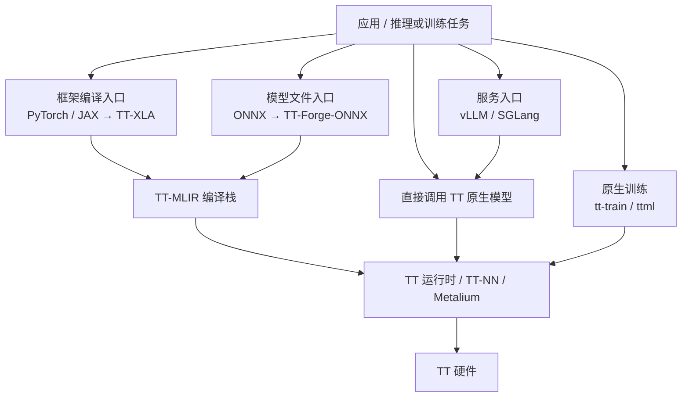
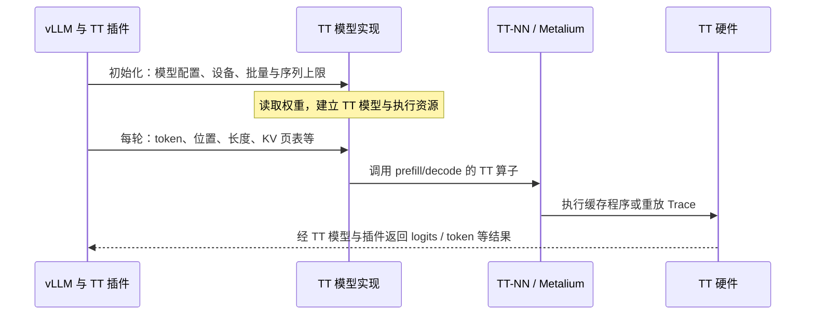

# Tenstorrent 接入生态简明总结

> 根据本次对话整理，日期：2026-10-23。模型与硬件支持随版本变化；文中的流程表示接入关系，不保证任意模型均可直接运行。

## 1. 先看整体关系

Tenstorrent（下文简称 TT）提供从模型服务、框架编译，到算子和设备内核的多层入口。**入口多，不代表每个入口都兼容全部模型。**



图中的服务路径以原生 TT 模型后端为例；TT-Inference-Server 还可以包装 Forge 等后端。

## 2. 推理：有哪些方式，分别怎么用？

| 接入方式 | 使用流程 | 适用场景与边界 |
|---|---|---|
| **vLLM TT 插件** | 选择已适配模型和硬件 → 安装匹配的 tt-metal、vLLM、插件 → 准备权重 → 启动服务或离线推理 → 调用 API | 已支持 LLM 的服务化。调用专门的 TT 模型实现，不能自动获得上游 vLLM 的全部模型支持。 |
| **SGLang TT 插件** | 核对支持范围 → 安装 SGLang 与 TT 插件 → 配置模型、设备和 mesh → 启动服务 → 调用 API | 已使用 SGLang 的应用；功能与硬件支持需要单独核实。 |
| **TT-Inference-Server** | 选择模型和设备 → 选择 `vllm`、`forge` 或 `media` 后端 → 准备权重与容器 → 部署 → 调用对应 API | 统一部署和验证入口。它是服务包装层，实际兼容性取决于所选后端。 |
| **直接调用原生模型** | 安装 tt-metal/TT-NN → 选择模型 demo → 配置权重和设备 → 调用 prefill/decode 或运行示例 → 按需包装服务 | 离线推理、自定义生成流程、性能优化。复用已有 TT 实现，服务管理由应用补齐。 |
| **TT-XLA / TT-Forge** | 准备 PyTorch/JAX 模型 → 安装 TT-XLA → 配置 TT 设备 → 编译并运行 → 校验结果、性能 → 按需封装服务 | 尽量保留框架代码，尝试移植自己的模型。仍受算子、形状、控制流和并行能力约束。 |
| **TT-Forge-ONNX** | 导出/加载 ONNX → 准备示例输入 → `forge.compile()` → 执行 → 校验 → 封装应用 | 已有 ONNX 或可导出模型；对话核查的官方定位为单芯片路径。 |
| **TT-NN / TT-Metalium** | 分解模型计算 → 用 TT-NN 算子实现 → 适配布局、内存和并行 → 为缺失能力编写内核 → 验证、优化 | 新架构或深度性能适配，控制最多，开发投入最大。 |

补充入口：

- **TT-Studio**：通过图形界面使用 TT-Inference-Server，简化部署操作。
- **TT-Lang**：自定义融合算子的 Python DSL，补充底层开发能力；需核实版本成熟度。
- **llama.cpp Metalium 分支**：可探索 GGUF 推理，但属于实验性个人项目，不能等同于官方成熟支持。

## 3. 训练：主要两条路线

| 路线 | 使用流程 | 主要取舍 |
|---|---|---|
| **PyTorch/JAX + TT-XLA + TT-Blacksmith** | 选择已有训练/LoRA 配方 → 准备数据和 checkpoint → 配置 TT 设备 → 运行前向、反向和优化器 → 检查收敛、保存与恢复 | 尽量保留熟悉的框架。Blacksmith 是训练配方与实验集合，不代表任意训练工程都可直接迁移。 |
| **tt-train / ttml** | 构建启用 tt-train 的 tt-metal → 选择示例或用 ttml 定义模型 → 配置数据、损失和优化器 → 训练 → 检查结果与 checkpoint | TT 原生训练框架，有 C++ 和 Python 入口；通常需要迁移模型或训练流程。 |

训练除了“能运行”，还要验证梯度、数值精度、收敛、优化器状态和断点恢复。

## 4. 怎么选兼容性最合适的路径？

| 首要目标 | 优先评估 |
|---|---|
| 快速部署官方已适配的 LLM | vLLM TT 插件 / TT-Inference-Server 的对应配方 |
| 尽量保留 PyTorch/JAX 模型代码 | TT-XLA |
| 已有 ONNX 文件 | TT-Forge-ONNX |
| 精细控制生成和执行流程 | 直接调用原生 TT 模型 |
| 新架构、缺失算子、深度性能优化 | TT-NN / TT-Lang / Metalium |
| 训练或微调 | 先核查 Blacksmith 配方，再评估 ttml 原生路线 |

**没有一种入口能保证前沿模型下载后直接运行。**TT-XLA 是通用框架移植入口，但不能据此断言它实际可用的前沿 LLM 一定比 vLLM 插件更多。

对目标模型，应按以下组合确认可用性：

**具体 checkpoint × 硬件拓扑 × 精度 × 上下文/并发 × 软件版本。**

## 5. vLLM 与 TT 如何分工？

以当前 `vllm-tt-plugin` 的原生模型路径为例：



- **vLLM 与插件**：管理请求、调度和每轮输入；TT 插件还提供适合自身执行方式的调度与运行逻辑。
- **TT 模型**：定义网络结构、权重转换、Attention/MLP、KV Cache、分片与通信。
- **TT 运行时**：准备、编译、缓存并执行设备程序。

这条路径主要接收配置、输入数据和执行元信息，**不是接收一张通用的 vLLM 模型图再自动转换**。所以，注册表有某个架构名，不等于该架构的全部 checkpoint 和功能都已验证。

## 6. 模型代码、Program、Trace 分别是什么？

| 层级 | 描述什么 | 与编译、执行的关系 |
|---|---|---|
| **TT 模型代码** | 整个网络怎么算，以及怎样准备权重、布局和推理状态 | 调用多个 TT 算子，模型结构通常已在代码中实现 |
| **Metalium Program** | 一段设备工作的 kernel、核心分配、Circular Buffer、同步与参数 | 包含计算和搬运的执行方案；不是整个模型，也不等于单独一份二进制 |
| **设备程序编译** | 将 kernel 源码与编译配置变成可执行设备代码 | 兼容配置可复用缓存；形状或配置变化可能需要新的缓存项 |
| **Metal Trace** | 一串设备派发命令及其固定执行配置 | 捕获后重放，减少 CPU/Python 重复组织和派发命令的开销 |

Trace 适合反复执行的 decode、固定形状推理等场景。地址和执行配置保持稳定，输入缓冲区里的数据可以更新；不同形状可能需要多个 Trace。**重放会重新计算，不是复用上一次结果。**

另外，`ttnn.graph.begin_graph_capture()` 是分析、可视化用的图记录；`ttnn.begin_trace_capture()` 是执行优化用的 Metal Trace。

## 7. 为什么 TT 原生代码也会 import torch？

在讨论的 `generator.py` 中，PyTorch 主要用于主机侧创建、补齐、拆分和合并张量，以及承接输出。`torch.Tensor` 是数据容器，不能因此认定它是模型计算图或编译 IR。

两条路径应分开理解：

```text
原生路径：torch 张量整理 → TT 模型 / TT-NN → Metalium → 硬件
编译路径：PyTorch/JAX 模型 → TT-XLA → StableHLO → TT-MLIR → TT 执行栈
```

同样，`import torch` 不代表使用 Triton；Triton 不是这条原生模型路径的必经中间表示。

## 官方参考入口

- [软件栈概览](https://docs.tenstorrent.com/getting-started/tt-software-stack.html)
- [vLLM TT 插件与使用示例](https://github.com/tenstorrent/vllm-tt-plugin)
- [插件模型注册代码](https://github.com/tenstorrent/vllm-tt-plugin/blob/main/src/vllm_tt_plugin/platform.py)
- [TT-Inference-Server](https://github.com/tenstorrent/tt-inference-server)
- [SGLang TT 插件](https://github.com/tenstorrent/tt-inference-server/blob/main/tt-sglang-plugin/README.md)
- [TT-XLA](https://github.com/tenstorrent/tt-xla) / [编译模型验证目录](https://github.com/tenstorrent/tt-forge-models)
- [TT-Forge-ONNX](https://github.com/tenstorrent/tt-forge-onnx)
- [TT 原生模型](https://github.com/tenstorrent/tt-metal/tree/main/models/tt_transformers)
- [TT-Blacksmith](https://github.com/tenstorrent/tt-blacksmith) / [tt-train](https://github.com/tenstorrent/tt-metal/tree/main/tt-train)
- [Metalium Program 示例](https://github.com/tenstorrent/tt-metal/blob/main/tt_metal/programming_examples/matmul/matmul_single_core/matmul_single_core.md)
- [Metal Trace 说明](https://github.com/tenstorrent/tt-metal/blob/main/tech_reports/AdvancedPerformanceOptimizationsForModels/AdvancedPerformanceOptimizationsForModels.md)
