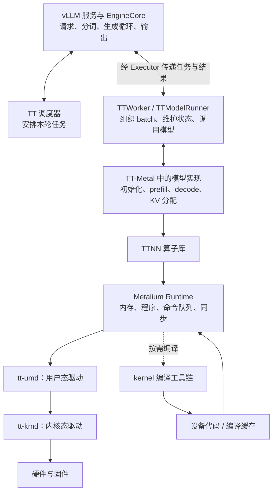
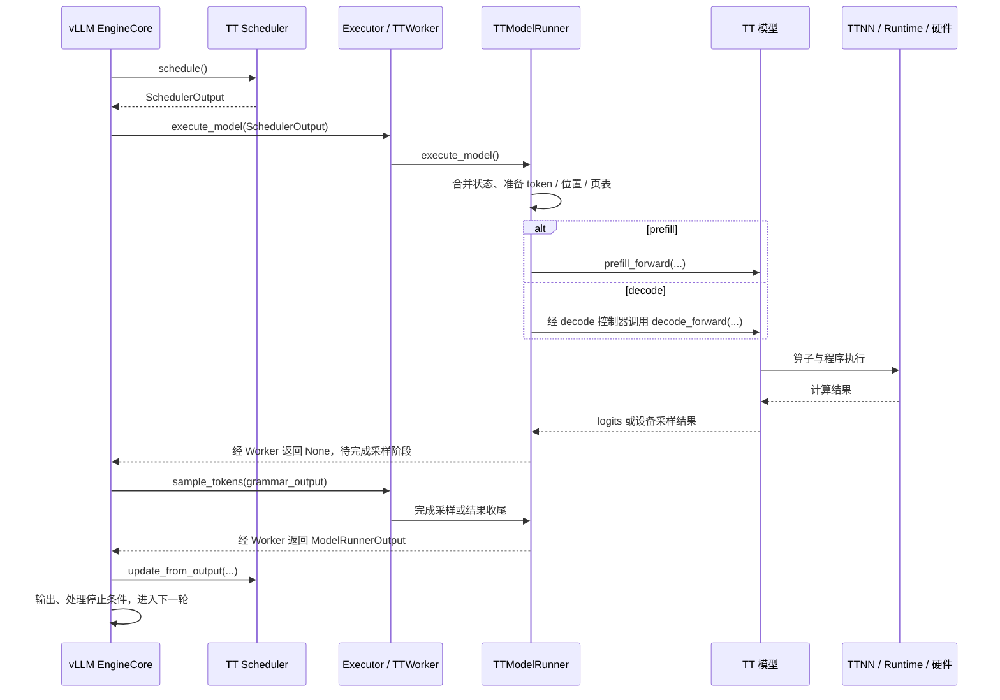

# 自研推理硬件如何参考 Tenstorrent 接入 vLLM

资料核查日期：2026-10-20。面向采用独立 SDK、算子库或模型执行引擎的硬件。

本文先说明 Tenstorrent（TT）的实现，再提出自研硬件的接入建议。以 `vllm-tt-plugin` 与 TT-Metal 的普通自回归文本生成路径为主；图中省略多模态、推测解码和多副本分支。远程引用指向核查时的 `main`，不是固定提交；实施时应固定 vLLM、插件、模型代码、驱动和固件的版本组合。

## 1. 先明确接入边界

**TT 在 vLLM 的 Worker / ModelRunner 执行层接管模型计算，同时通过插件适配平台和调度策略。**

- 启动时：vLLM 发现 TT 插件，选择 TT 平台、Worker、调度器和模型类。
- 推理时：引擎调用 `execute_model(SchedulerOutput)`，执行进入 TTWorker 和 TTModelRunner。
- 向下执行：TTModelRunner 调用 TT 模型，再通过 TTNN、Metalium 和驱动访问硬件。
- 结果返回：插件返回本轮生成结果，vLLM 继续更新请求、判断停止并输出文本。

**这条路径不要求接收 vLLM 导出的模型计算图，也不依赖替换 vLLM 的 Triton kernel。用户请求的完整生命周期仍由 vLLM 引擎驱动。** 参见 [插件说明](https://github.com/tenstorrent/vllm-tt-plugin)、[Worker](https://github.com/tenstorrent/vllm-tt-plugin/blob/main/src/vllm_tt_plugin/worker.py)。

## 2. Tenstorrent 的软件分层



驱动链表示职责分层，不意味着每个算子都调用一次内核接口。编译可以发生在程序准备阶段；缓存命中后可复用。

| 仓库 / 模块 | 主要职责 |
|---|---|
| `vllm-tt-plugin` | 平台识别、模型注册、调度适配、Worker、输入输出桥接 |
| `tt-metal/models/tt_transformers` | 包括 Llama 在内的模型计算实现及 vLLM 适配包装 |
| `tt-metal/ttnn` | 张量操作、Attention、矩阵乘等算子 |
| `tt-metal/tt_metal` | 设备程序、底层执行、kernel 构建、内存与队列 |
| `tt-umd` | 设备发现、地址映射、设备访问与拓扑等用户态能力 |
| `tt-kmd` | Linux 设备节点及底层资源接口 |
| `tt-inference-server` | 部署、测试、评测与服务组织，属于外围工具 |

`tt-metal` 引用 `tt-umd` 子模块；UMD 依赖 KMD。参见 [依赖关系](https://github.com/tenstorrent/tt-metal/blob/main/.gitmodules)、[UMD](https://github.com/tenstorrent/tt-umd)、[KMD](https://github.com/tenstorrent/tt-kmd)。

## 3. 启动流程：模型是谁提供的，如何进入 TT

### 3.1 模型需要拆成三部分理解

| 内容 | 来源 | 如何进入执行路径 |
|---|---|---|
| 模型名称或本地目录 | 用户启动服务时指定 | 例如选择一个受支持的 Llama checkpoint |
| 模型配置与权重 | 模型仓库或本地文件 | 读取配置、权重文件或本地缓存 |
| TT 模型计算代码 | TT 开发者预先实现 | 插件按模型架构选择对应 Python 类 |

这里传递的是配置和模型定位信息，权重由 TT 的加载逻辑读取。插件不会自动把任意模型转换为 TT 实现。

### 3.2 插件发现、设备准备与模型加载

| 顺序 | 实现 | 作用 |
|---|---|---|
| 1 | `pyproject.toml` 中的 `vllm.platform_plugins` | 注册平台探测入口 |
| 2 | `entrypoints.platform_plugin()` | 检查 `ttnn` 可导入，返回 `TTPlatform` 类路径；这不等于设备已通过健康检查 |
| 3 | `vllm.general_plugins` → 模型注册逻辑 | 在相关进程中注册 TT 模型，注册操作需可重复执行 |
| 4 | `TTPlatform.check_and_update_config()` | 选择 Worker、调度器，按模型能力检查或调整配置 |
| 5 | `TTWorker.init_device()` | 打开 TT mesh，确定目标 KV 容量，创建 Runner |
| 6 | `TTModelRunner.load_model()` → `TTModelLoader.load_model()` | 选择注册模型类并创建模型实例 |
| 7 | 模型类的 `initialize_vllm_model(...)` | 接收配置、设备、批大小等，构造 TT 模型并加载权重 |
| 8 | KV 规格与预算查询 → `initialize_from_config(...)` | 将 vLLM 的缓存规划落实为设备 KV 缓冲区 |
| 9 | `compile_or_warm_up_model()` | 预热相关执行形状，准备程序及可选的 trace |

以上是依赖顺序概览。平台检查、模型注册可能在不同进程重复发生，不能依赖某个 Python 全局变量跨进程共享。参见 [入口](https://github.com/tenstorrent/vllm-tt-plugin/blob/main/src/vllm_tt_plugin/entrypoints.py)、[Loader](https://github.com/tenstorrent/vllm-tt-plugin/blob/main/src/vllm_tt_plugin/loader.py)。

### 3.3 Llama 的具体模型映射

默认 `tt_transformers` 路径下，注册关系为：

```text
TTLlamaForCausalLM
    → models.tt_transformers.tt.generator_vllm:LlamaForCausalLM
```

这是 **TT-Metal 中的模型类**。插件也可以根据配置选择其他 TT Llama 实现。

其初始化通过 `ModelArgs.load_state_dict()` 读取权重，再创建 TT `Transformer`；叶子模块转换权重的数据类型、tile 布局和设备分片。模型结构由开发者用 TT 算子实现，原始权重保留训练结果，必要的格式及精度转换需验证。参见 [注册映射](https://github.com/tenstorrent/vllm-tt-plugin/blob/main/src/vllm_tt_plugin/platform.py)、[初始化](https://github.com/tenstorrent/tt-metal/blob/main/models/tt_transformers/tt/generator_vllm.py)、[权重加载](https://github.com/tenstorrent/tt-metal/blob/main/models/tt_transformers/tt/model_config.py)。

## 4. 推理流程：从任务单到硬件，再返回 vLLM

### 4.1 输入边界：SchedulerOutput

`SchedulerOutput` 是调度器产生的“本轮任务单”。它包含请求和缓存元数据，不包含模型计算图或设备二进制。

| 字段 | 含义 |
|---|---|
| `scheduled_new_reqs` | 首次调度的请求，包括提示词、采样参数、KV 块等 |
| `scheduled_cached_reqs` | 已有请求的进度和缓存变化；不保证每轮重传全部 token |
| `num_scheduled_tokens` | 每个请求本轮计算多少 token |
| `total_num_scheduled_tokens` | 本轮总计算 token 数 |
| `finished_req_ids` | 已结束请求，供执行层清理状态 |

Runner 必须把本轮增量与自己保存的状态合并，才能构造完整设备输入。计算提示词的 100 个 token，不等于生成 100 个 token。定义见 [当前本地 SchedulerOutput](E:/Codes/vllm/vllm/v1/core/sched/output.py:232)。

### 4.2 一轮普通同步执行



当前普通非空 TT 路径先执行或提交前向，再由 `sample_tokens()` 收尾；`None` 表示需要第二阶段。空任务可返回空输出。设备端采样可能已随执行发生，第二阶段不一定再次采样；异步路径可返回延迟取回的结果包装。参见 [TT Runner](https://github.com/tenstorrent/vllm-tt-plugin/blob/main/src/vllm_tt_plugin/model_runner.py)、[本地 EngineCore.step](E:/Codes/vllm/vllm/v1/engine/core.py:657)。

### 4.3 TT 模型继续做什么

普通 Llama 前向按如下结构计算：

```text
Embedding
    → 多个 Decoder 层：Norm、Attention、残差、Norm、MLP、残差
    → 最终 Norm / LM Head
    → logits → 采样 token
```

- Prefill：处理提示词，写入 KV；完整提示词处理完成后取得首个生成 token 所需结果。
- Decode：用新 token、位置和历史 KV 继续计算，追加缓存。普通自回归通常每轮生成一个 token。
- 分块 prefill：中间块只推进计算进度，不应错误输出生成 token。

TT 的 `decoder.py` 组织层结构，`attention.py` 调用缓存更新和 paged Attention，`mlp.py` 使用 `ttnn.linear` 等算子。硬件计算的实现入口在这些模块，不在 vLLM 服务入口。参见 [Decoder](https://github.com/tenstorrent/tt-metal/blob/main/models/tt_transformers/tt/decoder.py)、[Attention](https://github.com/tenstorrent/tt-metal/blob/main/models/tt_transformers/tt/attention.py)、[MLP](https://github.com/tenstorrent/tt-metal/blob/main/models/tt_transformers/tt/mlp.py)。

### 4.4 Runtime 提交的是什么

Runtime 组织设备程序、缓冲区、参数、执行配置与依赖，再提交命令。一个算子可包含计算和数据搬运等多个 kernel；一轮模型计算又可包含多个程序。

```text
kernel 源码 + 编译配置 → 编译工具链 → 设备代码
设备代码 + 数据地址 + 运行时参数 + 执行配置 → Runtime 提交
```

代码可编译、加载并缓存复用，后续执行更新输入和允许变化的参数。TT Metalium JIT Build 使用 SFPI 工具链中的设备编译器；TT-MLIR 则是模型图编译框架，属于另一种更高层的入口。上述 TT 手工模型路径不要求先经过 TT-MLIR。参见 [kernel 构建](https://github.com/tenstorrent/tt-metal/blob/main/tt_metal/jit_build/build.cpp)、[执行示例](https://github.com/tenstorrent/tt-metal/blob/main/tt_metal/programming_examples/hello_world_datamovement_kernel/hello_world_data_movement.md)、[TT-MLIR](https://docs.tenstorrent.com/tt-mlir/overview.html)。

### 4.5 结果与请求结束

`ModelRunnerOutput` 主要返回请求 ID、本轮采样 token 和可选的概率信息。引擎与调度器更新进度，处理结束或取消，前端将 token 转为文本。

后续任务单通知 Runner 清理已结束请求。KV 管理器回收逻辑块，设备缓存池通常继续存在供复用；清理请求不等于每次释放整块设备内存。异步执行必须避免旧任务仍访问已复用的块。

## 5. 两个最重要的责任边界

### 5.1 插件与模型

| 插件 / Runner 管理 | 模型 / SDK 管理 |
|---|---|
| 请求 ID、调度进度、batch 行映射 | 模型结构、权重、张量计算 |
| 新请求、结束、恢复等生命周期 | prefill / decode 的实际执行 |
| KV 逻辑块到设备页表的衔接 | 按页表读写设备 KV |
| 结果归属和 vLLM 输出封装 | 返回 logits，或支持的设备采样结果 |

TT 模型包装还可能负责 KV 分配、trace 和采样，实际分工以接口契约为准。`prefill_forward` 等是 TT 的桥接约定，不是所有 vLLM 硬件都必须使用的统一方法名。

### 5.2 KV 页表与驱动地址映射

- KV 页表：请求的第几个逻辑缓存块，对应缓存池中的哪个块。
- 驱动地址映射：CPU 或设备如何访问内存，以及相关地址如何转换。
- batch 行：本轮输入中的排列位置，可随请求退出而变化。

**请求身份、batch 行、KV 块编号不能混为一谈。** 请求换行后，历史 KV 和其他持久状态仍须属于原请求。

## 6. 自研硬件的相似接入方案

以下是基于 TT 路线的设计建议，不是 TT 已有代码的功能声明。

### 6.1 建议的核心模块

| 自研模块 | 实现内容 | 参考位置 |
|---|---|---|
| 插件入口 | 平台探测、模型注册，可在多进程安全重复调用 | TT `entrypoints.py`、`pyproject.toml` |
| `MyPlatform` | 继承 Platform，选择 Worker，校验精度、缓存、编译与功能组合 | TT `platform.py`；vLLM `platforms/interface.py` |
| `MyWorker` | 设备初始化、加载、KV 规格/预算/分配、执行、同步、关闭 | TT `worker.py`；vLLM WorkerBase 与实际调用方 |
| `MyModelRunner` | 合并请求状态、组织 batch、构造 SDK 参数、完成采样、封装结果 | TT `model_runner.py`、`input_batch.py` |
| 模型加载与适配 | 选择模型实现，读取权重并转换，封装 prefill/decode | TT `loader.py`；TT-Metal `generator_vllm.py` |
| 算子 / 模型执行引擎 | 模型数学计算、KV 读写、布局与精度；可手写，也可接已有模型编译器 | TT-Metal 的模型代码和 TTNN |
| Runtime 与驱动 | 程序加载、内存、数据传输、提交、完成通知、错误与资源回收 | Metalium、UMD、KMD |
| 可选调度器 | 适配不能混合 prefill/decode、固定 batch 等硬件限制 | TT `scheduler.py` |

第一版应明确支持的模型和功能，未支持的组合在启动或请求验证时拒绝。不能仅把设备名称改掉就复用 CUDA 执行路径。

### 6.2 先定义三组契约

1. **vLLM → Runner**：理解目标版本的 `SchedulerOutput`、KV 配置和输出约定。
2. **Runner → 模型 SDK**：初始化、KV 分配、prefill、decode、采样、同步和清理。
3. **编译产物 → Runtime**：目标硬件版本、形状约束、输入输出绑定、布局、工作区、动态参数和错误码。

第二组应至少讲清：`tokens`、有效长度、位置、KV 页表、KV 句柄、采样参数、结果行对应的请求。若 SDK 返回 logits，Runner 可做主机采样；若返回 token，SDK 必须正确落实允许使用的采样参数。

若 SDK 只支持“输入全文、返回完整答案”，需要补充逐步执行和状态控制，才能配合 vLLM 的逐轮批处理。若采用整模型编译，建议分别暴露 prefill/decode 入口，明确动态形状或形状档位。

### 6.3 Worker 的优先接口

| 接口 | 最低要求 |
|---|---|
| `init_device()` / `load_model()` | 建立设备上下文、加载模型和权重 |
| `get_kv_cache_spec()` | 上报真实缓存规格 |
| `determine_available_memory()` | 提供可以兑现的 KV 内存预算 |
| `initialize_from_config(...)` | 按引擎规划分配缓存并初始化 batch |
| `compile_or_warm_up_model()` | 完成必要的编译或预热，按目标版本返回统计 |
| `execute_model(...)` | 接收本轮任务并执行；直接返回结果，或按约定进入采样阶段 |
| `sample_tokens(...)` | 前一步返回 None 时完成结果，支持的结构化约束在此正确落实 |
| `synchronize_device()` / `shutdown()` | 同步、释放任务与设备资源 |

并非所有接口都声明在 WorkerBase。应同时查看 Engine、Executor、Worker 包装和 GPUWorker 的实际调用；Runner 也不必继承 GPUModelRunner。接口签名以目标版本为准。

### 6.4 循序渐进的实施与验收

| 阶段 | 先完成什么 | 通过标准 |
|---|---|---|
| 1. 基础设备 | 驱动、Runtime、程序提交与同步 | 数据往返正确，矩阵乘结果正确，超时有明确错误 |
| 2. 独立模型 | 一个文本模型的 prefill/decode | 不接 vLLM 也能生成；逐层及多步结果与参考实现对齐 |
| 3. KV 与状态 | 页表、位置、块复用、batch 重排 | 两请求并行，一个结束、新请求加入时无串扰 |
| 4. 最小插件 | Platform、Worker、Runner、模型注册 | 单设备、同步、基础采样的离线及服务请求均可运行 |
| 5. 生命周期 | 取消、抢占恢复、缓存不足和停止条件 | 无重复/丢失 token，无缓存泄漏或过早复用 |
| 6. 扩展优化 | 分块 prefill、设备采样、异步、trace、多卡 | 每项分别验证正确性、延迟、吞吐和内存 |

先固定一个受支持模型和设备配置。验证至少覆盖短长输入、多轮 decode、不同批大小、请求动态加入/结束；模型精度变化需要模型评测。性能记录至少包括 TTFT、TPOT、吞吐、峰值内存，区分预热/编译与稳定运行时间。

## 7. 实现难点与风险

| 难点 / 风险 | 可能的问题 | 处理重点 |
|---|---|---|
| 模型适配与算子覆盖 | 注册成功却不能运行，模型变体语义不一致 | 明确支持架构，逐层验证 RoPE、GQA、Norm、Attention 等 |
| KV 布局与块大小 | 缓存越界、历史错读、长上下文后才出错 | 统一规格、页表、位置与实际物理布局；验证边界 |
| batch 重排与持久状态 | 不同请求共享错 KV、随机数或循环状态 | 请求 ID、行号和设备槽位分别管理，重排时同步映射 |
| 内存预算 | 权重、KV、临时工作区、trace 叠加导致 OOM | 对允许的形状估算/测量真实峰值，保留余量 |
| 采样与输出约定 | 采样参数未生效，概率错误，中间 prefill 误输出 | 明确主机/设备采样边界，校验输出行和生成数量 |
| 形状与编译缓存 | 每轮重编译、固定形状无法处理变长请求 | 设计形状档位、padding 和有效长度，复用匹配产物 |
| trace 与异步 | 捕获地址失效，输入未更新，旧结果覆盖新状态 | 管理地址生命周期、事件、完成顺序和状态更新边界 |
| 抢占、取消与异常 | 使用已回收缓存，设备挂起或资源泄漏 | 等待/隔离在途任务，明确恢复与关闭策略 |
| 多设备 | 权重切分、通信与缓存归属不一致 | 先单设备，再明确由 SDK 或 vLLM 哪一层管理并行 |
| 版本兼容 | 接口、返回类型或默认功能变化后启动/执行失败 | 固定组合，建立启动和多请求回归，避免默认开启未验证功能 |

TT 当前使用自定义调度策略安排 prefill-only / decode-only 步骤，自研硬件仅在有相似约束时采用。TT 的 KV 预算也有专用适配：先确定目标块数，再返回让引擎规划出相同块数的字节预算，不能照抄为硬件真实空闲内存。参见 [调度器](https://github.com/tenstorrent/vllm-tt-plugin/blob/main/src/vllm_tt_plugin/scheduler.py)、[Worker 缓存处理](https://github.com/tenstorrent/vllm-tt-plugin/blob/main/src/vllm_tt_plugin/worker.py)。

## 8. 名词解释

| 名词 | 简要解释 |
|---|---|
| Platform / OOT | 平台适配描述；OOT 表示通过外部包提供实现 |
| EngineCore | 驱动调度、执行与结果更新的引擎核心 |
| Scheduler | 决定本轮哪些请求执行、分配多少计算量 |
| Executor | 把引擎调用分发给 Worker 的执行组织层 |
| Worker | 管理执行进程中的设备、模型和资源生命周期 |
| ModelRunner | 把调度任务转换成模型输入，并将结果转回 vLLM 格式 |
| SchedulerOutput | 本轮任务单，包含请求、计算量和缓存变化等 |
| ModelRunnerOutput | 本轮执行结果，包含请求 ID、token 和可选概率等 |
| Prefill / Decode | 处理提示词 / 利用历史缓存继续生成 |
| Logits / Sampling | 模型对下一 token 的分数 / 根据分数和参数选择 token |
| KV Cache / Page Table | 注意力历史键值缓存 / 逻辑块到缓存池块的映射 |
| Batch / Slot | 本轮批次 / 执行层持久状态可能绑定的槽位 |
| TTNN / Metalium | TT 算子库 / 底层设备编程与执行运行时 |
| Kernel / Program | 设备执行函数 / 组织多个 kernel 和相关资源的程序对象 |
| Runtime / SDK | 执行程序、管理资源的软件层 / 对外提供的开发接口集合 |
| JIT / 编译缓存 | 按需即时编译 / 复用匹配的编译产物 |
| Trace | 捕获执行命令并重放，通常要求管理稳定地址和输入更新 |
| TT-MLIR | 模型图编译框架，不等于 Metalium 的 kernel 编译工具链 |
| UMD / KMD | 用户态驱动 / 内核态驱动 |
| Mesh / TP / DP | 设备组 / 张量并行 / 数据并行副本 |
| TTFT / TPOT | 首 token 延迟 / 后续每 token 的生成耗时 |

## 9. 引用与代码阅读索引

### 9.1 Tenstorrent：建议按顺序阅读

下列代码路径均相对于对应仓库根目录；远程链接提供可直接阅读的源码。

| 顺序 | 仓库与代码路径 | 重点入口 / 用途 |
|---|---|---|
| 1 | [vllm-tt-plugin / README.md](https://github.com/tenstorrent/vllm-tt-plugin/blob/main/README.md) | 版本、安装、能力限制和模块布局 |
| 2 | [vllm-tt-plugin / pyproject.toml](https://github.com/tenstorrent/vllm-tt-plugin/blob/main/pyproject.toml) | 两组 entry points |
| 3 | [vllm-tt-plugin / src/vllm_tt_plugin/entrypoints.py](https://github.com/tenstorrent/vllm-tt-plugin/blob/main/src/vllm_tt_plugin/entrypoints.py) | `platform_plugin()`、`register()` |
| 4 | [vllm-tt-plugin / src/vllm_tt_plugin/platform.py](https://github.com/tenstorrent/vllm-tt-plugin/blob/main/src/vllm_tt_plugin/platform.py) | `TTPlatform.check_and_update_config()`、模型映射 |
| 5 | [vllm-tt-plugin / src/vllm_tt_plugin/worker.py](https://github.com/tenstorrent/vllm-tt-plugin/blob/main/src/vllm_tt_plugin/worker.py) | `TTWorker`、设备与 KV 生命周期 |
| 6 | [vllm-tt-plugin / src/vllm_tt_plugin/loader.py](https://github.com/tenstorrent/vllm-tt-plugin/blob/main/src/vllm_tt_plugin/loader.py) | `TTModelLoader.load_model()` |
| 7 | [tt-metal / models/tt_transformers/tt/generator_vllm.py](https://github.com/tenstorrent/tt-metal/blob/main/models/tt_transformers/tt/generator_vllm.py) | `LlamaForCausalLM`、初始化及 KV 桥接 |
| 8 | [tt-metal / models/tt_transformers/tt/model_config.py](https://github.com/tenstorrent/tt-metal/blob/main/models/tt_transformers/tt/model_config.py) | `ModelArgs.load_state_dict()` |
| 9 | [vllm-tt-plugin / src/vllm_tt_plugin/model_runner.py](https://github.com/tenstorrent/vllm-tt-plugin/blob/main/src/vllm_tt_plugin/model_runner.py) | `build_model_input()`、`execute_model()`、`sample_tokens()` |
| 10 | [vllm-tt-plugin / src/vllm_tt_plugin/async_decode.py](https://github.com/tenstorrent/vllm-tt-plugin/blob/main/src/vllm_tt_plugin/async_decode.py) | decode 提交、读回与异步状态 |
| 11 | [vllm-tt-plugin / src/vllm_tt_plugin/scheduler.py](https://github.com/tenstorrent/vllm-tt-plugin/blob/main/src/vllm_tt_plugin/scheduler.py) | `TTScheduler.schedule()` |
| 12 | [tt-metal / models/tt_transformers/tt/model.py](https://github.com/tenstorrent/tt-metal/blob/main/models/tt_transformers/tt/model.py) | TT Transformer 的整体结构 |
| 13 | [tt-metal / models/tt_transformers/tt/decoder.py](https://github.com/tenstorrent/tt-metal/blob/main/models/tt_transformers/tt/decoder.py) | 一层 Decoder 如何组合计算 |
| 14 | [tt-metal / models/tt_transformers/tt/attention.py](https://github.com/tenstorrent/tt-metal/blob/main/models/tt_transformers/tt/attention.py) | Attention、RoPE 与分页缓存读写 |
| 15 | [tt-metal / models/tt_transformers/tt/mlp.py](https://github.com/tenstorrent/tt-metal/blob/main/models/tt_transformers/tt/mlp.py) | 权重转换和 `ttnn.linear` |
| 16 | [tt-metal / tt_metal/jit_build/build.cpp](https://github.com/tenstorrent/tt-metal/blob/main/tt_metal/jit_build/build.cpp) | kernel 编译工具链调用 |
| 17 | [tt-metal / METALIUM_GUIDE.md](https://github.com/tenstorrent/tt-metal/blob/main/METALIUM_GUIDE.md) | 设备执行与数据搬运模型 |
| 18 | [tt-kmd / ioctl.h](https://github.com/tenstorrent/tt-kmd/blob/main/ioctl.h) | 底层驱动接口与数据结构 |

补充资料：[TT-UMD](https://github.com/tenstorrent/tt-umd)、[TT-MLIR 架构](https://docs.tenstorrent.com/tt-mlir/overview.html)、[TT 推理部署工具](https://github.com/tenstorrent/tt-inference-server)。

### 9.2 vLLM：当前本地接口索引

本地链接对应本文核查的 `E:/Codes/vllm` 工作区，分享给他人时可按同名仓库路径查找。它与远程 TT 插件目标版本不保证完全相同，不能直接混用签名。

| 本地代码 | 重点内容 |
|---|---|
| [docs/design/plugin_system.md](E:/Codes/vllm/docs/design/plugin_system.md) | 平台插件注册流程与约定 |
| [vllm/platforms/interface.py](E:/Codes/vllm/vllm/platforms/interface.py:137) | `Platform` 定义 |
| [vllm/v1/engine/core.py](E:/Codes/vllm/vllm/v1/engine/core.py:657) | `EngineCore.step()`：调度、执行、采样、结果更新 |
| [vllm/v1/executor/uniproc_executor.py](E:/Codes/vllm/vllm/v1/executor/uniproc_executor.py) | 单进程 Executor 如何初始化并调用 Worker |
| [vllm/v1/worker/worker_base.py](E:/Codes/vllm/vllm/v1/worker/worker_base.py:44) | Worker 基础契约与包装层 |
| [vllm/v1/worker/gpu_worker.py](E:/Codes/vllm/vllm/v1/worker/gpu_worker.py) | 缓存预算、初始化及其他实际 Worker 接口参考 |
| [vllm/v1/core/sched/output.py](E:/Codes/vllm/vllm/v1/core/sched/output.py:232) | `SchedulerOutput` 及请求数据 |
| [vllm/v1/outputs.py](E:/Codes/vllm/vllm/v1/outputs.py:267) | `ModelRunnerOutput` |
| [vllm/v1/kv_cache_interface.py](E:/Codes/vllm/vllm/v1/kv_cache_interface.py) | KV 规格与缓存配置 |
| [vllm/model_executor/models/registry.py](E:/Codes/vllm/vllm/model_executor/models/registry.py:1137) | `ModelRegistry.register_model()` |

本文是基于源码阅读的设计说明，未在 TT 或自研硬件上执行验证。接入是否完成，应以第 6 节的分阶段验收结果为准。
