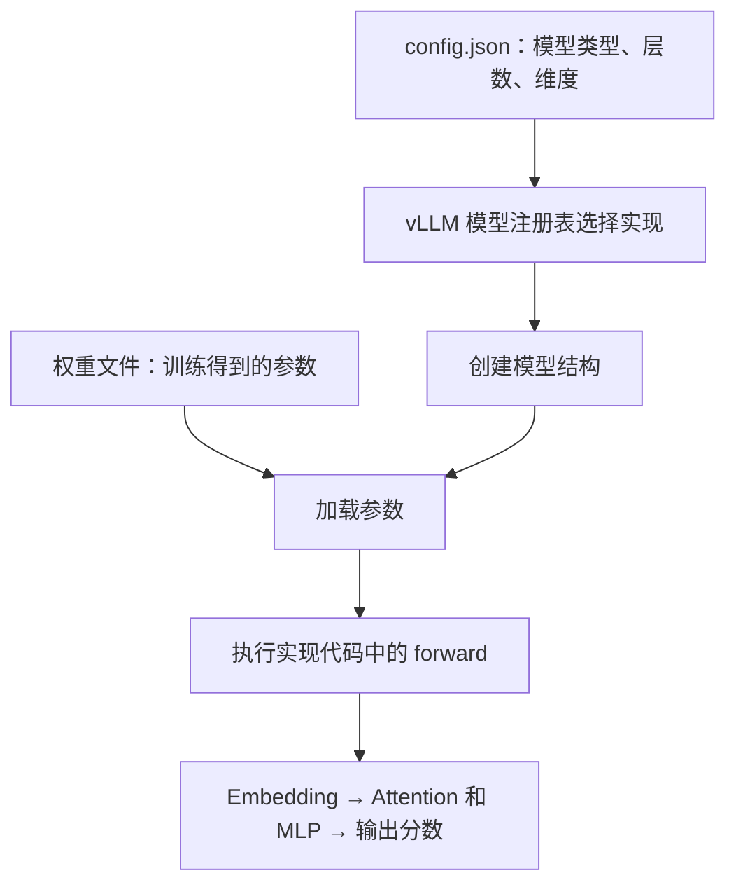
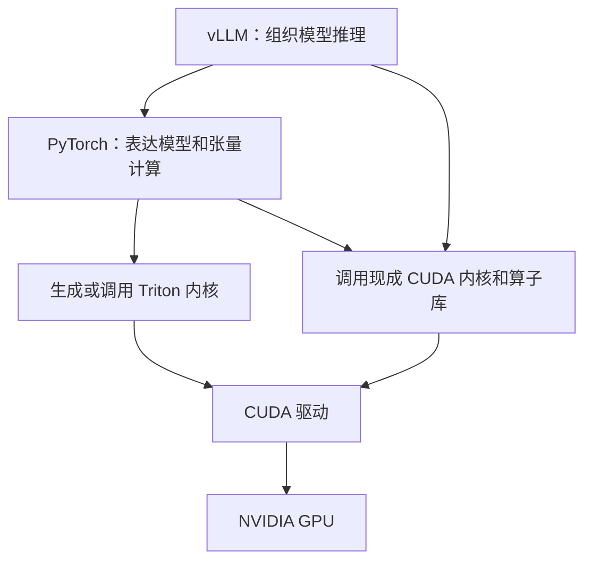
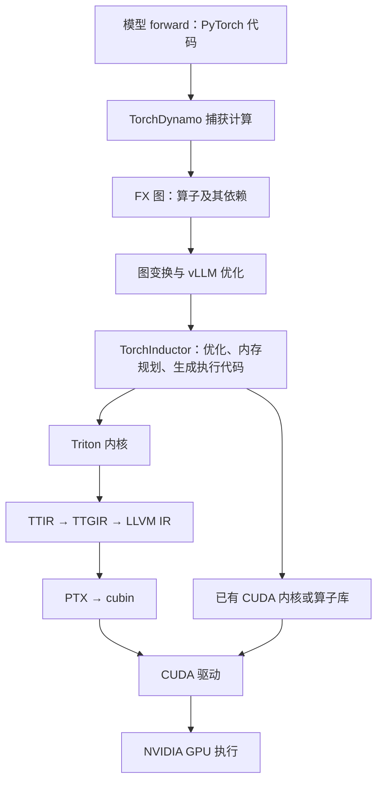
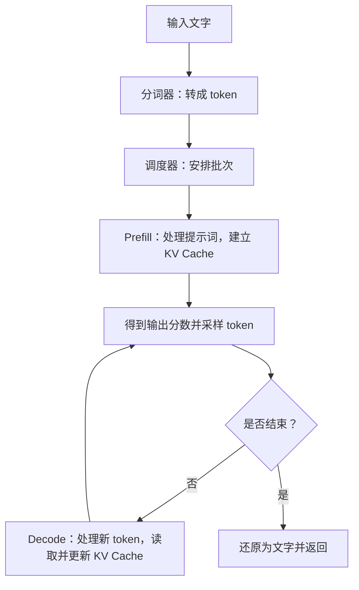

# 从模型文件到 GPU：vLLM 推理入门

本文整理我们关于模型文件、vLLM、PyTorch、Triton、编译和 GPU 执行的讨论。正文先建立整体认识，文末完整保留名词解释表。

## 1. 先理解这四句话

- **模型代码给方法**：定义先做什么、后做什么。
- **模型配置给规格**：说明模型类型、层数、维度等。
- **模型权重给参数**：提供训练得到的具体数值。
- **推理引擎组织执行**：加载模型、安排请求、管理缓存，把计算交给硬件。

**vLLM 不会从一堆权重数值中猜出模型算法。** 它根据配置找到已有的模型实现，再加载权重。

## 2. 下载的模型文件里有什么？

通常下载到的是一个模型文件夹，而不只是一个文件。

| 内容 | 常见文件 | 用途 |
|---|---|---|
| 权重 | `*.safetensors`、`pytorch_model*.bin` | 保存参数，通常占绝大部分空间 |
| 模型配置 | `config.json` | 说明模型架构、层数和维度等 |
| 分词器 | `tokenizer.json`、`tokenizer.model` 等 | 在文字和 token 编号之间转换 |
| 生成配置 | `generation_config.json` | 提供采样等生成参数的默认值 |
| 权重索引 | `model.safetensors.index.json` | 权重分片时，说明各参数存在哪个文件 |
| 可选代码 | `modeling_*.py`、`configuration_*.py` 等 | 为某些自定义模型提供实现 |

**通常，权重文件没有 Python 或 PyTorch 的 `forward` 代码。** 常见模型的实现已经包含在 vLLM 或 Transformers 中，因此模型目录不必再次附带代码。

权重是数据，`forward` 是使用这些数据的计算方法。只有权重，通常不能完整确定计算流程。

## 3. vLLM 怎么知道模型该怎么算？

以 Llama 为例：



模型实现由开发者提前编写。配置中的 `architectures` 等信息帮助 vLLM 选择对应实现；具体加载路径也可能使用 Transformers 的模型实现。

这里有两个不同的问题：

| 问题 | 谁决定 |
|---|---|
| 数学上做什么，例如矩阵乘法、Attention、归一化 | 模型实现代码 |
| 相同计算在某块 GPU 上怎样执行得快 | vLLM 后端选择逻辑、编译器和算子库 |

张量、向量和函数也不是互相替代的计算方式：

- **张量是数据容器**；向量是一维张量，矩阵是二维张量。
- **算子或函数处理这些数据**，例如加法、矩阵乘法、激活函数。

例如 `y = x @ W`：`x`、`W` 是张量，`@` 是矩阵乘法。代码规定做乘法，配置和输入决定形状，权重文件提供 `W` 的数值。

## 4. vLLM、PyTorch、Triton 是什么关系？

| 组件 | 主要职责 |
|---|---|
| vLLM | 找到模型实现、加载权重、调度请求、管理 KV Cache、组织执行 |
| PyTorch | 提供张量、模型层、数学运算，以及图捕获和编译能力 |
| Triton | 提供 GPU 内核编程语言和编译器，实现部分底层计算 |



这是一张简化的协作关系图，不表示所有算子必须经过全部组件。

PyTorch 抽象程度较高，主要描述张量运算；Triton 更接近 GPU，需要考虑数据分块、并行和访存。它们让上层更容易表达计算，再由下层适配硬件，并非只是为了贴近模型文件的数据格式。

**PyTorch 不必通过 Triton 执行所有操作。** 它也可以调用 CUDA 内核和 cuBLAS 等库。这里的 Triton 指 GPU 编程语言及编译器。

## 5. TorchDynamo“捕获模型”是什么意思？

准确说，是提取模型代码中的张量计算过程，形成计算图。

原来的计算可以写成：

```text
a = 矩阵乘法(x, 权重)
b = a + 偏置
y = 激活函数(b)
```

TorchDynamo 将其中的计算提取为 FX 图：

```text
输入 → 矩阵乘法 → 加法 → 激活函数 → 输出
```

有了图，编译器能看见运算之间的依赖，判断哪些操作可以融合、哪些中间数据可以省掉。

**TorchDynamo 是 PyTorch 的图捕获组件，不负责读取权重，也不直接生成 GPU 机器码。** 它可能提取出一个或多个图，具体取决于代码和配置。

## 6. 从模型代码到 NVIDIA GPU，经过哪些转换？

没有固定的组件数量，因为执行有分支。启用编译时，常见路径如下：



各层表示关心的事情不同：

| 层次 | 主要表达什么 |
|---|---|
| FX 图及 ATen 算子 | 有哪些张量运算，它们怎样连接 |
| vLLM IR | 保留 RMSNorm 等操作的高层含义，方便融合和选择实现 |
| Inductor IR | 循环、数据访问、缓冲区等更具体的计算安排 |
| TTIR | Triton 数据块上的计算 |
| TTGIR | 数据如何分配到 GPU 线程等执行细节 |
| LLVM IR | 更底层的计算和访存操作 |
| PTX | NVIDIA 的虚拟指令 |
| cubin | 包含面向具体 GPU 的机器码等内容的二进制文件 |

**vLLM IR 可以作为高层算子出现在 FX 图中，不是每个模型都必须单独经过的一种文件格式。** 部分图整理工作还会经过 AOTAutograd 等 PyTorch 组件；推理路径使用这些组件，不意味着必须计算训练所需的梯度。

Triton 路线主要由 Triton、LLVM 和 NVIDIA 工具链逐步编译。现成 CUDA 内核则可能已经提前编译好，直接被调用。关闭图编译时，也可以按顺序调用现成算子执行。

### GPU 上具体选什么实现？

后端选择通常考虑：GPU 型号、数据类型、量化方式、张量形状、用户配置和实现的支持范围。

- 矩阵乘法：可能调用 cuBLAS，也可能使用其他专用内核。
- Attention：可能选择 FlashAttention、FlashInfer 等实现。
- 归一化、量化等：可能使用 vLLM 的 CUDA 内核或 Triton 内核。

这些选择主要来自开发者写好的规则，部分路径还会比较不同实现或参数的性能。同一个数学算子，可以有多种硬件实现。

## 7. 启动准备和实际生成，要分开理解

**启动准备**主要包括：创建模型、加载权重、准备 KV Cache、按配置进行编译、预热和 CUDA Graph 捕获。具体顺序和范围随实现变化，已有缓存也能减少准备工作。

**实际生成**主要重复执行准备好的程序：



这个图简化展示单个请求的生成过程；实际服务可以边生成边返回文字。

- **KV Cache**：保留历史 token 的 K、V，避免每轮重新计算它们。
- **连续批处理**：新请求不断加入批次，完成的请求退出，减少 GPU 等待。
- **分块管理**：按块分配 KV Cache，提升显存利用率。
- **CUDA Graph**：把一串 GPU 操作录制后重放，减少 CPU 逐个提交操作的开销。

CUDA Graph 是运行提交方式的优化，与计算图和编译 IR 的优化层次不同。**通常不会每生成一个 token，就重新走一遍整条编译链。**

## 8. 为什么要有这么多层？推理引擎是谁生成的？

**vLLM 本身就是开发者写好的推理引擎。** 启动时，它把模型实现、参数、缓存和后端组合起来；编译器优化的是已有计算，并生成部分执行程序。

| 层次 | 为什么需要 |
|---|---|
| 模型代码 | 便于人理解、编写和维护模型 |
| 高层计算图 | 看清整体计算，发现融合和简化机会 |
| 底层 IR 和编译器 | 将计算落实到线程、存储和具体硬件 |
| 专用内核和算子库 | 为矩阵乘法、Attention 等关键操作提供高效实现 |
| vLLM 的运行管理 | 让多个请求高效共享 GPU 和 KV Cache |
| CUDA 驱动 | 加载程序并把任务提交给 GPU |

分层的代价是系统和启动准备更复杂；收益是模型更容易开发、能够适配不同硬件，并让后续反复执行的推理更高效。

## 9. 延伸阅读

- [vLLM 模型注册说明](https://github.com/vllm-project/vllm/blob/main/docs/contributing/model/registration.md)
- [vLLM IR 设计](https://github.com/vllm-project/vllm/blob/main/docs/design/vllm_ir.md)
- [vLLM CUDA Graph 设计](https://github.com/vllm-project/vllm/blob/main/docs/design/cuda_graphs.md)
- [PyTorch 编译器说明](https://docs.pytorch.org/docs/main/user_guide/torch_compiler/torch.compiler.html)
- [TorchDynamo 说明](https://docs.pytorch.org/docs/main/user_guide/torch_compiler/torch.compiler_dynamo_overview.html)
- [Triton 编译阶段说明](https://pytorch.org/blog/triton-kernel-compilation-stages/)

## 附录：完整名词解释

以下完整保留此前的名词解释表，并在最后补充正文新增的少量名词。

### 一、模型文件里有什么

| 名词 | 含义 | 在推理中的作用 |
|---|---|---|
| 大语言模型（LLM） | 根据上下文预测下一个 token 的模型 | 根据输入逐步生成回答 |
| 模型架构／模型结构 | 模型由哪些层组成，以及如何连接 | 规定整体计算方法 |
| 模型实现代码 | 用程序实现模型结构和计算步骤 | 告诉推理框架“怎么算” |
| 参数／权重 | 训练得到的大量数值 | 决定模型的具体输出 |
| 权重文件 | 保存参数的文件，如 `*.safetensors`、`pytorch_model*.bin` | 加载时提供参数数值 |
| 模型配置 `config.json` | 模型类型、层数、维度等信息 | 帮助选择模型代码并创建正确结构 |
| 权重分片 | 把大份权重拆成多个文件 | 方便存储和加载 |
| 权重索引 `model.safetensors.index.json` | 参数名到权重分片的对应表 | 帮助加载器找到各个参数 |
| 分词器文件 | 如 `tokenizer.json`、`tokenizer.model` | 保存文字与 token 之间的转换规则 |
| 生成配置 `generation_config.json` | 生成参数的默认设置 | 提供采样等行为的默认值 |
| 自定义模型代码 | 模型目录中可选的 `modeling_*.py` 等文件 | 为特殊模型提供实现；常见模型通常已有库内实现 |
| 模型加载器 | 创建模型并装入参数的程序模块 | 把配置、代码、权重组合成可执行模型 |
| 模型注册表 | 模型架构名称与实现代码的对应表 | 让 vLLM 找到对应模型实现 |
| `architectures` | 配置中的模型架构名称字段 | 是 vLLM 选择实现的重要依据之一 |

### 二、模型如何表达计算

| 名词 | 含义 | 在推理中的作用 |
|---|---|---|
| Python | 编程语言 | 编写模型结构、调度和执行逻辑 |
| PyTorch | 张量计算和深度学习框架 | 提供模型层、数学运算及编译能力 |
| Transformers | 提供大量模型、配置和分词器实现的库 | 为加载和执行模型提供支持 |
| Llama | 一类大语言模型架构 | 是前面说明模型加载和执行流程的例子 |
| `forward`／前向计算 | 模型从输入算到输出的过程 | 定义一次模型计算的步骤 |
| 模型层 | 模型中的一个计算模块 | 组合成完整模型，例如线性层、注意力层 |
| 张量（Tensor） | 多维数值数组 | 存放输入、权重和中间计算结果 |
| 向量 | 一维张量 | 表示一个 token 的特征等 |
| 矩阵 | 二维张量 | 表示一批特征或一组权重等 |
| 形状（Shape） | 张量各个维度的大小 | 决定计算规模，并影响内核选择 |
| 算子（Operator） | 一个有明确输入、输出的计算操作 | 例如加法、矩阵乘法、归一化 |
| 函数 | 一段可调用的程序 | 可以包含一个或多个算子及其他逻辑 |
| 矩阵乘法／`@` | 两个矩阵按规则相乘 | 完成模型中大量特征变换 |
| Linear／线性层 | 主要执行乘权重、可选加偏置的层 | 将输入特征映射为新的特征 |
| 偏置（Bias） | 加在计算结果上的一组参数 | 调整线性层等模块的输出 |
| Embedding／嵌入层 | 根据 token 编号查找对应向量 | 把离散编号转成可计算的特征 |
| Attention／注意力 | 根据相关程度汇总上下文信息 | 让模型利用前文内容 |
| Q、K、V | 注意力中的查询、键、值 | Q 与 K 计算相关程度，再据此汇总 V |
| 注意力头 | 一组独立的注意力计算 | 让模型从多个角度处理上下文 |
| MLP／前馈网络 | 由线性变换、激活等组成的模块 | 进一步加工每个 token 的特征 |
| 激活函数 | 引入非线性变换的函数 | 让模型能表达更复杂的关系 |
| 归一化／RMSNorm | 调整特征数值尺度的操作／一种具体方法 | 控制数值尺度，支持稳定计算 |
| 输出分数／Logits | 模型对候选 token 给出的原始分数 | 供后续采样选择输出 token |

### 三、vLLM 如何组织推理

| 名词 | 含义 | 在推理中的作用 |
|---|---|---|
| 推理 | 用训练好的参数计算输出 | 执行模型并生成结果 |
| 推理引擎 | 组织模型运行的软件系统 | 管理加载、执行、缓存和请求 |
| vLLM | 面向高效模型推理和服务的引擎 | 将模型计算与调度、缓存、GPU 后端组合起来 |
| Token | 模型处理的基本文本单位 | 可以对应字、词的一部分或符号等 |
| Tokenizer／分词器 | 文字与 token 编号的转换工具 | 输入时编码，输出时还原文字 |
| 提示词／Prompt | 用户交给模型的输入内容 | 作为生成回答的上下文 |
| 请求（Request） | 一次推理任务 | 包含输入内容及生成设置 |
| 调度器（Scheduler） | 安排请求执行顺序和批次的模块 | 决定当前让哪些请求一起计算 |
| 批次／Batch | 一起执行的一组输入 | 提高 GPU 利用率 |
| 连续批处理 | 在生成过程中不断加入和移出请求 | 减少等待，提高整体处理能力 |
| 模型执行器 | 准备输入并调用模型的模块 | 落实调度结果，驱动 GPU 计算 |
| KV Cache | 保存历史 token 的 K、V 的缓存 | 避免每轮重新计算历史 K、V |
| 分块管理 | 把 KV Cache 划成固定大小的块来分配 | 提高显存利用率和管理灵活性 |
| Prefill／预填充 | 处理提示词的阶段 | 建立 KV Cache，并产生用于首个输出 token 的分数 |
| Decode／解码阶段 | 根据已有上下文继续生成的阶段 | 通常每轮为每个请求生成一个 token |
| 采样（Sampling） | 根据分数和规则选择 token | 决定实际输出哪个 token |
| 自回归生成 | 把已生成内容继续作为后续输入 | 通过反复推理逐步生成完整回答 |

### 四、计算如何被编译和优化

| 名词 | 含义 | 在推理中的作用 |
|---|---|---|
| 编译（Compilation） | 把程序转换为另一种可执行形式 | 生成或组织更高效的执行程序 |
| `torch.compile` | PyTorch 的编译入口 | 串联图捕获、优化和代码生成 |
| TorchDynamo | PyTorch 的计算图捕获组件 | 从 Python 执行过程中提取张量运算 |
| 捕获／Tracing | 把程序中的计算步骤提取并记录下来 | 形成可供编译器分析的图 |
| 计算图 | 用节点和连线表示运算及依赖 | 方便整体分析和优化 |
| FX 图 | PyTorch 中的一种计算图表示 | 承载捕获后的计算，供后续变换 |
| ATen 算子 | PyTorch 的基础张量算子集合 | 表达加法、乘法等具体张量运算 |
| IR／中间表示 | 编译过程中使用的程序表达形式 | 在不同层次描述并优化计算 |
| vLLM IR | 表达 RMSNorm 等高层操作的一套表示 | 保留操作含义，方便融合和选择实现 |
| 图变换 | 修改计算图，同时保持预期计算含义 | 简化计算、替换操作或融合算子 |
| 算子融合（Fusion） | 将多个操作合并执行 | 减少中间数据读写和内核启动次数 |
| Lowering／降低表示层次 | 把高层操作转换为更具体的实现 | 从“算什么”逐步落实到“怎样算” |
| TorchInductor | PyTorch 的一个编译后端 | 优化计算并生成内核或现成内核的调用代码 |
| Inductor IR | Inductor 内部的计算表示 | 描述循环、数据访问及缓冲区等 |
| 内存规划 | 安排计算结果存在哪里、何时复用空间 | 减少内存或显存占用 |
| 缓冲区（Buffer） | 临时存放数据的空间 | 保存输入、输出及中间结果 |
| 代码生成（Codegen） | 根据 IR 生成程序代码 | 产生 Triton 内核或调用代码等 |
| 自动调优（Autotuning） | 比较多个实现或执行参数的性能 | 为特定计算选择更快的方案 |
| 编译缓存 | 保存已有编译结果 | 避免后续重复编译 |
| Eager／即时执行 | 按程序顺序直接调用算子的模式 | 无需先把整段计算编译成优化图 |

### 五、从 GPU 内核到硬件

| 名词 | 含义 | 在推理中的作用 |
|---|---|---|
| 后端（Backend） | 某一层负责具体执行或编译的实现 | 例如编译后端、Attention 后端；含义取决于所在层 |
| Kernel／内核 | 在 GPU 上运行的一段计算程序 | 实际执行矩阵乘法、归一化等工作 |
| Triton | GPU 内核编程语言及编译器 | 编写或编译高效 GPU 内核 |
| TTIR | Triton 的较高层中间表示 | 描述数据块上的计算 |
| TTGIR | 带 GPU 执行布局信息的 Triton IR | 描述数据如何分配给线程等 |
| LLVM／LLVM IR | 编译基础设施／其使用的中间表示 | 支持更底层的优化和目标代码生成 |
| PTX | NVIDIA GPU 的虚拟指令集 | 作为生成 GPU 机器码的中间阶段 |
| `ptxas` | NVIDIA 的 PTX 汇编工具 | 将 PTX 转为针对具体 GPU 的机器码 |
| cubin | NVIDIA GPU 的二进制程序文件 | 保存 GPU 可加载的代码等内容 |
| 机器码／SASS | GPU 真正执行的指令编码／常见汇编表示 | 最终落实计算 |
| CUDA | NVIDIA 的 GPU 计算平台和工具体系 | 提供 GPU 编程、编译和运行支持 |
| CUDA C++ | 用于编写 CUDA 程序的 C++ 扩展 | 实现手写 GPU 内核 |
| cuBLAS | NVIDIA 的高性能基础线性代数库 | 提供矩阵乘法等优化实现 |
| FlashAttention | 高效注意力算法及其实现 | 通过优化数据读写等方式加速 Attention |
| FlashInfer | 面向模型推理的 GPU 内核库 | 提供 Attention 等高效实现 |
| CUDA Graph | 可记录并重放的一组 GPU 操作 | 减少 CPU 逐个提交操作的开销 |
| CUDA 驱动 | 操作系统与 NVIDIA GPU 之间的软件层 | 加载 GPU 程序、提交执行任务 |
| CPU | 通用处理器 | 执行大量控制、调度和程序准备工作 |
| GPU | 擅长并行计算的处理器 | 执行模型中的大规模数值运算 |
| 显存 | GPU 使用的主要数据存储空间 | 存放权重、KV Cache 和中间结果 |
| GPU 线程 | GPU 上的一个执行单位 | 多个线程协同完成计算 |
| 寄存器 | GPU 计算单元中的高速小容量存储 | 保存线程正在使用的数据 |
| 数据精度／数据类型 | 数值的存储格式，如 FP16、BF16 | 影响显存占用、速度和数值误差 |
| 量化（Quantization） | 用更低位数表示权重或其他数据的方法 | 降低存储和带宽需求，并可能加速计算 |
| 多卡切分／模型并行 | 把模型参数或计算分配到多张 GPU | 支持更大模型或提升执行能力 |

### 六、正文补充名词

| 名词 | 含义 | 在推理中的作用 |
|---|---|---|
| AOTAutograd | PyTorch 编译流程中的一个组件 | 可参与图整理、算子分解和函数化；用于推理不表示必须计算梯度 |
| 算子分解 | 将一个较复杂的操作展开成若干更基础的操作 | 便于后续编译器处理和优化 |
| 函数化 | 将原地修改等操作整理成更容易分析的形式 | 帮助编译器理解数据依赖并安全优化 |
| 原地修改 | 直接改写已有张量的内容 | 有助于复用空间，但优化时需处理其他使用者的依赖 |
| 梯度 | 描述输出随参数等变化而变化的量 | 主要用于训练更新参数；普通生成推理通常不需要计算 |
| 预热 | 正式执行前进行准备性运行 | 完成必要初始化，为稳定执行或 CUDA Graph 捕获做准备 |
| FP16／BF16 | 两种常见的 16 位浮点数格式 | 常用于模型推理，在资源消耗与数值表现间取舍 |
| 流式输出 | 在完整回答生成完之前逐步返回内容 | 让用户更早看到生成结果 |
