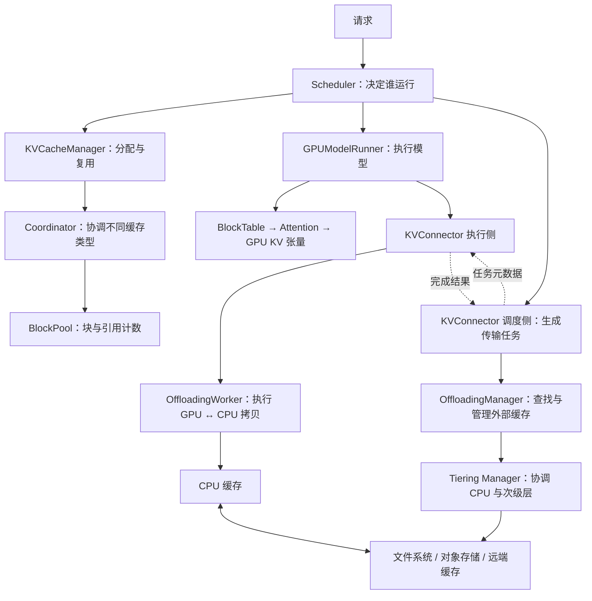
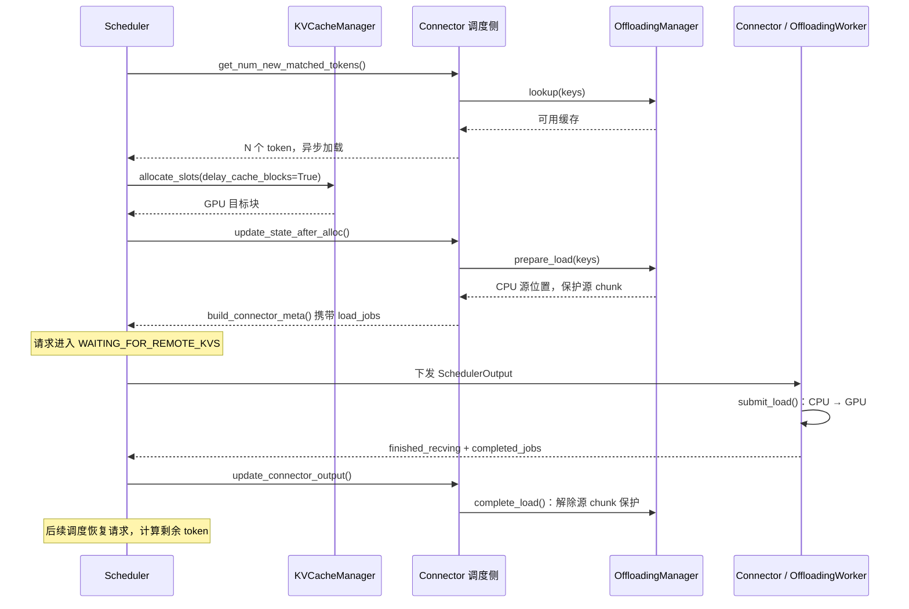
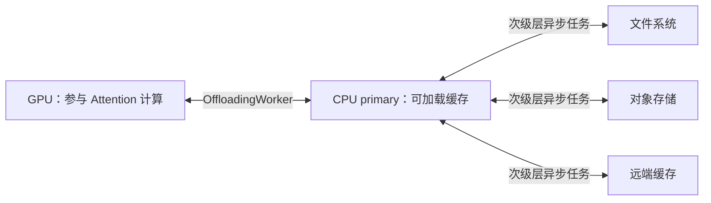

# vLLM KV cache：从全局架构到具体调度

本文面向入门读者，基于当前仓库 V1 实现（提交 `e37e51dd24`）。先看全局，再沿着一次请求追踪调用。具体跨层流程以内置 **OffloadingConnector** 为例；NIXL、LMCache 等 Connector 的传输时序可能不同。

## 1. 全局架构：谁决定，谁管理，谁搬运

KV cache 保存已经计算过的 token 的 Key/Value。后续生成读取历史 KV，避免重复计算历史 token。



图中的箭头包括调用、元数据传递和存储关系，不意味着这些模块都处于同一进程。多层管理器是可选的 OffloadingManager 实现，并不是 CPU 卸载必经的额外一层。

| 模块 | 管什么 | 不要混淆的边界 |
|---|---|---|
| Scheduler | 请求队列、token 预算、运行与等待状态、抢占 | 它决定计算批次，不直接拷贝 KV |
| KVCacheManager | 请求所需的 GPU 块、前缀复用 | 管理的是块元数据；实际张量在执行端 |
| Coordinator / SingleTypeKVCacheManager | 不同 KV cache group 的分配、命中与保留范围 | 全量注意力、滑动窗口、Mamba 的需求不同 |
| BlockPool | 空闲块、引用计数、前缀哈希索引 | 请求释放引用，不一定立即擦除缓存内容 |
| Connector 调度侧 | 把请求与缓存管理结果转换为 load/store 任务 | 生成任务描述，不搬运 GPU 数据 |
| OffloadingManager | 外部缓存的 key、位置、可读状态、淘汰策略 | 与 KVCacheManager 是两种不同的 Manager |
| Connector 执行侧 | 接收任务、提交传输、上报完成情况 | 与调度侧通过元数据配合 |
| GPUModelRunner / GPU Worker | 执行计算、维护块表、持有 GPU KV 张量 | 模型执行 Worker 与卸载 Worker 职责不同 |
| OffloadingWorker | 按任务描述执行 GPU ↔ CPU 传输 | CPU ↔ 次级层由分层后端负责 |

**一句话记忆：Scheduler 决定何时做，Manager 决定用哪些位置，Connector 组织任务，Worker 执行数据操作。**

## 2. 三种粒度：token、block、chunk

- **Token**：Scheduler 以本轮要计算多少 token 来分配计算预算。
- **GPU Block**：固定数量 token 对应的 KV 存储单元；块表把请求的逻辑块映射到物理块编号。
- **Offload Chunk**：外部缓存的管理与搬运单元，可以包含多个 GPU block。

```text
请求逻辑块：       [0]       [1]       [2]       [3]
GPU 物理块编号：  [7]       [2]       [9]       [4]
卸载 chunk：      └── chunk A ──┘    └── chunk B ──┘
```

这只是示例，不代表固定块大小。BlockTable 负责地址映射；前缀哈希/OffloadKey 负责识别缓存内容。外部缓存不应靠 GPU 物理块编号识别同一个前缀，因为块编号会被复用。

## 3. Scheduler 一轮做什么

一轮调度可以理解为：**规划本轮计算 → 准备缓存位置与传输任务 → 执行 → 接收结果**。

```text
Scheduler.schedule()
  ├─ 给 running 请求安排更多 token
  │    └─ allocate_slots()；空间不足时可能抢占其他请求
  ├─ 尝试接纳 waiting 请求
  │    ├─ 本地前缀命中查询
  │    ├─ 外部前缀命中查询
  │    ├─ 分配 GPU 块
  │    └─ 需要异步加载？进入 WAITING_FOR_REMOTE_KVS
  ├─ 构建 SchedulerOutput
  └─ build_connector_meta()：附带 load/store/flush 任务

GPUModelRunner 执行本轮计算与 Connector 生命周期
  └─ 返回 ModelRunnerOutput / KVConnectorOutput

Scheduler 接收结果
  ├─ 更新计算与生成进度
  ├─ 处理加载完成的请求
  └─ Connector 调度侧提交传输完成状态到 Manager
```

计算预算和缓存容量是两道不同的约束：token 预算够，也可能没有 GPU 块；外部缓存命中了，也必须先有 GPU 目标块才能加载。

## 4. 请求进入：先查本地，再查外部

### 4.1 本地 GPU 前缀命中

Scheduler 通过本地前缀查询路径调用 `KVCacheManager.get_computed_blocks()`，寻找已经存在的可复用前缀块。

`BlockPool` 保存哈希到缓存块的索引。接纳请求时，Manager 采用命中的块并增加引用，为剩余 token 分配新块。多个请求可以引用同一份前缀 KV。

### 4.2 外部缓存查询

Scheduler 调用：

```text
connector.get_num_new_matched_tokens(request, local_computed_tokens)
  → OffloadingConnectorScheduler
  → OffloadingManager.lookup(key, request_context)
```

接口返回 `(额外命中的 token 数, 是否异步加载)`：

| 返回结果 | Scheduler 的动作 |
|---|---|
| `(0, False)` | 没有可用的外部命中，安排正常计算 |
| `(N, True)` | 准备加载额外的 N 个 token 的 KV |
| `(None, False)` | 查询或缓存准备尚未完成，跳过该请求，后续轮次重试 |

外部命中数量指**本地命中之外的增量**。例如本地已有 32 个 token，外部前缀覆盖到 64 个，外部增量是 32 个，不是 64 个。

实际查询会考虑 block/chunk 对齐，以及多个缓存组共同可用的边界。滑动窗口只需必要窗口，Mamba 需要对应状态，不能简单把所有组都当成“保存完整历史的 KV”。

## 5. 外部命中后：先分配，再加载，再恢复计算



这里有四个关键点：

1. **先有目的地**：`allocate_slots()` 为加载结果预留 GPU 块。异步加载会占用显存，因此 Scheduler 还要考虑其他在途请求的预留空间。
2. **先保护来源**：`prepare_load()` 增加 CPU chunk 引用计数，防止传输过程中被淘汰。
3. **命中不等于可计算**：请求进入 `WAITING_FOR_REMOTE_KVS`，在加载完成前不会使用尚未到达的数据。
4. **到达后再公开缓存**：`delay_cache_blocks=True` 推迟将目标块登记为可复用缓存，避免其他请求读到未完成的数据。

收到 `finished_recving` 后，Scheduler 在后续检查中确认可用范围、登记成功加载的缓存，并把请求恢复到 `WAITING` 或 `PREEMPTED`，再尝试进入 `RUNNING`。

即使整个 prompt 命中，也通常还需计算末尾 token 来得到用于采样的输出；滑动窗口等模型还可能需要有限范围的重算。

## 6. Worker 的具体执行时序

`KVConnectorModelRunnerMixin` 把 Connector 生命周期嵌入模型执行过程：

```text
执行前：处理抢占与块复用相关的 flush
  ↓
bind_connector_metadata()：绑定本轮任务
  ↓
同步加载：在 forward 前 start_load_kv()
  ↓
模型 forward：读历史 KV，写新 KV
  ↓
异步加载：在 forward 发起后 start_load_kv()
  ↓
wait_for_save()：OffloadingConnector 在这里暂存本轮 store 任务
  ↓
查询传输完成情况，上报 KVConnectorOutput
```

同步加载给本轮 forward 提供数据；异步加载服务于等待中的请求，可与其他请求的计算重叠。这里“forward 发起后”不表示全部 GPU 计算已经完成；实际依赖通过执行顺序、CUDA stream 和 event 保证。

内置 CPU 卸载 Worker 用 `submit_load()` / `submit_store()` 提交拷贝，记录 CUDA event。`get_finished()` 查询 event；只有数据传输完成后才返回完成结果。必须保护块复用时，`wait(job_ids)` 会同步等待指定任务。

**不要仅凭接口名字理解行为：** 对当前 `OffloadingConnector`，`wait_for_save()` 实际调用 `prepare_store_kv()`，把保存任务排到后续轮次；它不是每轮都等待所有保存完成。其 `wait_for_layer_load()` 和 `save_kv_layer()` 是空实现，因为该后端按块组织传输，而不是逐层触发保存。

## 7. 保存路径：本轮规划，后续提交

保存不是“显存满了才发生”。Connector 可以在正常生成过程中，根据配置把可缓存内容保存到外部层，供未来请求复用。

```text
第 t 轮调度
  build_connector_meta()
    → 根据本轮预计计算边界确定可保存 chunk
    → manager.prepare_store() 分配 CPU 位置
    → 形成 store_jobs

第 t 轮执行
  forward 写入本轮 KV
    → wait_for_save() 将 store_jobs 放入待提交队列

第 t+1 轮执行
  handle_preemptions() / start_kv_transfers()
    → submit_store()：GPU → CPU

后续轮次
  Worker 上报 completed_jobs
    → Connector 调度侧确认所有相关 Worker 完成
    → manager.complete_store()：缓存变为可读
```

Manager 可以跳过已经缓存、正在写入、未达到保存阈值或没有容量接纳的内容。是否只保存 prompt、按 chunk 还是按请求处理，取决于配置和后端。

保存边界必须对应有效 KV。尤其请求结束时，最后一个刚采样出的 token 通常尚未做 forward，不能把它当成已经写好 KV 的 token。投机解码、滑动窗口和部分尾块也有额外边界处理。

## 8. 完成、释放、抢占：如何避免覆盖仍在传输的数据

### 8.1 CPU chunk 的状态

```text
空闲位置
  → prepare_store：分配，写入中，不可读
  → complete_store：可读，可按策略淘汰
  → prepare_load：引用计数增加，不可淘汰
  → complete_load：引用计数减少，归零后可淘汰
```

CPU Manager 的查询结果包含 `MISS`、`HIT_PENDING`、`HIT`。`HIT_PENDING` 表示内容存在于管理状态中，但还没准备好读取；Connector 可以让 Scheduler 稍后重试。CPU 淘汰策略支持 LRU、ARC 等，仍需尊重在途任务的引用保护。

### 8.2 GPU 源块的复用保护

请求结束可以释放 GPU 块引用，但后台保存可能还在读取这些块。

当前 OffloadingConnector 会跟踪块与未完成保存任务的关系。Scheduler 发现本轮重新分配的块关联旧任务时，把任务放入 `jobs_to_flush`；执行侧先提交必要的待提交保存，并等待这些任务完成，再允许新计算覆盖块。

```text
旧请求的 GPU 块 #7 正在保存
  → 新请求准备使用块 #7
  → 元数据携带 jobs_to_flush
  → Worker 等旧拷贝完成
  → 新请求才能覆盖块 #7
```

因此不能笼统说“所有 Connector 都等保存结束后才释放整个请求”：通用接口允许延迟释放，而当前 OffloadingConnector 的 `request_finished()` 返回 `False`，主要通过块级跟踪和 flush 保护复用。

### 8.3 显存不足时的抢占

Scheduler 对运行请求分配失败时，可以选择请求抢占：释放其块引用，置为 `PREEMPTED`，把计算进度重置，再放回等待队列。

重新调度时仍会查询本地和外部缓存；命中可以减少重算，没有命中的部分重新计算。**抢占不是默认保证把全部 KV 搬到 CPU 的 swap。**

## 9. 多层存储：CPU 是内置 tiering 的中转站



`TieringOffloadingManager` 对 Connector 提供与 CPU Manager 相同的管理接口，内部协调 CPU primary 和配置的 secondary tiers。

**次级层命中时：**

1. 查询 CPU；没有现成可读数据，再查次级层。
2. 命中后准备 CPU 位置，异步提交“次级层 → CPU”任务。
3. 尚未提升完成时，查询返回待准备状态，Connector 返回 `None`，Scheduler 后续重试。
4. CPU 数据准备好后，再走第 5 节的“分配 GPU → CPU 加载到 GPU”流程。

**新内容保存时：** GPU → CPU 完成后，分层管理器继续向配置的次级层安排保存；请求级策略还会处理 CPU 已有内容的级联保存。任务是否被接纳以及具体 I/O 行为由后端策略决定。

CPU ↔ 次级层任务的完成、待提交提升和级联工作，在 `on_schedule_end()` 等路径中持续推进。即使没有模型 token 要计算，仍可能通过无 forward 的执行轮次推进传输和回收；`has_pending_push_work()` 用于报告这些剩余工作。

上述 CPU 中转规则属于内置 tiering；NIXL 等实例间传输后端可以采用不同的数据路径。

## 10. 一个小例子串起全部过程

假设块大小为 16 token，每个卸载 chunk 包含 2 个 GPU block。新请求有 100 个 token，本地命中 32 个，CPU 可复用前缀覆盖到 64 个。

```text
token 范围     [0 ... 31]       [32 ... 63]       [64 ... 99]
来源          本地 GPU 命中     CPU 缓存命中       需要计算
动作          引用已有块        分配块并加载        后续安排 prefill
```

- Scheduler 得到外部增量命中 32 token，而不是 64。
- KVCacheManager 引用本地块，分配加载目标及所需计算空间。
- Connector 创建 CPU → GPU 任务，请求进入 `WAITING_FOR_REMOTE_KVS`。
- Worker 搬运；Scheduler 可以同时安排其他请求计算。
- 加载完成后，请求恢复调度，计算剩余 36 token，再继续 decode。
- 新形成的可保存 chunk 按策略进入 store 任务；请求结束后释放引用，缓存和后台任务按各自生命周期回收。

## 11. 建议的源码阅读顺序

以下链接相对于本文所在的仓库根目录。

| 顺序 | 文件 | 重点入口 |
|---|---|---|
| 1 | [scheduler.py](vllm/v1/core/sched/scheduler.py) | `schedule()`、`_handle_blocked_waiting_request()`、`_preempt_request()` |
| 2 | [kv_cache_manager.py](vllm/v1/core/kv_cache_manager.py) | `get_computed_blocks()`、`allocate_slots()`、`cache_blocks()`、`free()` |
| 3 | [kv_cache_coordinator.py](vllm/v1/core/kv_cache_coordinator.py)、[single_type_kv_cache_manager.py](vllm/v1/core/single_type_kv_cache_manager.py)、[block_pool.py](vllm/v1/core/block_pool.py) | 多组缓存协调、类型差异、空闲块与引用计数 |
| 4 | [offloading_connector.py](vllm/distributed/kv_transfer/kv_connector/v1/offloading_connector.py) | 调度侧与执行侧角色、接口到实现的映射 |
| 5 | [offloading/scheduler.py](vllm/distributed/kv_transfer/kv_connector/v1/offloading/scheduler.py) | `get_num_new_matched_tokens()`、`update_state_after_alloc()`、`build_connector_meta()`、`update_connector_output()` |
| 6 | [kv_connector_model_runner_mixin.py](vllm/v1/worker/kv_connector_model_runner_mixin.py) | `_get_kv_connector_output()`：模型执行中的 Connector 生命周期 |
| 7 | [offloading/worker.py](vllm/distributed/kv_transfer/kv_connector/v1/offloading/worker.py) | `handle_preemptions()`、`start_kv_transfers()`、`prepare_store_kv()`、`get_finished()` |
| 8 | [cpu/manager.py](vllm/v1/kv_offload/cpu/manager.py)、[cpu/gpu_worker.py](vllm/v1/kv_offload/cpu/gpu_worker.py) | CPU 位置管理、引用保护、异步拷贝与 CUDA event |
| 9 | [tiering/manager.py](vllm/v1/kv_offload/tiering/manager.py) | `lookup()`、`complete_store()`、`on_schedule_end()`：多层提升与保存 |

阅读时始终追问三个问题：**数据是否已经可读？来源是否仍受保护？目标块何时允许计算使用或覆盖？** 这三个问题贯穿整个调度流程。
